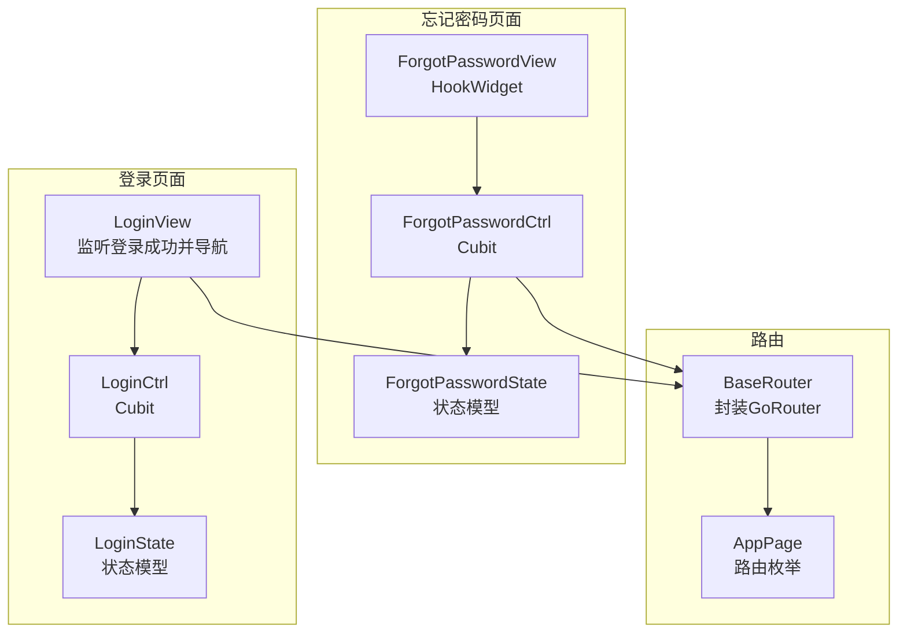
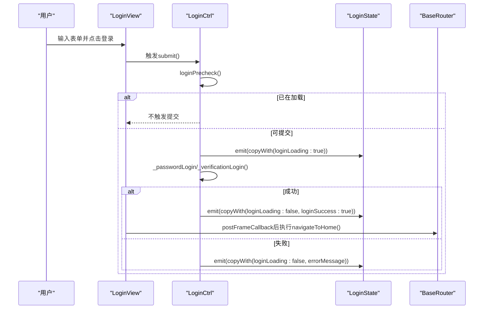
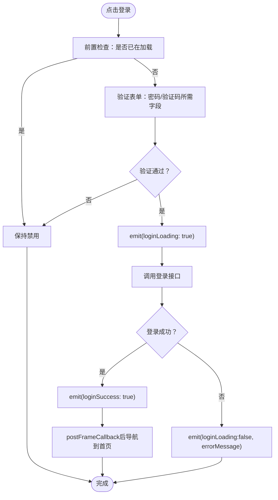
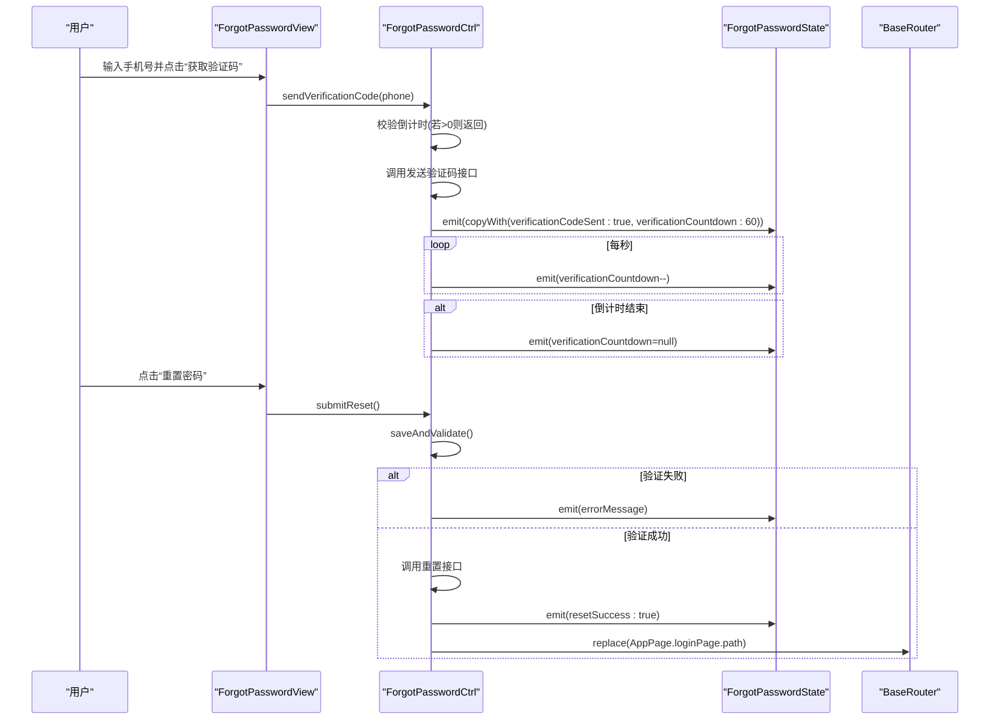

# 集成测试

<cite>
**本文引用的文件**
- [pubspec.yaml](file://pubspec.yaml)
- [lib/pages/login/controller.dart](file://lib/pages/login/controller.dart)
- [lib/pages/login/state.dart](file://lib/pages/login/state.dart)
- [lib/pages/login/view.dart](file://lib/pages/login/view.dart)
- [lib/pages/forgot_password/controller.dart](file://lib/pages/forgot_password/controller.dart)
- [lib/pages/forgot_password/state.dart](file://lib/pages/forgot_password/state.dart)
- [lib/pages/forgot_password/view.dart](file://lib/pages/forgot_password/view.dart)
- [lib/router/router.dart](file://lib/router/router.dart)
- [lib/router/routes.dart](file://lib/router/routes.dart)
- [test/pages/login/login_button_validation_test.dart](file://test/pages/login/login_button_validation_test.dart)
- [test/pages/login/login_button_loading_state_test.dart](file://test/pages/login/login_button_loading_state_test.dart)
- [test/pages/forgot_password/send_code_button_state_test.dart](file://test/pages/forgot_password/send_code_button_state_test.dart)
- [test/pages/forgot_password/countdown_integrity_test.dart](file://test/pages/forgot_password/countdown_integrity_test.dart)
- [test/pages/forgot_password/navigation_test.dart](file://test/pages/forgot_password/navigation_test.dart)
</cite>

## 目录
1. [简介](#简介)
2. [项目结构](#项目结构)
3. [核心组件](#核心组件)
4. [架构总览](#架构总览)
5. [详细组件分析](#详细组件分析)
6. [依赖分析](#依赖分析)
7. [性能考虑](#性能考虑)
8. [故障排查指南](#故障排查指南)
9. [结论](#结论)
10. [附录](#附录)

## 简介
本集成测试文档聚焦于用户关键路径的端到端验证，涵盖登录页面的登录按钮启用/禁用、加载指示器与表单验证的集成；以及“忘记密码”流程中的倒计时功能与页面导航。文档说明如何通过bloc_test风格的断言策略，模拟BLoC/Cubit的状态转换，并验证UI对状态变化的正确响应。同时给出运行效率与维护成本的建议，帮助团队高效地持续集成测试。

## 项目结构
- 页面与状态管理采用Cubit模式，控制器负责状态变更与副作用（网络、导航、倒计时），视图通过BlocListener监听状态变化驱动UI更新。
- 路由系统基于go_router，提供统一的导航能力与页面注册。
- 测试位于test目录，按页面分组，分别覆盖登录与忘记密码的关键行为。

图表来源
- [lib/pages/login/controller.dart](file://lib/pages/login/controller.dart#L1-L354)
- [lib/pages/login/state.dart](file://lib/pages/login/state.dart#L1-L63)
- [lib/pages/login/view.dart](file://lib/pages/login/view.dart#L1-L47)
- [lib/pages/forgot_password/controller.dart](file://lib/pages/forgot_password/controller.dart#L1-L203)
- [lib/pages/forgot_password/state.dart](file://lib/pages/forgot_password/state.dart#L1-L43)
- [lib/pages/forgot_password/view.dart](file://lib/pages/forgot_password/view.dart#L1-L17)
- [lib/router/router.dart](file://lib/router/router.dart#L1-L228)
- [lib/router/routes.dart](file://lib/router/routes.dart#L1-L260)

章节来源
- [lib/pages/login/controller.dart](file://lib/pages/login/controller.dart#L1-L354)
- [lib/pages/forgot_password/controller.dart](file://lib/pages/forgot_password/controller.dart#L1-L203)
- [lib/router/router.dart](file://lib/router/router.dart#L1-L228)
- [lib/router/routes.dart](file://lib/router/routes.dart#L1-L260)

## 核心组件
- 登录控制器LoginCtrl：负责登录前置检查、密码/验证码登录、错误消息解析、验证码发送与倒计时、登录成功后的导航。
- 登录状态LoginState：承载登录过程中的所有可观察状态（加载、成功、错误、活动标签、验证码倒计时、是否已发送、协议接受）。
- 忘密码控制器ForgotPasswordCtrl：负责验证码发送、倒计时、密码重置提交、错误解析与成功后的导航。
- 忘密码状态ForgotPasswordState：承载找回密码过程中的可观察状态（加载、成功、错误、倒计时、是否已发送）。
- 路由系统：BaseRouter封装GoRouter，提供push/replace/pop等导航方法；AppPage枚举统一管理页面路径与builder。

章节来源
- [lib/pages/login/controller.dart](file://lib/pages/login/controller.dart#L1-L354)
- [lib/pages/login/state.dart](file://lib/pages/login/state.dart#L1-L63)
- [lib/pages/forgot_password/controller.dart](file://lib/pages/forgot_password/controller.dart#L1-L203)
- [lib/pages/forgot_password/state.dart](file://lib/pages/forgot_password/state.dart#L1-L43)
- [lib/router/router.dart](file://lib/router/router.dart#L1-L228)
- [lib/router/routes.dart](file://lib/router/routes.dart#L1-L260)

## 架构总览
以下序列图展示了登录按钮从“启用/禁用”到“加载状态”的端到端流程，以及UI如何响应状态变化进行导航。

图表来源
- [lib/pages/login/view.dart](file://lib/pages/login/view.dart#L1-L47)
- [lib/pages/login/controller.dart](file://lib/pages/login/controller.dart#L1-L354)
- [lib/pages/login/state.dart](file://lib/pages/login/state.dart#L1-L63)
- [lib/router/router.dart](file://lib/router/router.dart#L1-L228)

章节来源
- [lib/pages/login/view.dart](file://lib/pages/login/view.dart#L1-L47)
- [lib/pages/login/controller.dart](file://lib/pages/login/controller.dart#L1-L354)
- [lib/pages/login/state.dart](file://lib/pages/login/state.dart#L1-L63)

## 详细组件分析

### 登录页面：登录按钮启用/禁用、加载指示器与表单验证集成
- 表单验证门控：密码登录需要手机号与密码，验证码登录需要手机号与验证码。测试覆盖必填字段校验、部分字段缺失、不同标签切换后的验证一致性、以及加载状态下禁止登录。
- 加载状态：当表单通过验证且非加载时，按钮进入加载态；加载态期间按钮禁用；加载完成后恢复可用。
- UI响应：登录成功后，LoginView通过BlocListener在下一帧回调中触发导航至首页。

图表来源
- [lib/pages/login/controller.dart](file://lib/pages/login/controller.dart#L1-L354)
- [lib/pages/login/state.dart](file://lib/pages/login/state.dart#L1-L63)
- [lib/pages/login/view.dart](file://lib/pages/login/view.dart#L1-L47)
- [test/pages/login/login_button_validation_test.dart](file://test/pages/login/login_button_validation_test.dart#L1-L242)
- [test/pages/login/login_button_loading_state_test.dart](file://test/pages/login/login_button_loading_state_test.dart#L1-L63)

章节来源
- [test/pages/login/login_button_validation_test.dart](file://test/pages/login/login_button_validation_test.dart#L1-L242)
- [test/pages/login/login_button_loading_state_test.dart](file://test/pages/login/login_button_loading_state_test.dart#L1-L63)
- [lib/pages/login/controller.dart](file://lib/pages/login/controller.dart#L1-L354)
- [lib/pages/login/state.dart](file://lib/pages/login/state.dart#L1-L63)
- [lib/pages/login/view.dart](file://lib/pages/login/view.dart#L1-L47)

### 忘记密码：倒计时功能与按钮状态
- 倒计时逻辑：发送验证码后进入60秒倒计时，每秒递减；倒计时结束或停止后重置状态。
- 按钮状态：手机号无效或倒计时不为0时禁用；倒计时结束或无倒计时时启用；按钮文本随倒计时动态变化。
- 错误处理：网络/限流/验证码错误等场景返回友好提示。

图表来源
- [lib/pages/forgot_password/controller.dart](file://lib/pages/forgot_password/controller.dart#L1-L203)
- [lib/pages/forgot_password/state.dart](file://lib/pages/forgot_password/state.dart#L1-L43)
- [lib/pages/forgot_password/view.dart](file://lib/pages/forgot_password/view.dart#L1-L17)
- [lib/router/routes.dart](file://lib/router/routes.dart#L1-L260)
- [lib/router/router.dart](file://lib/router/router.dart#L1-L228)

章节来源
- [test/pages/forgot_password/send_code_button_state_test.dart](file://test/pages/forgot_password/send_code_button_state_test.dart#L1-L148)
- [test/pages/forgot_password/countdown_integrity_test.dart](file://test/pages/forgot_password/countdown_integrity_test.dart#L1-L130)
- [test/pages/forgot_password/navigation_test.dart](file://test/pages/forgot_password/navigation_test.dart#L1-L111)
- [lib/pages/forgot_password/controller.dart](file://lib/pages/forgot_password/controller.dart#L1-L203)
- [lib/pages/forgot_password/state.dart](file://lib/pages/forgot_password/state.dart#L1-L43)
- [lib/pages/forgot_password/view.dart](file://lib/pages/forgot_password/view.dart#L1-L17)
- [lib/router/routes.dart](file://lib/router/routes.dart#L1-L260)
- [lib/router/router.dart](file://lib/router/router.dart#L1-L228)

### 页面间导航流程
- 登录成功后，LoginView在下一帧回调中调用控制器的导航方法跳转首页。
- 忘记密码重置成功后，控制器调用BaseRouter.replace跳转到登录页，替换当前栈顶路由，不增加历史记录。
- 测试覆盖导航路径正确性、replace不增加历史记录、多次返回操作等。

章节来源
- [lib/pages/login/view.dart](file://lib/pages/login/view.dart#L1-L47)
- [lib/pages/login/controller.dart](file://lib/pages/login/controller.dart#L1-L354)
- [lib/pages/forgot_password/controller.dart](file://lib/pages/forgot_password/controller.dart#L1-L203)
- [lib/router/router.dart](file://lib/router/router.dart#L1-L228)
- [test/pages/forgot_password/navigation_test.dart](file://test/pages/forgot_password/navigation_test.dart#L1-L111)

## 依赖分析
- 状态管理：bloc与flutter_bloc用于Cubit状态管理与UI监听。
- 路由：go_router作为主要导航库，BaseRouter提供封装与全局观察者。
- 网络：dio用于HTTP请求，retrofit-generator用于生成网络层代码（在依赖中声明）。
- 表单：flutter_form_builder用于表单保存与校验。
- 测试：flutter_test用于单元/集成测试。

章节来源
- [pubspec.yaml](file://pubspec.yaml#L1-L211)

## 性能考虑
- 测试运行速度
  - 将UI渲染与导航解耦：LoginView在postFrameCallback中执行导航，避免在构建阶段触发导航导致的额外重绘与路由开销。
  - 控制器内部通过emit状态变更，UI仅在状态变化时重建相关子树，减少不必要的重建。
- 维护成本
  - 将按钮状态、倒计时、导航等逻辑集中在控制器内，测试只需断言状态变化与导航行为，降低视图层复杂度带来的维护成本。
  - 使用枚举与状态模型明确状态边界，便于扩展与回归测试。
- 运行效率
  - 倒计时使用Timer.periodic，注意在控制器关闭时及时cancel，避免内存泄漏与后台任务残留。
  - 对网络错误进行分类解析，减少UI层的分支判断，提升渲染稳定性。

[本节为通用指导，无需特定文件来源]

## 故障排查指南
- 登录按钮始终禁用
  - 检查loginPrecheck是否被调用，确认state.loginLoading是否被正确置位。
  - 确认表单验证逻辑：密码登录需手机号与密码，验证码登录需手机号与验证码。
- 登录按钮点击无反应
  - 确认BlocListener在LoginView中生效，且loginSuccess为true时才触发导航。
  - 检查postFrameCallback是否在下一帧执行，避免在构建期间导航。
- 倒计时不更新或按钮状态异常
  - 确认sendVerificationCode后是否emit(verificationCountdown:60)，并启动Timer。
  - 检查stopCountdown是否在倒计时结束或手动停止时正确重置状态。
- 导航不生效
  - 忘记密码重置成功后使用BaseRouter.replace，确保栈顶被替换而非新增。
  - 检查AppPage路径是否与routes中定义一致。

章节来源
- [lib/pages/login/controller.dart](file://lib/pages/login/controller.dart#L1-L354)
- [lib/pages/login/view.dart](file://lib/pages/login/view.dart#L1-L47)
- [lib/pages/forgot_password/controller.dart](file://lib/pages/forgot_password/controller.dart#L1-L203)
- [lib/router/router.dart](file://lib/router/router.dart#L1-L228)
- [lib/router/routes.dart](file://lib/router/routes.dart#L1-L260)

## 结论
通过将状态管理、倒计时与导航逻辑集中于Cubit控制器，并以测试驱动的方式验证状态转换与UI响应，可以高效覆盖关键用户路径。登录与忘记密码流程的集成测试既保证了功能正确性，也兼顾了运行效率与长期维护成本。建议在新增功能时沿用此模式，确保状态变化与UI响应的一致性。

[本节为总结，无需特定文件来源]

## 附录
- 关键测试文件清单
  - 登录按钮验证与加载状态：[login_button_validation_test.dart](file://test/pages/login/login_button_validation_test.dart#L1-L242)、[login_button_loading_state_test.dart](file://test/pages/login/login_button_loading_state_test.dart#L1-L63)
  - 忘记密码按钮状态与倒计时：[send_code_button_state_test.dart](file://test/pages/forgot_password/send_code_button_state_test.dart#L1-L148)、[countdown_integrity_test.dart](file://test/pages/forgot_password/countdown_integrity_test.dart#L1-L130)
  - 忘记密码导航：[navigation_test.dart](file://test/pages/forgot_password/navigation_test.dart#L1-L111)

[本节为补充信息，无需特定文件来源]