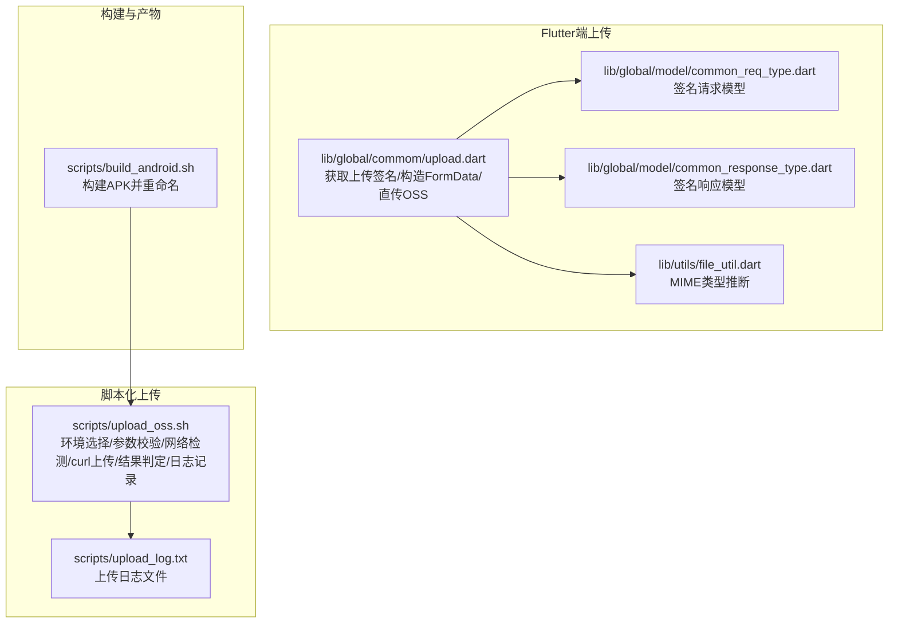
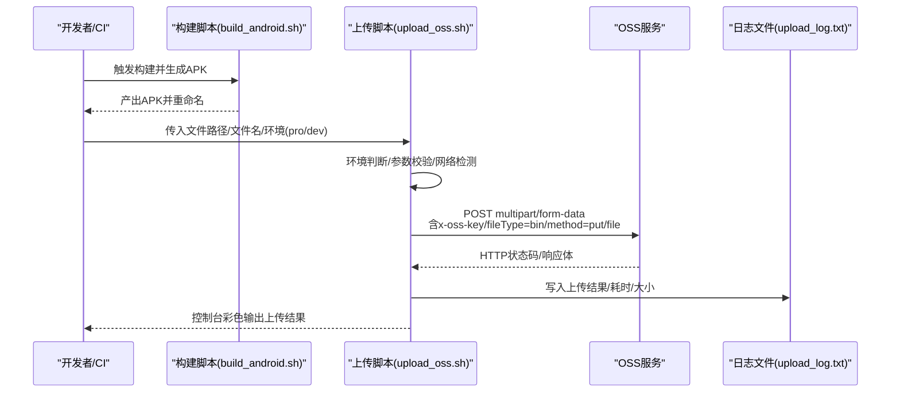
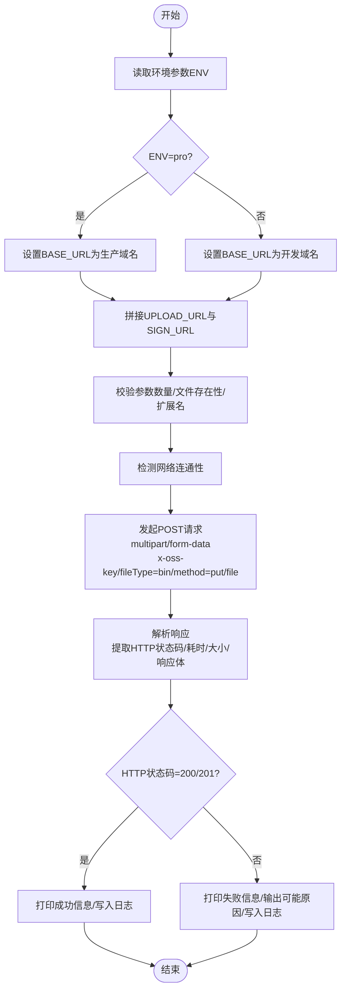
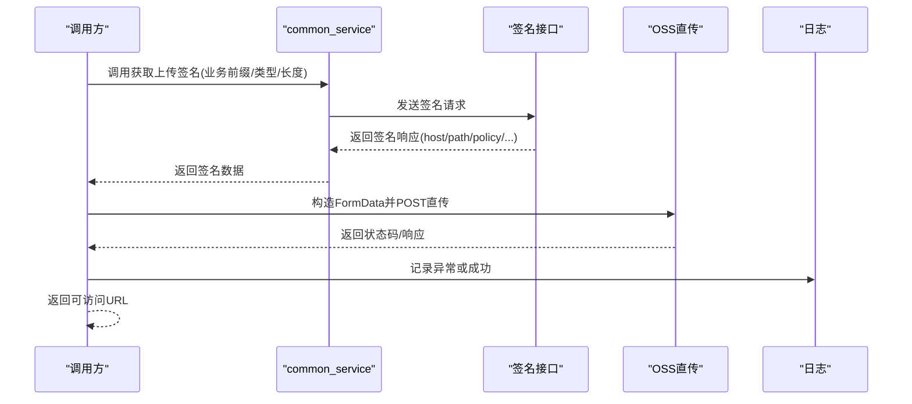
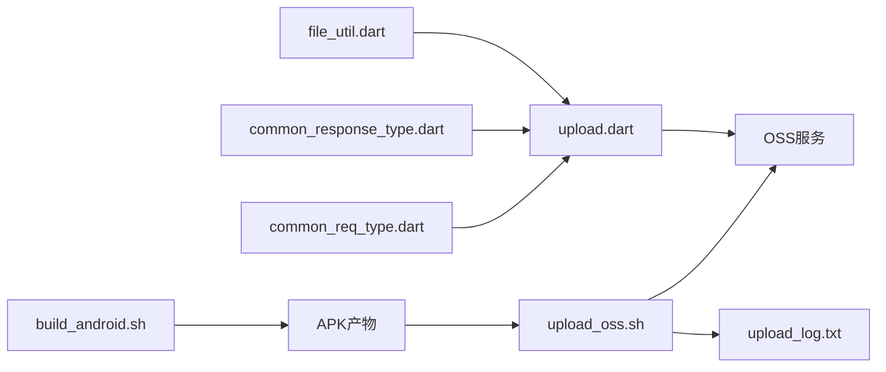

# Android上传流程

<cite>
**本文引用的文件**
- [scripts/upload_oss.sh](file://scripts/upload_oss.sh)
- [scripts/upload_log.txt](file://scripts/upload_log.txt)
- [scripts/build_android.sh](file://scripts/build_android.sh)
- [lib/global/commom/upload.dart](file://lib/global/commom/upload.dart)
- [lib/global/model/common_req_type.dart](file://lib/global/model/common_req_type.dart)
- [lib/global/model/common_response_type.dart](file://lib/global/model/common_response_type.dart)
- [lib/utils/file_util.dart](file://lib/utils/file_util.dart)
</cite>

## 目录
1. [简介](#简介)
2. [项目结构](#项目结构)
3. [核心组件](#核心组件)
4. [架构总览](#架构总览)
5. [详细组件分析](#详细组件分析)
6. [依赖关系分析](#依赖关系分析)
7. [性能考量](#性能考量)
8. [故障排查指南](#故障排查指南)
9. [结论](#结论)

## 简介
本文件围绕Android应用的上传流程展开，重点说明脚本上传机制与Flutter端上传实现的差异与协作。文档将详细解释：
- upload_oss.sh脚本如何根据环境参数（dev/pro）自动切换BASE_URL，分别指向开发与生产环境的OSS服务。
- curl命令发起POST请求的完整过程，包括x-oss-key认证头、multipart/form-data数据封装，以及fileType=bin和method=put等关键参数的作用。
- 上传响应解析与结果判断（HTTP状态码200/201视为成功）。
- 日志记录机制（控制台彩色输出与upload_log.txt文件写入）。
- 常见HTTP错误码的故障排查策略（400/401/403/404/413/500/502/503/504等）。

## 项目结构
Android上传涉及两条主线：
- 脚本化上传：通过shell脚本直接向OSS服务发起上传请求，适用于快速发布或CI场景。
- Flutter端上传：通过服务端签名，客户端直传OSS，适用于图片等通用业务上传。

图表来源
- [scripts/upload_oss.sh](file://scripts/upload_oss.sh#L1-L211)
- [scripts/upload_log.txt](file://scripts/upload_log.txt#L1-L10)
- [scripts/build_android.sh](file://scripts/build_android.sh#L1-L70)
- [lib/global/commom/upload.dart](file://lib/global/commom/upload.dart#L1-L72)
- [lib/global/model/common_req_type.dart](file://lib/global/model/common_req_type.dart#L1-L16)
- [lib/global/model/common_response_type.dart](file://lib/global/model/common_response_type.dart#L1-L67)
- [lib/utils/file_util.dart](file://lib/utils/file_util.dart#L1-L43)

章节来源
- [scripts/upload_oss.sh](file://scripts/upload_oss.sh#L1-L211)
- [scripts/upload_log.txt](file://scripts/upload_log.txt#L1-L10)
- [scripts/build_android.sh](file://scripts/build_android.sh#L1-L70)
- [lib/global/commom/upload.dart](file://lib/global/commom/upload.dart#L1-L72)
- [lib/global/model/common_req_type.dart](file://lib/global/model/common_req_type.dart#L1-L16)
- [lib/global/model/common_response_type.dart](file://lib/global/model/common_response_type.dart#L1-L67)
- [lib/utils/file_util.dart](file://lib/utils/file_util.dart#L1-L43)

## 核心组件
- 脚本上传组件（upload_oss.sh）
  - 环境参数处理：支持dev（默认）与pro两种环境，自动切换BASE_URL与上传/签名接口URL。
  - 参数校验：文件路径存在性、文件名扩展名（建议为.apk）、网络连通性检测。
  - 上传请求：使用curl以multipart/form-data格式提交，包含x-oss-key认证头、fileType=bin、method=put、file文件域。
  - 结果判定：HTTP状态码200/201视为成功；其他状态码输出对应原因提示。
  - 日志记录：控制台彩色输出与upload_log.txt文件写入。
- Flutter端上传组件（upload.dart）
  - 通过服务端接口获取OSS直传签名（host、path、policy、signature等）。
  - 构造FormData并直传至OSS，附带Authorization头（用于服务端鉴权）。
  - 返回拼接后的可访问URL。

章节来源
- [scripts/upload_oss.sh](file://scripts/upload_oss.sh#L1-L211)
- [lib/global/commom/upload.dart](file://lib/global/commom/upload.dart#L1-L72)

## 架构总览
下图展示了Android上传的整体流程，区分脚本化上传与Flutter端上传两条路径，并标注关键交互点。

图表来源
- [scripts/build_android.sh](file://scripts/build_android.sh#L1-L70)
- [scripts/upload_oss.sh](file://scripts/upload_oss.sh#L1-L211)
- [scripts/upload_log.txt](file://scripts/upload_log.txt#L1-L10)

## 详细组件分析

### 脚本上传组件（upload_oss.sh）深度解析
- 环境参数与URL切换
  - 环境参数ENV默认dev；当ENV=pro时，BASE_URL指向生产域名，否则使用开发域名。
  - 上传URL与签名URL均基于BASE_URL动态拼接。
- 参数校验与网络检测
  - 校验参数个数与文件存在性；对非.apk文件名给出警告。
  - 使用curl短超时检测目标URL连通性，避免后续上传阻塞。
- curl上传请求细节
  - 方法：POST
  - 头部：
    - x-oss-key：用于OSS侧认证。
    - Content-Type：multipart/form-data。
  - 表单字段：
    - fileType=bin：标识文件类型为二进制。
    - method=put：指定上传方法为PUT。
    - file=@<文件>;filename=<文件名>：二进制文件域。
  - 输出格式：通过-w选项收集HTTP状态码、总耗时、实际上传字节数。
- 响应解析与结果判定
  - 提取HTTP状态码、耗时、上传大小；若存在响应体则打印。
  - 200/201视为成功；其他状态码按预设映射输出可能原因。
- 日志记录机制
  - 控制台输出：统一使用颜色前缀（蓝色信息、绿色成功、黄色警告、红色错误）。
  - 文件输出：upload_log.txt追加写入时间戳与上传结果摘要。

图表来源
- [scripts/upload_oss.sh](file://scripts/upload_oss.sh#L1-L211)

章节来源
- [scripts/upload_oss.sh](file://scripts/upload_oss.sh#L1-L211)

### Flutter端上传组件（upload.dart）深度解析
- 签名请求与响应模型
  - 请求模型：包含业务前缀、内容类型、内容长度。
  - 响应模型：包含host、path、policy、signature、signatureVersion、credential、date、securityToken、bucket、endpoint、expireAt等。
- 上传流程
  - 通过服务端接口获取签名信息（host、path等）。
  - 构造FormData，包含policy、x-oss-signature-version、x-oss-credential、x-oss-date、success_action_status、key、x-oss-signature、x-oss-security-token、file等字段。
  - 使用Dio直传至OSS，附带Authorization头（用于服务端鉴权）。
  - 若状态码非200，记录错误并返回空；否则返回host/path拼接的可访问URL。
- MIME类型推断
  - 优先使用XFile的mimeType，若为空则根据扩展名推断。

图表来源
- [lib/global/commom/upload.dart](file://lib/global/commom/upload.dart#L1-L72)
- [lib/global/model/common_req_type.dart](file://lib/global/model/common_req_type.dart#L1-L16)
- [lib/global/model/common_response_type.dart](file://lib/global/model/common_response_type.dart#L1-L67)
- [lib/utils/file_util.dart](file://lib/utils/file_util.dart#L1-L43)

章节来源
- [lib/global/commom/upload.dart](file://lib/global/commom/upload.dart#L1-L72)
- [lib/global/model/common_req_type.dart](file://lib/global/model/common_req_type.dart#L1-L16)
- [lib/global/model/common_response_type.dart](file://lib/global/model/common_response_type.dart#L1-L67)
- [lib/utils/file_util.dart](file://lib/utils/file_util.dart#L1-L43)

## 依赖关系分析
- 脚本上传依赖
  - 系统工具：bash、curl、stat、bc、mkdir、date。
  - 环境变量：HTTP_ENV（由构建脚本注入）影响最终文件名与上传行为。
- Flutter端上传依赖
  - 服务端接口：提供OSS直传签名。
  - 第三方库：dio、flutter_bloc、image_picker。
  - 工具类：file_util用于MIME类型推断。

图表来源
- [scripts/build_android.sh](file://scripts/build_android.sh#L1-L70)
- [scripts/upload_oss.sh](file://scripts/upload_oss.sh#L1-L211)
- [scripts/upload_log.txt](file://scripts/upload_log.txt#L1-L10)
- [lib/global/commom/upload.dart](file://lib/global/commom/upload.dart#L1-L72)
- [lib/global/model/common_req_type.dart](file://lib/global/model/common_req_type.dart#L1-L16)
- [lib/global/model/common_response_type.dart](file://lib/global/model/common_response_type.dart#L1-L67)
- [lib/utils/file_util.dart](file://lib/utils/file_util.dart#L1-L43)

章节来源
- [scripts/build_android.sh](file://scripts/build_android.sh#L1-L70)
- [scripts/upload_oss.sh](file://scripts/upload_oss.sh#L1-L211)
- [lib/global/commom/upload.dart](file://lib/global/commom/upload.dart#L1-L72)

## 性能考量
- 上传超时与并发
  - curl设置了连接超时与最大传输超时，避免长时间阻塞。
  - 上传完成后统计实际上传字节数与总耗时，便于评估网络状况。
- 文件大小与分片
  - 脚本未实现分片上传；大文件建议采用服务端签名直传（Flutter端实现）以提升稳定性。
- 日志开销
  - 控制台彩色输出不影响功能；upload_log.txt追加写入需注意磁盘空间与轮转策略。

[本节为通用建议，不直接分析具体文件]

## 故障排查指南
- 网络连接超时
  - 现象：网络检测阶段失败或curl连接超时。
  - 排查：检查代理、防火墙、DNS解析；确认BASE_URL可达。
- 认证失败（401）
  - 现象：HTTP状态码401。
  - 排查：核对x-oss-key是否正确；确认OSS密钥未过期。
- 权限不足（403）
  - 现象：HTTP状态码403。
  - 排查：确认账号权限与OSS Bucket策略；检查签名参数是否齐全。
- 文件过大（413）
  - 现象：HTTP状态码413。
  - 排查：检查服务端上传大小限制；考虑分片上传或优化文件体积。
- 接口不存在（404）
  - 现象：HTTP状态码404。
  - 排查：确认UPLOAD_URL/SIGN_URL拼接是否正确；检查服务端路由。
- 服务器内部错误（500）
  - 现象：HTTP状态码500。
  - 排查：查看服务端日志；稍后重试。
- 服务器不可用（502/503/504）
  - 现象：HTTP状态码502/503/504。
  - 排查：等待服务恢复；检查负载均衡与网关状态。
- 其他错误
  - 现象：其他HTTP状态码。
  - 排查：结合控制台输出与upload_log.txt定位问题；必要时抓包分析。

章节来源
- [scripts/upload_oss.sh](file://scripts/upload_oss.sh#L196-L211)
- [scripts/upload_log.txt](file://scripts/upload_log.txt#L1-L10)

## 结论
- 脚本上传（upload_oss.sh）适合快速发布与CI场景，具备环境自动切换、参数校验、网络检测、curl直传与日志记录能力。
- Flutter端上传（upload.dart）通过服务端签名实现更安全、可控的直传流程，适合图片等通用业务上传。
- 两条路径在项目中互补：脚本负责APK等二进制产物的快速上传，Flutter端负责业务图片等资源的直传与鉴权。