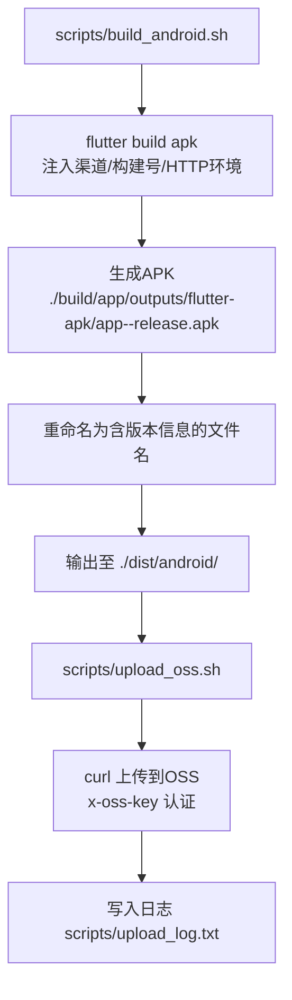
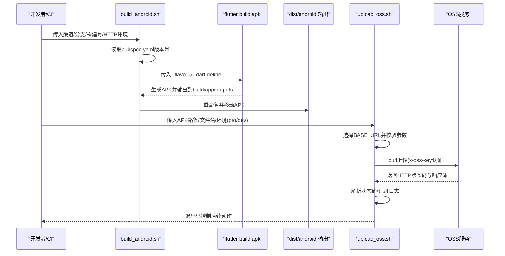
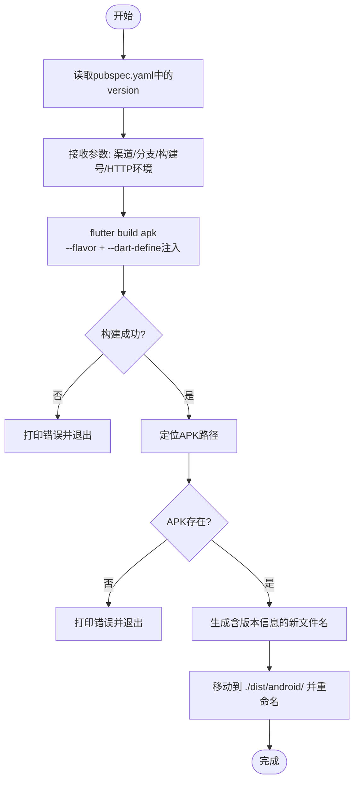
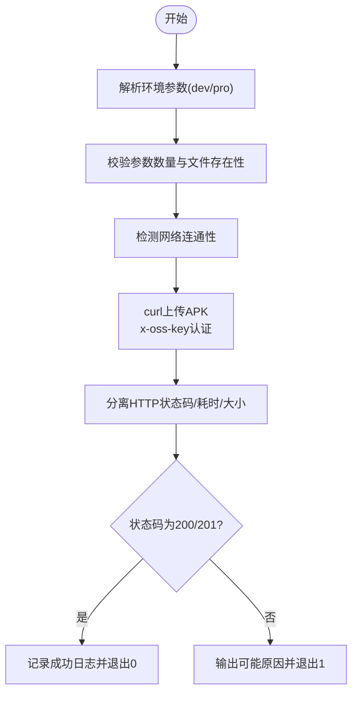
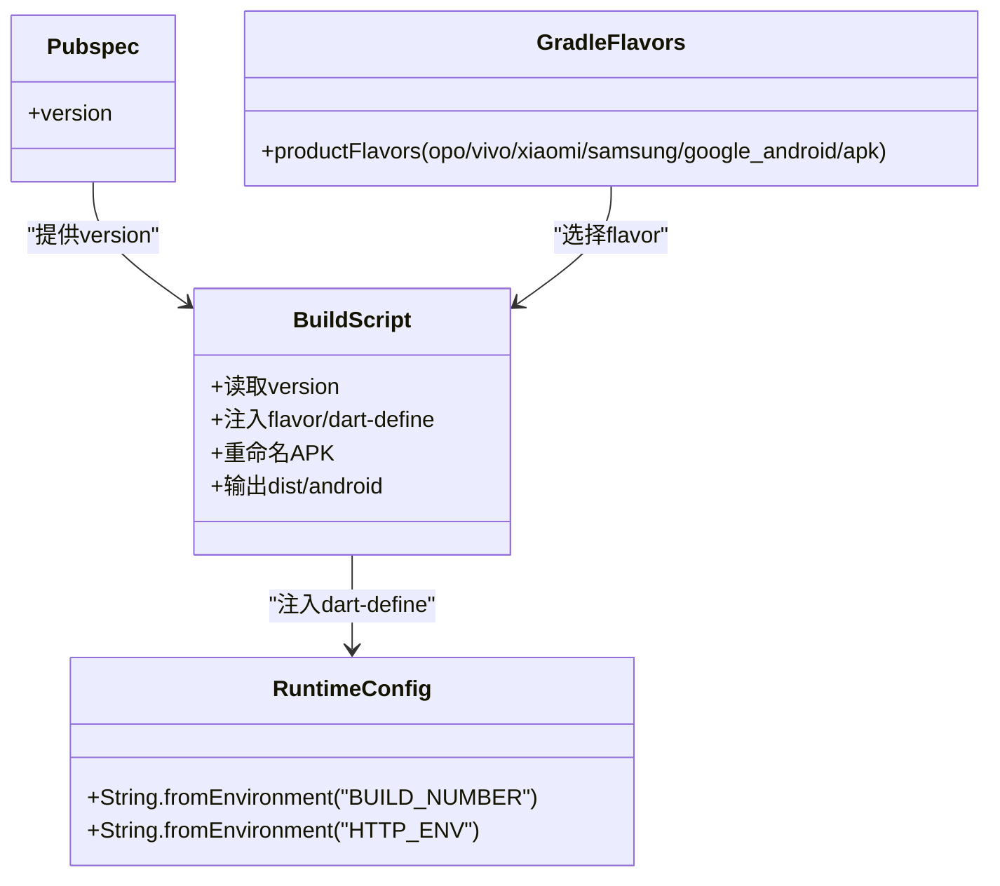
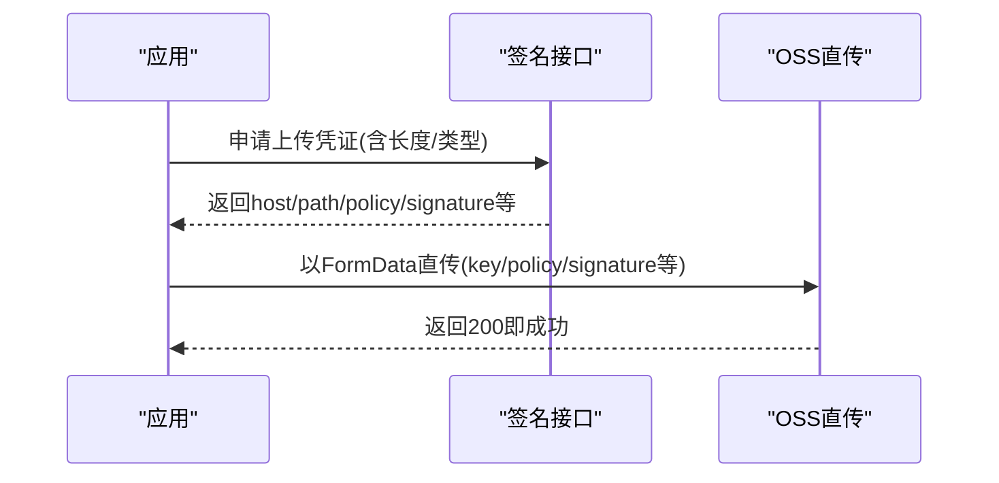
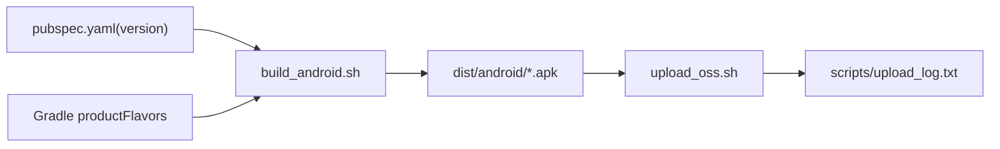

# Android发布流程

<cite>
**本文引用的文件**
- [build_android.sh](file://scripts/build_android.sh)
- [upload_oss.sh](file://scripts/upload_oss.sh)
- [pubspec.yaml](file://pubspec.yaml)
- [android/app/build.gradle](file://android/app/build.gradle)
- [lib/config/config.dart](file://lib/config/config.dart)
- [lib/global/commom/upload.dart](file://lib/global/commom/upload.dart)
- [lib/global/model/common_req_type.dart](file://lib/global/model/common_req_type.dart)
- [lib/global/model/common_response_type.g.dart](file://lib/global/model/common_response_type.g.dart)
</cite>

## 目录
1. [简介](#简介)
2. [项目结构](#项目结构)
3. [核心组件](#核心组件)
4. [架构总览](#架构总览)
5. [详细组件分析](#详细组件分析)
6. [依赖关系分析](#依赖关系分析)
7. [性能考虑](#性能考虑)
8. [故障排查指南](#故障排查指南)
9. [结论](#结论)
10. [附录](#附录)

## 简介
本文件系统化梳理Android应用的完整发布流程，围绕两条主线展开：
- 构建阶段：通过脚本解析版本号、注入渠道与构建参数，生成带版本信息的APK并输出到指定目录。
- 上传阶段：通过脚本向OSS服务上传APK，处理认证头与环境差异，解析响应并记录日志。

同时给出自动化发布建议、错误处理策略与监控机制，帮助团队在CI/CD流水线中稳定可靠地交付产物。

## 项目结构
与发布流程直接相关的关键位置如下：
- 构建脚本：scripts/build_android.sh
- 上传脚本：scripts/upload_oss.sh
- 版本来源：pubspec.yaml
- 渠道配置：android/app/build.gradle 的productFlavors
- 运行时环境注入：lib/config/config.dart 中通过String.fromEnvironment注入BUILD_NUMBER与HTTP_ENV
- 应用内上传实现参考：lib/global/commom/upload.dart 与模型定义：lib/global/model/common_req_type.dart、lib/global/model/common_response_type.g.dart

图表来源
- [build_android.sh](file://scripts/build_android.sh#L1-L70)
- [upload_oss.sh](file://scripts/upload_oss.sh#L1-L211)
- [pubspec.yaml](file://pubspec.yaml#L1-L211)
- [android/app/build.gradle](file://android/app/build.gradle#L34-L60)

章节来源
- [build_android.sh](file://scripts/build_android.sh#L1-L70)
- [upload_oss.sh](file://scripts/upload_oss.sh#L1-L211)
- [pubspec.yaml](file://pubspec.yaml#L1-L211)
- [android/app/build.gradle](file://android/app/build.gradle#L34-L60)

## 核心组件
- 构建脚本：负责从pubspec.yaml读取版本号，注入渠道、构建号与HTTP环境，调用flutter build apk生成APK，并按规则重命名与移动到dist/android目录。
- 上传脚本：负责根据环境参数选择基础URL，校验文件与扩展名，使用curl上传APK，解析HTTP状态码与响应体，记录日志并退出码控制后续流程。
- 版本与环境注入：pubspec.yaml提供版本号；运行时通过String.fromEnvironment注入BUILD_NUMBER与HTTP_ENV；Gradle配置决定Android版本号与渠道后缀。

章节来源
- [build_android.sh](file://scripts/build_android.sh#L1-L70)
- [upload_oss.sh](file://scripts/upload_oss.sh#L1-L211)
- [pubspec.yaml](file://pubspec.yaml#L1-L211)
- [lib/config/config.dart](file://lib/config/config.dart#L74-L107)
- [android/app/build.gradle](file://android/app/build.gradle#L22-L32)

## 架构总览
下面以序列图展示从构建到上传的端到端流程。

图表来源
- [build_android.sh](file://scripts/build_android.sh#L1-L70)
- [upload_oss.sh](file://scripts/upload_oss.sh#L1-L211)
- [pubspec.yaml](file://pubspec.yaml#L1-L211)

## 详细组件分析

### 构建脚本 build_android.sh 工作机制
- 版本号读取：从pubspec.yaml中提取version字段作为APK文件名的一部分，确保产物可追溯。
- 渠道(flavor)注入：通过--flavor参数传递渠道名称，同时以--dart-define注入ANDROID_CHANNEL，便于应用侧区分渠道。
- 构建号与HTTP环境：通过--dart-define注入BUILD_NUMBER与HTTP_ENV，供应用运行时读取。
- 构建产物定位：APK位于build/app/outputs/flutter-apk/app-<flavor>-release.apk。
- 重命名与输出：将APK重命名为包含版本号、构建号、HTTP环境等信息的文件名，并移动到./dist/android/目录。
- 错误处理：若flutter build失败或APK未找到，脚本会打印错误并退出非零码。

图表来源
- [build_android.sh](file://scripts/build_android.sh#L1-L70)
- [pubspec.yaml](file://pubspec.yaml#L1-L211)

章节来源
- [build_android.sh](file://scripts/build_android.sh#L1-L70)
- [pubspec.yaml](file://pubspec.yaml#L1-L211)

### 上传脚本 upload_oss.sh 执行流程
- 环境选择：根据第三个参数选择dev或pro，默认dev；据此拼接BASE_URL、UPLOAD_URL与SIGN_URL。
- 参数校验：要求至少两个参数（文件路径与文件名），最多三个（含环境）；校验文件存在性与扩展名。
- 网络连通性：在上传前进行短超时探测，避免无效上传。
- 上传过程：使用curl以multipart/form-data上传APK，携带x-oss-key认证头；记录HTTP状态码、上传耗时与实际上传大小。
- 结果判定：HTTP状态码为200或201视为成功；否则根据状态码输出可能原因并退出非零码。
- 日志记录：统一写入scripts/upload_log.txt，包含时间戳、文件大小、耗时、响应内容等。

图表来源
- [upload_oss.sh](file://scripts/upload_oss.sh#L1-L211)

章节来源
- [upload_oss.sh](file://scripts/upload_oss.sh#L1-L211)

### 渠道与版本注入的协同
- 渠道(flavor)：在Gradle中定义多套productFlavors，用于区分不同厂商或分发渠道，构建时通过--flavor选择。
- 版本号：pubspec.yaml提供version，构建脚本将其写入APK文件名，便于归档与回溯。
- 构建号与HTTP环境：通过--dart-define注入BUILD_NUMBER与HTTP_ENV，应用启动时通过String.fromEnvironment读取，用于上报与环境切换。

图表来源
- [build_android.sh](file://scripts/build_android.sh#L1-L70)
- [pubspec.yaml](file://pubspec.yaml#L1-L211)
- [android/app/build.gradle](file://android/app/build.gradle#L34-L60)
- [lib/config/config.dart](file://lib/config/config.dart#L74-L107)

章节来源
- [android/app/build.gradle](file://android/app/build.gradle#L34-L60)
- [lib/config/config.dart](file://lib/config/config.dart#L74-L107)

### 应用内上传实现参考（与发布流程衔接）
虽然发布流程主要由脚本完成，但应用内上传实现可作为参考，体现签名与直传OSS的思路：
- 服务端签发上传凭证（包含host、path、policy、signature等），客户端以FormData直传OSS。
- 该模式与上传脚本的“先上传到平台再签名直传”的思路互补，可根据业务选择。

图表来源
- [lib/global/commom/upload.dart](file://lib/global/commom/upload.dart#L29-L71)
- [lib/global/model/common_req_type.dart](file://lib/global/model/common_req_type.dart#L1-L16)
- [lib/global/model/common_response_type.g.dart](file://lib/global/model/common_response_type.g.dart#L1-L67)

章节来源
- [lib/global/commom/upload.dart](file://lib/global/commom/upload.dart#L29-L71)
- [lib/global/model/common_req_type.dart](file://lib/global/model/common_req_type.dart#L1-L16)
- [lib/global/model/common_response_type.g.dart](file://lib/global/model/common_response_type.g.dart#L1-L67)

## 依赖关系分析
- 构建脚本依赖pubspec.yaml中的version字段，以及Gradle的productFlavors配置。
- 上传脚本依赖环境参数与curl工具，依赖OSS服务端接口。
- 运行时配置依赖应用启动时的环境注入，与构建脚本注入的BUILD_NUMBER/HTTP_ENV保持一致。

图表来源
- [build_android.sh](file://scripts/build_android.sh#L1-L70)
- [pubspec.yaml](file://pubspec.yaml#L1-L211)
- [android/app/build.gradle](file://android/app/build.gradle#L34-L60)
- [upload_oss.sh](file://scripts/upload_oss.sh#L1-L211)

章节来源
- [build_android.sh](file://scripts/build_android.sh#L1-L70)
- [upload_oss.sh](file://scripts/upload_oss.sh#L1-L211)
- [pubspec.yaml](file://pubspec.yaml#L1-L211)
- [android/app/build.gradle](file://android/app/build.gradle#L34-L60)

## 性能考虑
- 构建优化：脚本注释中提供了--shrink/--obfuscate/--split-debug-info等选项，可在CI中按需启用以减小包体与提升安全性。
- 上传优化：curl已设置连接与最大传输时间，避免长时间阻塞；建议在CI中结合并发与缓存策略，减少重复构建与上传。
- 日志与监控：上传脚本统一写入日志文件，建议配合CI日志聚合与告警，及时发现异常。

[本节为通用建议，无需列出具体文件来源]

## 故障排查指南
- 构建失败
  - 症状：flutter build返回非零码。
  - 排查：检查渠道参数是否正确、依赖是否齐全、签名配置是否就绪。
  - 参考：构建脚本对构建结果的检查与退出逻辑。
  
- APK未找到
  - 症状：提示APK未在预期路径生成。
  - 排查：确认--flavor与产物路径一致；检查构建是否成功。
  - 参考：构建脚本对APK路径的判断与错误输出。

- 上传失败
  - 症状：HTTP状态码非200/201。
  - 排查：检查x-oss-key是否正确、网络连通性、文件大小限制、URL是否正确。
  - 参考：上传脚本的状态码分支与可能原因列表。

- 环境参数不匹配
  - 症状：应用运行时环境与构建注入不一致。
  - 排查：确认BUILD_NUMBER与HTTP_ENV在构建与运行时一致；Gradle与Dart环境注入需同步。

章节来源
- [build_android.sh](file://scripts/build_android.sh#L1-L70)
- [upload_oss.sh](file://scripts/upload_oss.sh#L1-L211)
- [lib/config/config.dart](file://lib/config/config.dart#L74-L107)

## 结论
本发布流程通过脚本化实现了从版本号读取、渠道与环境注入、APK生成与重命名、到OSS上传与日志记录的闭环。建议在CI中结合构建优化与并发策略，完善错误处理与监控告警，确保发布过程稳定高效。

[本节为总结，无需列出具体文件来源]

## 附录
- 自动化发布建议
  - CI触发：在PR合并或Tag推送时触发构建与上传。
  - 构建参数：统一从CI注入BUILD_NUMBER与HTTP_ENV，确保与应用运行时一致。
  - 产物命名：遵循“油业务应用_版本号_构建号_HTTP环境”的命名规范，便于检索。
  - 错误处理：针对网络超时、认证失败、服务器错误分别设置重试与告警。
  - 监控与审计：集中收集scripts/upload_log.txt，建立异常告警与合规审计。

[本节为通用建议，无需列出具体文件来源]