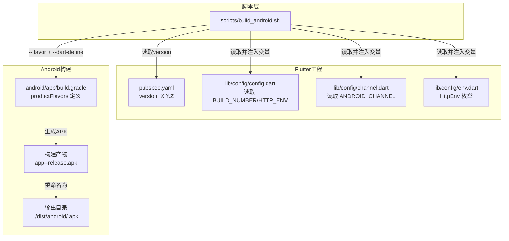
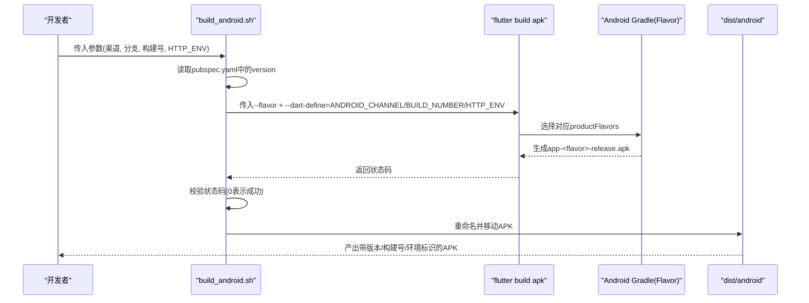
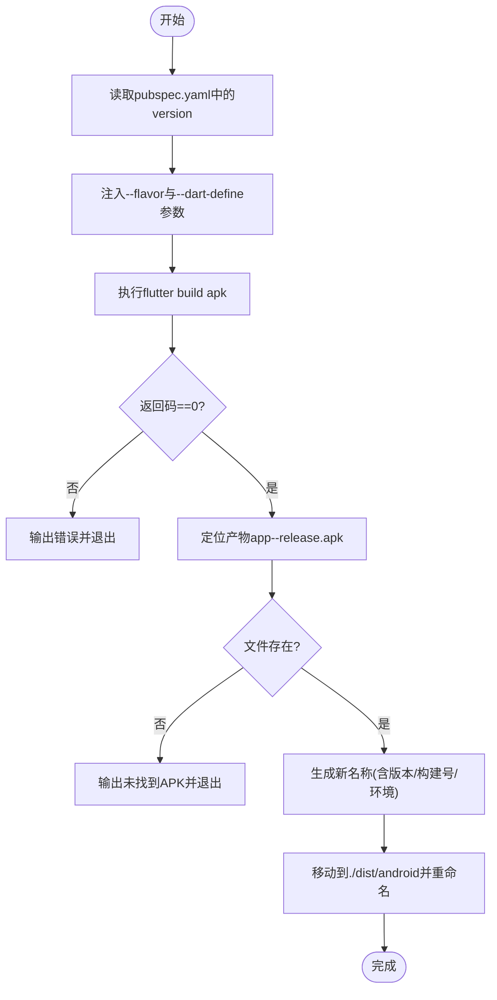
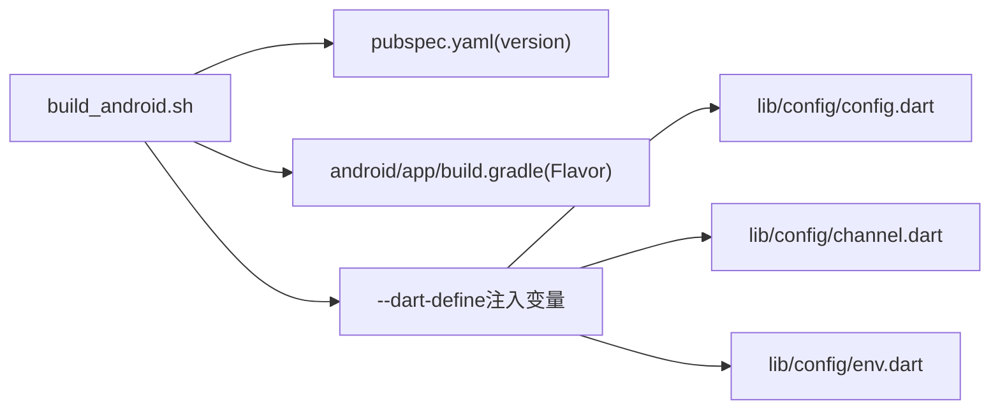

# Android构建流程

<cite>
**本文引用的文件**
- [scripts/build_android.sh](file://scripts/build_android.sh)
- [pubspec.yaml](file://pubspec.yaml)
- [android/app/build.gradle](file://android/app/build.gradle)
- [lib/config/config.dart](file://lib/config/config.dart)
- [lib/config/channel.dart](file://lib/config/channel.dart)
- [lib/config/env.dart](file://lib/config/env.dart)
</cite>

## 目录
1. [简介](#简介)
2. [项目结构](#项目结构)
3. [核心组件](#核心组件)
4. [架构总览](#架构总览)
5. [详细组件分析](#详细组件分析)
6. [依赖关系分析](#依赖关系分析)
7. [性能考虑](#性能考虑)
8. [故障排查指南](#故障排查指南)
9. [结论](#结论)

## 简介
本文件系统化解析 Android 构建脚本 build_android.sh 的构建机制与流程，重点说明：
- 如何通过 grep 从 pubspec.yaml 中提取版本号；
- 如何使用 flutter build apk 执行构建任务；
- 四个参数（渠道、分支、构建号、HTTP 环境）的动态注入方式；
- 如何通过 --dart-define 实现编译时变量配置；
- 构建产物 APK 的命名规则与输出路径；
- 构建结果检查与错误处理策略。

## 项目结构
该仓库采用 Flutter 多 Flavor 架构组织 Android 渠道，Gradle 层面定义了多套 flavor；应用层在 Dart 侧通过环境变量读取构建期注入的变量，用于运行时行为控制。

图表来源
- [scripts/build_android.sh](file://scripts/build_android.sh#L1-L70)
- [pubspec.yaml](file://pubspec.yaml#L1-L25)
- [android/app/build.gradle](file://android/app/build.gradle#L34-L60)
- [lib/config/config.dart](file://lib/config/config.dart#L74-L107)
- [lib/config/channel.dart](file://lib/config/channel.dart#L63-L85)
- [lib/config/env.dart](file://lib/config/env.dart#L1-L24)

章节来源
- [scripts/build_android.sh](file://scripts/build_android.sh#L1-L70)
- [pubspec.yaml](file://pubspec.yaml#L1-L25)
- [android/app/build.gradle](file://android/app/build.gradle#L34-L60)
- [lib/config/config.dart](file://lib/config/config.dart#L74-L107)
- [lib/config/channel.dart](file://lib/config/channel.dart#L63-L85)
- [lib/config/env.dart](file://lib/config/env.dart#L1-L24)

## 核心组件
- 构建脚本 build_android.sh：负责从 pubspec.yaml 提取版本号、执行 flutter build apk、注入 --dart-define 参数、检查构建结果、重命名并移动 APK 至 dist/android 输出目录。
- pubspec.yaml：定义应用版本号，供脚本读取。
- android/app/build.gradle：定义 Android 多 Flavor（渠道），用于 --flavor 选择。
- lib/config/config.dart：在运行时读取 BUILD_NUMBER 与 HTTP_ENV 环境变量，决定网络环境与构建号显示。
- lib/config/channel.dart：在运行时读取 ANDROID_CHANNEL 环境变量，映射渠道常量。
- lib/config/env.dart：定义 HttpEnv 枚举，用于区分生产/测试环境。

章节来源
- [scripts/build_android.sh](file://scripts/build_android.sh#L1-L70)
- [pubspec.yaml](file://pubspec.yaml#L1-L25)
- [android/app/build.gradle](file://android/app/build.gradle#L34-L60)
- [lib/config/config.dart](file://lib/config/config.dart#L74-L107)
- [lib/config/channel.dart](file://lib/config/channel.dart#L63-L85)
- [lib/config/env.dart](file://lib/config/env.dart#L1-L24)

## 架构总览
下图展示从脚本到产物的端到端流程，包括参数注入、构建与产物命名。

图表来源
- [scripts/build_android.sh](file://scripts/build_android.sh#L1-L70)
- [android/app/build.gradle](file://android/app/build.gradle#L34-L60)
- [lib/config/config.dart](file://lib/config/config.dart#L74-L107)
- [lib/config/channel.dart](file://lib/config/channel.dart#L63-L85)

## 详细组件分析

### 构建脚本 build_android.sh 的工作机制
- 版本号提取
  - 使用 grep 匹配 pubspec.yaml 中的 version 行，awk 提取第二列值，去除前缀“version: ”后得到版本号字符串。
  - 参考路径：[scripts/build_android.sh](file://scripts/build_android.sh#L5-L6)
- 参数注入
  - 通过 --flavor 注入渠道参数；
  - 通过 --dart-define 注入 ANDROID_CHANNEL、BUILD_NUMBER、HTTP_ENV；
  - 参考路径：[scripts/build_android.sh](file://scripts/build_android.sh#L26-L26)
- 构建结果检查
  - 使用 $? 检查上一条命令返回值，非 0 则输出错误并退出；
  - 参考路径：[scripts/build_android.sh](file://scripts/build_android.sh#L28-L31)
- APK 产物定位与重命名
  - 产物路径固定为 ./build/app/outputs/flutter-apk/app-<flavor>-release.apk；
  - 生成 APK 名称包含版本号、构建号、HTTP 环境标识；
  - 参考路径：[scripts/build_android.sh](file://scripts/build_android.sh#L34-L49)
- 输出目录与最终命名
  - 输出目录 ./dist/android；
  - 最终文件名形如 oil_business_app_<版本>_<构建号>_<环境>.apk；
  - 参考路径：[scripts/build_android.sh](file://scripts/build_android.sh#L34-L49)

图表来源
- [scripts/build_android.sh](file://scripts/build_android.sh#L1-L70)

章节来源
- [scripts/build_android.sh](file://scripts/build_android.sh#L1-L70)

### Gradle 多 Flavor 与渠道映射
- Gradle 层定义了 productFlavors，包括 oppo、vivo、xiaomi、samsung、google_android、apk 等；
- 脚本通过 --flavor 选择对应 Flavor，从而影响 applicationIdSuffix 与产物命名；
- 参考路径：
  - [android/app/build.gradle](file://android/app/build.gradle#L34-L60)

章节来源
- [android/app/build.gradle](file://android/app/build.gradle#L34-L60)

### 运行时读取构建期注入的变量
- BUILD_NUMBER：在运行时通过 String.fromEnvironment('BUILD_NUMBER') 读取，用于显示或上报；
- HTTP_ENV：在运行时通过 String.fromEnvironment('HTTP_ENV') 读取，映射为 HttpEnv 枚举；
- ANDROID_CHANNEL：在运行时通过 String.fromEnvironment('ANDROID_CHANNEL') 读取，映射为 AndroidChannel；
- 参考路径：
  - [lib/config/config.dart](file://lib/config/config.dart#L74-L107)
  - [lib/config/channel.dart](file://lib/config/channel.dart#L63-L85)
  - [lib/config/env.dart](file://lib/config/env.dart#L1-L24)

章节来源
- [lib/config/config.dart](file://lib/config/config.dart#L74-L107)
- [lib/config/channel.dart](file://lib/config/channel.dart#L63-L85)
- [lib/config/env.dart](file://lib/config/env.dart#L1-L24)

### APK 命名规则与输出路径
- 命名规则：oil_business_app_<版本>_<构建号>_<环境>.apk
  - 版本号来自 pubspec.yaml 的 version 字段；
  - 构建号来自脚本参数 $3；
  - 环境标识来自脚本参数 $4；
- 输出路径：./dist/android/<name>.apk
- 参考路径：
  - [scripts/build_android.sh](file://scripts/build_android.sh#L34-L49)
  - [pubspec.yaml](file://pubspec.yaml#L1-L25)

章节来源
- [scripts/build_android.sh](file://scripts/build_android.sh#L34-L49)
- [pubspec.yaml](file://pubspec.yaml#L1-L25)

## 依赖关系分析
- 构建脚本对 pubspec.yaml 的依赖：仅读取 version 字段；
- 构建脚本对 Gradle Flavor 的依赖：通过 --flavor 选择；
- 构建脚本对 Dart 运行时环境变量的依赖：通过 --dart-define 注入；
- 应用运行时对环境变量的依赖：在 lib/config 下统一读取；
- 渠道映射依赖：lib/config/channel.dart 将 ANDROID_CHANNEL 映射为枚举值；
- 环境映射依赖：lib/config/env.dart 定义 HttpEnv 枚举。

图表来源
- [scripts/build_android.sh](file://scripts/build_android.sh#L1-L70)
- [pubspec.yaml](file://pubspec.yaml#L1-L25)
- [android/app/build.gradle](file://android/app/build.gradle#L34-L60)
- [lib/config/config.dart](file://lib/config/config.dart#L74-L107)
- [lib/config/channel.dart](file://lib/config/channel.dart#L63-L85)
- [lib/config/env.dart](file://lib/config/env.dart#L1-L24)

章节来源
- [scripts/build_android.sh](file://scripts/build_android.sh#L1-L70)
- [pubspec.yaml](file://pubspec.yaml#L1-L25)
- [android/app/build.gradle](file://android/app/build.gradle#L34-L60)
- [lib/config/config.dart](file://lib/config/config.dart#L74-L107)
- [lib/config/channel.dart](file://lib/config/channel.dart#L63-L85)
- [lib/config/env.dart](file://lib/config/env.dart#L1-L24)

## 性能考虑
- 代码压缩与混淆：脚本注释中保留了 --shrink 与 --obfuscate 的选项，可在需要时启用以减小包体与提升安全性；
- Tree Shake Icons：使用 --no-tree-shake-icons 保持图标资源完整性；
- 调试信息分离：注释中提供了 --split-debug-info 选项，便于在发布时分离调试信息；
- 并行与缓存：建议在 CI 环境中开启 Flutter 缓存与 Gradle 缓存，减少重复构建时间。

## 故障排查指南
- 构建命令执行失败
  - 现象：脚本检测到返回码非 0，直接输出错误并退出；
  - 排查要点：检查 Flutter SDK、Gradle 配置、签名配置、依赖安装是否完整；
  - 参考路径：[scripts/build_android.sh](file://scripts/build_android.sh#L28-L31)
- APK 文件未生成
  - 现象：产物路径 ./build/app/outputs/flutter-apk/app-<flavor>-release.apk 不存在；
  - 排查要点：确认 --flavor 与 Gradle 中 productFlavors 是否一致；检查构建日志是否有异常；确认输出目录权限；
  - 参考路径：[scripts/build_android.sh](file://scripts/build_android.sh#L44-L53)
- 渠道参数不匹配
  - 现象：--flavor 与 Gradle 中定义的 Flavor 不一致导致构建失败；
  - 排查要点：核对脚本传入的渠道值与 android/app/build.gradle 中 productFlavors 的名称；
  - 参考路径：[scripts/build_android.sh](file://scripts/build_android.sh#L26-L26)，[android/app/build.gradle](file://android/app/build.gradle#L34-L60)
- 运行时变量未生效
  - 现象：运行时 BUILD_NUMBER、HTTP_ENV、ANDROID_CHANNEL 与预期不符；
  - 排查要点：确认脚本是否正确传入 --dart-define；确认应用启动时是否读取了环境变量；
  - 参考路径：[scripts/build_android.sh](file://scripts/build_android.sh#L26-L26)，[lib/config/config.dart](file://lib/config/config.dart#L74-L107)，[lib/config/channel.dart](file://lib/config/channel.dart#L63-L85)

章节来源
- [scripts/build_android.sh](file://scripts/build_android.sh#L26-L53)
- [android/app/build.gradle](file://android/app/build.gradle#L34-L60)
- [lib/config/config.dart](file://lib/config/config.dart#L74-L107)
- [lib/config/channel.dart](file://lib/config/channel.dart#L63-L85)

## 结论
build_android.sh 通过从 pubspec.yaml 提取版本号、结合 --flavor 与 --dart-define 实现了灵活可控的 Android 构建流程。脚本对构建结果进行严格校验，并按约定规则重命名与输出 APK，确保产物可追溯且命名规范。配合 Gradle 的多 Flavor 与 Dart 侧的环境变量读取，实现了“构建期注入、运行时生效”的完整闭环。建议在 CI 场景中固定参数、完善缓存与日志记录，以提升稳定性与可维护性。