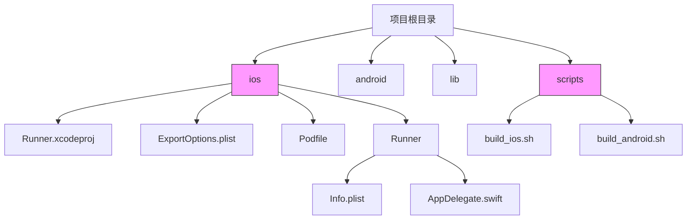
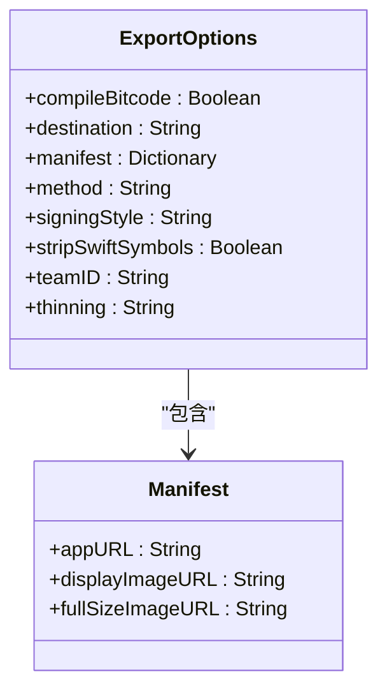
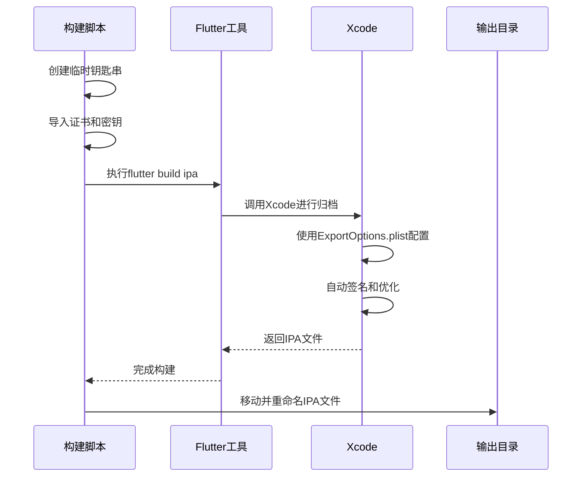

# iOS分发配置

<cite>
**本文档引用的文件**
- [ExportOptions.plist](file://ios/ExportOptions.plist)
- [build_ios.sh](file://scripts/build_ios.sh)
- [Podfile](file://ios/Podfile)
- [ci_post_clone.sh](file://ios/ci_scripts/ci_post_clone.sh)
</cite>

## 目录
1. [项目结构](#项目结构)
2. [核心分发配置](#核心分发配置)
3. [ExportOptions.plist详解](#exportoptionsplist详解)
4. [构建与分发流程](#构建与分发流程)
5. [分发场景配置调整](#分发场景配置调整)

## 项目结构

本项目是一个Flutter跨平台应用，包含iOS、Android等多个平台的实现。iOS相关的配置和代码主要位于`ios`目录下，关键文件包括Xcode项目文件、构建脚本和分发配置。

**Diagram sources**
- [ExportOptions.plist](file://ios/ExportOptions.plist)
- [build_ios.sh](file://scripts/build_ios.sh)

**Section sources**
- [ExportOptions.plist](file://ios/ExportOptions.plist)
- [build_ios.sh](file://scripts/build_ios.sh)

## 核心分发配置

iOS应用的分发配置主要通过`ExportOptions.plist`文件进行管理，该文件定义了应用打包和分发的关键参数。这些配置确保应用能够正确签名、优化并分发到目标环境。

**Section sources**
- [ExportOptions.plist](file://ios/ExportOptions.plist)

## ExportOptions.plist详解

`ExportOptions.plist`文件包含了iOS应用分发所需的所有配置选项，每个键值对都有特定的含义和作用。

**Diagram sources**
- [ExportOptions.plist](file://ios/ExportOptions.plist)

### 分发方法配置

`method`键值设置为`release-testing`，表示这是一种发布测试分发方式。这种配置适用于内部测试或外部测试场景，允许开发者将应用分发给特定的测试用户群体进行验证。

**Section sources**
- [ExportOptions.plist](file://ios/ExportOptions.plist#L18-L19)

### 签名配置

`signingStyle`设置为`automatic`，表示使用自动签名方式。这种方式由Xcode自动管理证书和配置文件，简化了开发者的签名流程，特别适合持续集成环境。

`teamID`值为`6Z52J7K44T`，这是开发者团队的唯一标识符，用于关联Apple Developer账户中的团队信息。

**Section sources**
- [ExportOptions.plist](file://ios/ExportOptions.plist#L20-L25)

### 编译优化配置

`compileBitcode`设置为`false`，表示不编译Bitcode。Bitcode是苹果的中间代码格式，禁用它可以减少构建时间和包体积，但会限制App Store对应用的重新编译优化。

`stripSwiftSymbols`设置为`true`，表示在构建过程中剥离Swift符号。这可以显著减小应用包体积，因为Swift运行时符号在发布版本中通常不需要。

**Section sources**
- [ExportOptions.plist](file://ios/ExportOptions.plist#L5-L6)
- [ExportOptions.plist](file://ios/ExportOptions.plist#L22-L23)

### Manifest配置

`manifest`字典包含了三个URL占位符：
- `appURL`: 应用下载地址
- `displayImageURL`: 显示图片地址
- `fullSizeImageURL`: 完整尺寸图片地址

这些占位符在实际分发时会被具体的URL替换，用于企业内部分发时的安装页面展示。

**Section sources**
- [ExportOptions.plist](file://ios/ExportOptions.plist#L9-L17)

### 二进制瘦身配置

`thinning`设置为`<thin-for-all-variants>`，表示对所有设备变体进行二进制瘦身。这种配置会为不同设备生成优化的二进制文件，只包含目标设备所需的资源和代码，从而减小下载大小。

**Section sources**
- [ExportOptions.plist](file://ios/ExportOptions.plist#L26-L27)

## 构建与分发流程

应用的构建和分发通过脚本自动化完成，主要流程包括环境准备、构建、签名和输出。

**Diagram sources**
- [build_ios.sh](file://scripts/build_ios.sh)
- [ExportOptions.plist](file://ios/ExportOptions.plist)

### 构建脚本分析

`scripts/build_ios.sh`脚本负责整个iOS构建流程：
1. 创建临时钥匙串并导入证书
2. 调用`flutter build ipa`命令，指定`ExportOptions.plist`文件
3. 处理构建结果，重命名并移动IPA文件

脚本中使用`--export-options-plist="./ios/ExportOptions.plist"`参数明确指定分发配置文件。

**Section sources**
- [build_ios.sh](file://scripts/build_ios.sh#L29-L67)

### CI/CD集成

项目包含CI脚本`ios/ci_scripts/ci_post_clone.sh`，用于在持续集成环境中自动配置构建环境，包括：
- 安装Flutter SDK
- 配置包管理认证
- 预缓存iOS构建组件
- 安装CocoaPods依赖

**Section sources**
- [ci_post_clone.sh](file://ios/ci_scripts/ci_post_clone.sh)

## 分发场景配置调整

不同分发场景需要调整`ExportOptions.plist`中的配置参数。

### App Store分发

对于App Store分发，应调整以下配置：
- `method`设置为`app-store`
- 确保`compileBitcode`为`true`以获得App Store优化
- 移除`manifest`配置（App Store不需要）

### TestFlight分发

TestFlight分发配置：
- `method`设置为`app-store`
- `uploadSymbols`设置为`true`
- `uploadBitcode`根据需要设置

### 企业分发

企业分发配置：
- `method`设置为`enterprise`
- 保留`manifest`配置以支持OTA安装
- `thinning`通常设置为`<none>`以支持所有设备

### 内部测试分发

内部测试分发（如当前配置）：
- `method`设置为`ad-hoc`或`development`
- 使用`release-testing`自定义方法
- 配置适当的设备UDID列表

**Section sources**
- [ExportOptions.plist](file://ios/ExportOptions.plist)