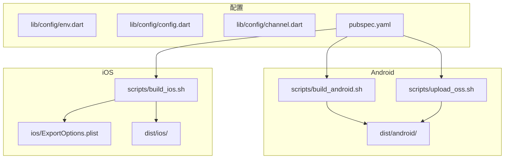
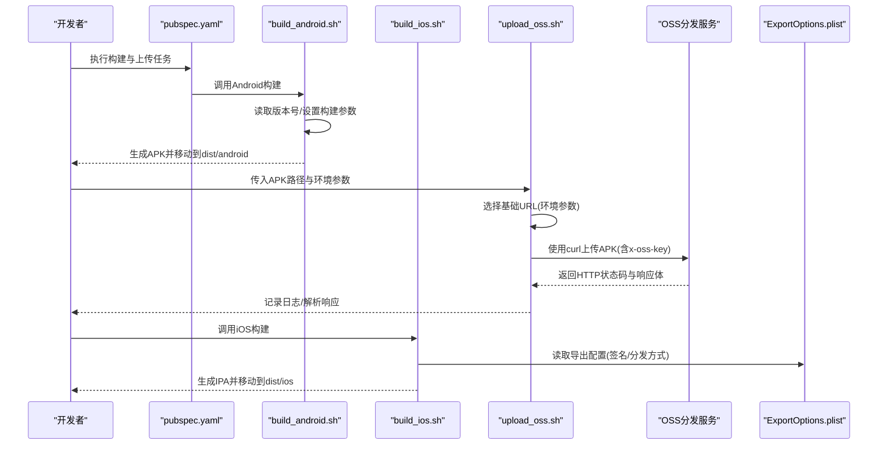
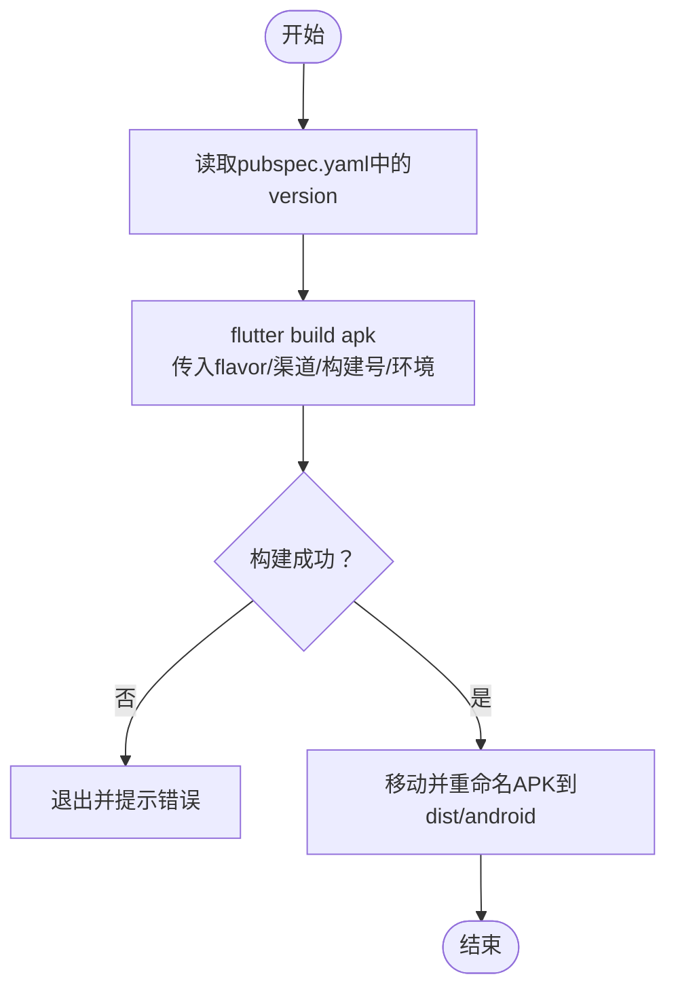
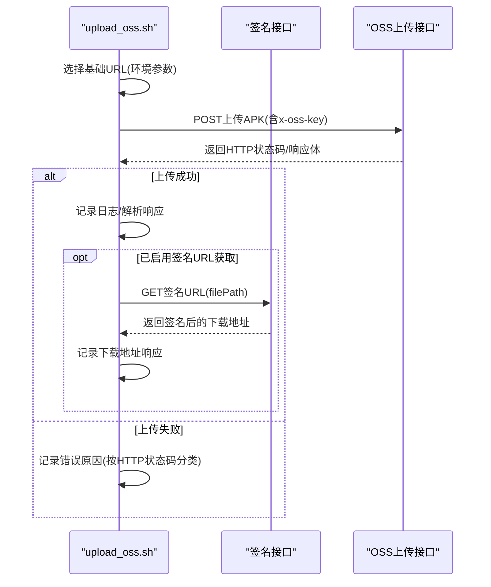
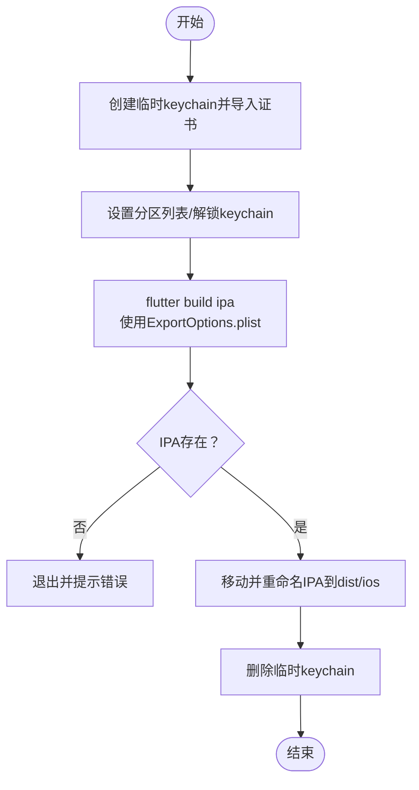
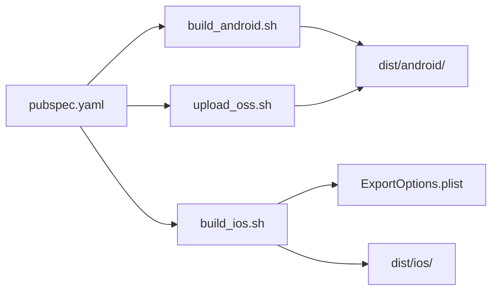

# 发布流程

<cite>
**本文引用的文件列表**
- [scripts/build_android.sh](file://scripts/build_android.sh)
- [scripts/build_ios.sh](file://scripts/build_ios.sh)
- [scripts/upload_oss.sh](file://scripts/upload_oss.sh)
- [ios/ExportOptions.plist](file://ios/ExportOptions.plist)
- [pubspec.yaml](file://pubspec.yaml)
- [lib/config/env.dart](file://lib/config/env.dart)
- [lib/config/config.dart](file://lib/config/config.dart)
- [lib/config/channel.dart](file://lib/config/channel.dart)
</cite>

## 目录
1. [简介](#简介)
2. [项目结构](#项目结构)
3. [核心组件](#核心组件)
4. [架构总览](#架构总览)
5. [详细组件分析](#详细组件分析)
6. [依赖关系分析](#依赖关系分析)
7. [性能考量](#性能考量)
8. [故障排查指南](#故障排查指南)
9. [结论](#结论)
10. [附录](#附录)

## 简介
本文件系统化梳理该Flutter应用从构建到分发平台的完整发布流程，重点解析：
- Android端：通过build_android.sh生成APK，并调用upload_oss.sh上传至OSS分发平台；说明如何基于环境参数选择不同基础URL，以及上传成功后的下载地址获取逻辑。
- iOS端：通过build_ios.sh生成IPA，使用ExportOptions.plist配置App Store或企业分发选项。
- 自动化与错误处理：针对网络超时、认证失败、服务器错误等场景给出策略建议。

## 项目结构
围绕发布流程的关键文件分布如下：
- Android构建与上传：scripts/build_android.sh、scripts/upload_oss.sh
- iOS构建与导出：scripts/build_ios.sh、ios/ExportOptions.plist
- 环境与渠道配置：lib/config/env.dart、lib/config/config.dart、lib/config/channel.dart
- 任务入口与脚本别名：pubspec.yaml

图表来源
- [scripts/build_android.sh](file://scripts/build_android.sh#L1-L70)
- [scripts/upload_oss.sh](file://scripts/upload_oss.sh#L1-L211)
- [scripts/build_ios.sh](file://scripts/build_ios.sh#L1-L72)
- [ios/ExportOptions.plist](file://ios/ExportOptions.plist#L1-L30)
- [pubspec.yaml](file://pubspec.yaml#L24-L33)
- [lib/config/env.dart](file://lib/config/env.dart#L1-L24)
- [lib/config/config.dart](file://lib/config/config.dart#L90-L108)
- [lib/config/channel.dart](file://lib/config/channel.dart#L1-L86)

章节来源
- [pubspec.yaml](file://pubspec.yaml#L24-L33)
- [scripts/build_android.sh](file://scripts/build_android.sh#L1-L70)
- [scripts/build_ios.sh](file://scripts/build_ios.sh#L1-L72)
- [scripts/upload_oss.sh](file://scripts/upload_oss.sh#L1-L211)
- [ios/ExportOptions.plist](file://ios/ExportOptions.plist#L1-L30)
- [lib/config/env.dart](file://lib/config/env.dart#L1-L24)
- [lib/config/config.dart](file://lib/config/config.dart#L90-L108)
- [lib/config/channel.dart](file://lib/config/channel.dart#L1-L86)

## 核心组件
- Android构建脚本：负责读取版本号、执行flutter build apk、重命名并移动APK到dist/android目录。
- OSS上传脚本：负责根据环境参数选择基础URL，使用curl上传APK，解析响应并记录日志；包含下载地址获取的预留逻辑。
- iOS构建脚本：负责临时创建钥匙串、导入签名证书、执行flutter build ipa并重命名输出IPA。
- ExportOptions.plist：定义iOS导出方式（App Store或企业分发）、签名风格、团队ID等。
- 环境与渠道配置：在运行时通过环境变量注入HTTP_ENV与BUILD_NUMBER，影响应用初始化与网络请求。

章节来源
- [scripts/build_android.sh](file://scripts/build_android.sh#L1-L70)
- [scripts/upload_oss.sh](file://scripts/upload_oss.sh#L1-L211)
- [scripts/build_ios.sh](file://scripts/build_ios.sh#L1-L72)
- [ios/ExportOptions.plist](file://ios/ExportOptions.plist#L1-L30)
- [lib/config/env.dart](file://lib/config/env.dart#L1-L24)
- [lib/config/config.dart](file://lib/config/config.dart#L90-L108)
- [lib/config/channel.dart](file://lib/config/channel.dart#L1-L86)

## 架构总览
下图展示从构建到上传的端到端流程，以及iOS导出配置对分发的影响。

图表来源
- [pubspec.yaml](file://pubspec.yaml#L24-L33)
- [scripts/build_android.sh](file://scripts/build_android.sh#L1-L70)
- [scripts/upload_oss.sh](file://scripts/upload_oss.sh#L1-L211)
- [scripts/build_ios.sh](file://scripts/build_ios.sh#L1-L72)
- [ios/ExportOptions.plist](file://ios/ExportOptions.plist#L1-L30)

## 详细组件分析

### Android构建流程（build_android.sh）
- 版本号来源：从pubspec.yaml读取version字段，用于命名APK文件。
- 构建参数：通过flutter build apk传入flavor、ANDROID_CHANNEL、BUILD_NUMBER、HTTP_ENV等。
- 输出重命名：将生成的APK移动到dist/android目录，并按规则重命名（包含版本号、build number、环境标识）。
- 错误处理：若构建失败或目标APK不存在，直接退出并提示错误。

图表来源
- [scripts/build_android.sh](file://scripts/build_android.sh#L1-L70)

章节来源
- [scripts/build_android.sh](file://scripts/build_android.sh#L1-L70)

### OSS上传流程（upload_oss.sh）
- 环境选择：根据第三个参数选择基础URL（dev或pro），进而确定上传与签名接口地址。
- 认证头：通过请求头x-oss-key携带密钥进行认证。
- 上传实现：使用curl以multipart/form-data方式POST上传APK，同时记录HTTP状态码、耗时与实际上传大小。
- 响应解析：分离HTTP状态码与响应体，依据状态码判断上传成功与否；对常见HTTP错误码给出原因提示。
- 下载地址获取：脚本包含获取签名URL的预留逻辑（注释），可按需启用并记录响应。

图表来源
- [scripts/upload_oss.sh](file://scripts/upload_oss.sh#L1-L211)

章节来源
- [scripts/upload_oss.sh](file://scripts/upload_oss.sh#L1-L211)

### iOS构建与导出（build_ios.sh + ExportOptions.plist）
- 钥匙串与证书：临时创建keychain、导入p12证书、设置分区列表以支持非交互签名。
- 构建命令：执行flutter build ipa，并通过export-options-plist指定导出配置。
- 导出配置：ExportOptions.plist中包含导出方式（如release-testing）、签名风格、团队ID、薄化策略等，决定分发类型（App Store或企业分发）。
- 输出重命名：将生成的IPA移动到dist/ios目录并按规则重命名。

图表来源
- [scripts/build_ios.sh](file://scripts/build_ios.sh#L1-L72)
- [ios/ExportOptions.plist](file://ios/ExportOptions.plist#L1-L30)

章节来源
- [scripts/build_ios.sh](file://scripts/build_ios.sh#L1-L72)
- [ios/ExportOptions.plist](file://ios/ExportOptions.plist#L1-L30)

### 环境与渠道配置
- HTTP_ENV：在应用启动时通过环境变量注入，映射为HttpEnv枚举值，控制是否走正式或测试环境。
- BUILD_NUMBER：从环境变量注入，用于构建号显示与分发追踪。
- ANDROID_CHANNEL：通过flutter build apk传入，影响渠道相关配置（如AFKey、PartnerId）。

章节来源
- [lib/config/env.dart](file://lib/config/env.dart#L1-L24)
- [lib/config/config.dart](file://lib/config/config.dart#L90-L108)
- [lib/config/channel.dart](file://lib/config/channel.dart#L1-L86)
- [scripts/build_android.sh](file://scripts/build_android.sh#L24-L33)

## 依赖关系分析
- 任务入口：pubspec.yaml中定义了build_android、build_ios、upload_app等脚本别名，便于统一执行。
- 构建链路：Android与iOS分别由各自脚本驱动，最终产物进入dist目录供后续分发。
- 上传链路：upload_oss.sh依赖环境参数与OSS接口，上传成功后可选地获取签名下载地址。
- 导出链路：iOS导出受ExportOptions.plist影响，签名与分发方式在此处定义。

图表来源
- [pubspec.yaml](file://pubspec.yaml#L24-L33)
- [scripts/build_android.sh](file://scripts/build_android.sh#L1-L70)
- [scripts/build_ios.sh](file://scripts/build_ios.sh#L1-L72)
- [scripts/upload_oss.sh](file://scripts/upload_oss.sh#L1-L211)
- [ios/ExportOptions.plist](file://ios/ExportOptions.plist#L1-L30)

章节来源
- [pubspec.yaml](file://pubspec.yaml#L24-L33)

## 性能考量
- 构建优化：build_android.sh使用无树摇图标、禁用图标摇树，有助于减少APK体积与构建时间。
- 上传超时：upload_oss.sh设置了连接超时与最大传输时间，避免长时间阻塞。
- 日志与可观测性：上传完成后记录HTTP状态码、耗时与实际上传大小，便于定位性能瓶颈。

章节来源
- [scripts/build_android.sh](file://scripts/build_android.sh#L20-L33)
- [scripts/upload_oss.sh](file://scripts/upload_oss.sh#L100-L112)

## 故障排查指南
- 网络超时
  - 现象：上传前连通性检测失败或curl连接超时。
  - 排查：检查网络连通性、代理设置、防火墙策略；适当增大连接超时阈值。
  - 参考位置：[scripts/upload_oss.sh](file://scripts/upload_oss.sh#L93-L98)
- 认证失败（401）
  - 现象：HTTP 401，x-oss-key不正确或被拒绝。
  - 排查：核对RELEASE_OSS_KEY是否正确、是否过期；确认OSS访问权限。
  - 参考位置：[scripts/upload_oss.sh](file://scripts/upload_oss.sh#L102-L112)
- 服务器错误（5xx）
  - 现象：HTTP 500/502/503/504。
  - 排查：重试或稍后重试；检查服务端日志与负载情况。
  - 参考位置：[scripts/upload_oss.sh](file://scripts/upload_oss.sh#L200-L209)
- 文件过大（413）
  - 现象：超过服务器限制。
  - 排查：检查APK体积，必要时优化资源或拆分模块。
  - 参考位置：[scripts/upload_oss.sh](file://scripts/upload_oss.sh#L204-L206)
- iOS签名失败
  - 现象：证书导入失败、签名不匹配或非交互签名受限。
  - 排查：确认p12证书密码正确、临时keychain创建与分区列表设置成功；检查团队ID与导出方式。
  - 参考位置：[scripts/build_ios.sh](file://scripts/build_ios.sh#L30-L48), [ios/ExportOptions.plist](file://ios/ExportOptions.plist#L1-L30)
- 环境变量未生效
  - 现象：应用初始化的HTTP_ENV与期望不符。
  - 排查：确保在构建或运行时正确注入HTTP_ENV与BUILD_NUMBER。
  - 参考位置：[lib/config/config.dart](file://lib/config/config.dart#L96-L106)

章节来源
- [scripts/upload_oss.sh](file://scripts/upload_oss.sh#L93-L112)
- [scripts/upload_oss.sh](file://scripts/upload_oss.sh#L200-L209)
- [scripts/build_ios.sh](file://scripts/build_ios.sh#L30-L48)
- [ios/ExportOptions.plist](file://ios/ExportOptions.plist#L1-L30)
- [lib/config/config.dart](file://lib/config/config.dart#L96-L106)

## 结论
该发布体系通过脚本化的方式实现了Android与iOS的自动化构建与分发：
- Android侧：build_android.sh生成APK，upload_oss.sh负责上传与日志记录，支持按环境切换基础URL与认证头。
- iOS侧：build_ios.sh结合ExportOptions.plist完成签名与导出，灵活适配App Store或企业分发。
- 建议：在CI/CD中集成上述脚本，完善重试与告警机制；对upload_oss.sh的签名URL获取逻辑进行启用与监控，确保下载地址可用性。

## 附录
- 任务入口与别名：pubspec.yaml中定义了build_android、build_ios、upload_app等命令，便于统一执行。
- 渠道与环境：通过环境变量注入渠道与环境，影响应用初始化与网络请求行为。

章节来源
- [pubspec.yaml](file://pubspec.yaml#L24-L33)
- [lib/config/env.dart](file://lib/config/env.dart#L1-L24)
- [lib/config/config.dart](file://lib/config/config.dart#L90-L108)
- [lib/config/channel.dart](file://lib/config/channel.dart#L1-L86)