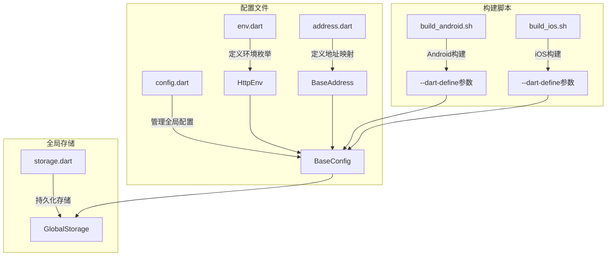
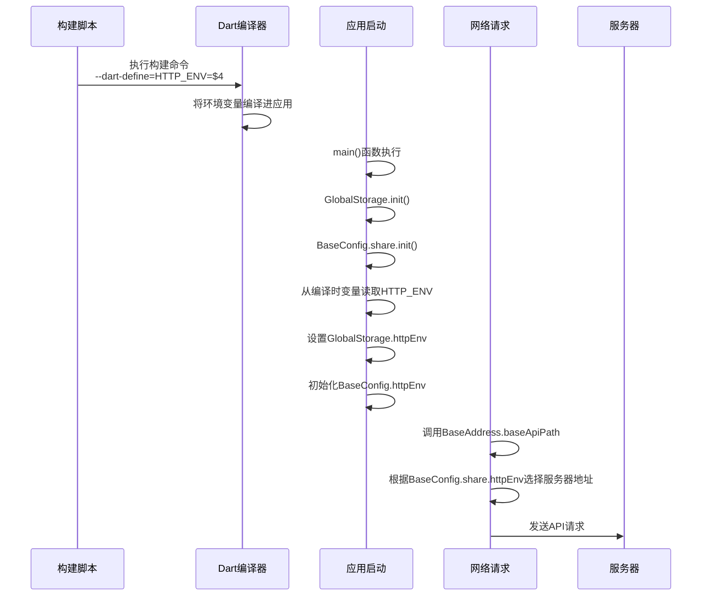
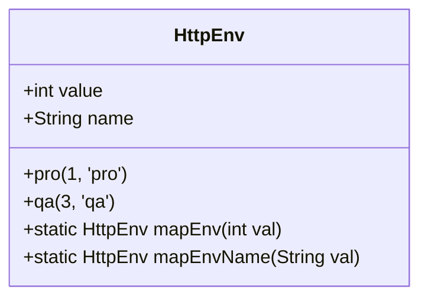
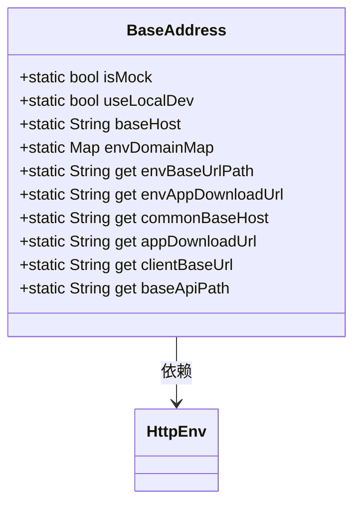
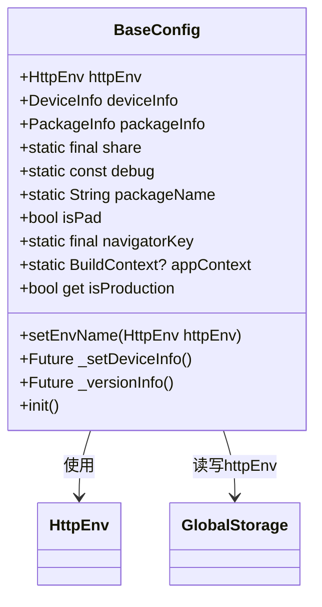
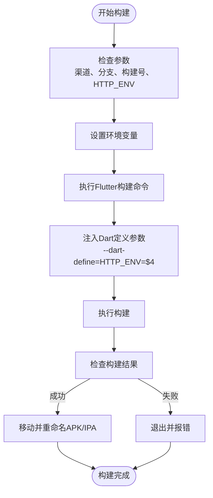
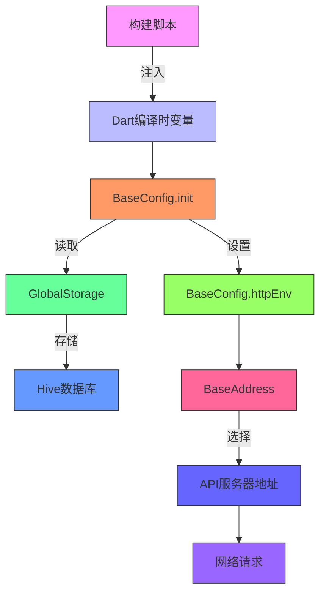

# 多环境配置

<cite>
**本文档引用的文件**   
- [env.dart](file://lib/config/env.dart)
- [address.dart](file://lib/config/address.dart)
- [config.dart](file://lib/config/config.dart)
- [storage.dart](file://lib/global/storage.dart)
- [main.dart](file://lib/main.dart)
- [build_android.sh](file://scripts/build_android.sh)
- [build_ios.sh](file://scripts/build_ios.sh)
- [GEMINI.md](file://GEMINI.md)
- [project.md](file://openspec/project.md)
</cite>

## 目录
1. [简介](#简介)
2. [项目结构](#项目结构)
3. [核心组件](#核心组件)
4. [架构概述](#架构概述)
5. [详细组件分析](#详细组件分析)
6. [依赖分析](#依赖分析)
7. [性能考虑](#性能考虑)
8. [故障排除指南](#故障排除指南)
9. [结论](#结论)

## 简介
本文档深入解释油品业务应用的多环境配置机制。该机制允许应用在开发、测试和生产等不同环境中运行，通过灵活的配置系统动态选择正确的API服务器地址。文档详细说明了如何通过`env.dart`和`address.dart`文件定义环境配置，如何在构建过程中通过Dart的`-DHTTP_ENV`参数注入环境变量，以及如何在运行时动态选择服务器地址。同时，文档还提供了配置新环境的步骤和常见问题的排查方法。

## 项目结构
该项目采用标准的Flutter项目结构，多环境配置相关文件主要位于`lib/config`目录下，构建脚本位于`scripts`目录中。

**Diagram sources**
- [env.dart](file://lib/config/env.dart#L1-L24)
- [address.dart](file://lib/config/address.dart#L1-L41)
- [config.dart](file://lib/config/config.dart#L1-L108)
- [storage.dart](file://lib/global/storage.dart#L1-L34)
- [build_android.sh](file://scripts/build_android.sh#L1-L70)
- [build_ios.sh](file://scripts/build_ios.sh#L1-L72)

**Section sources**
- [env.dart](file://lib/config/env.dart#L1-L24)
- [address.dart](file://lib/config/address.dart#L1-L41)
- [config.dart](file://lib/config/config.dart#L1-L108)
- [storage.dart](file://lib/global/storage.dart#L1-L34)
- [build_android.sh](file://scripts/build_android.sh#L1-L70)
- [build_ios.sh](file://scripts/build_ios.sh#L1-L72)

## 核心组件
多环境配置机制的核心组件包括环境枚举定义、地址映射、全局配置管理和构建参数注入。这些组件协同工作，确保应用能够在不同环境中正确运行。

**Section sources**
- [env.dart](file://lib/config/env.dart#L1-L24)
- [address.dart](file://lib/config/address.dart#L1-L41)
- [config.dart](file://lib/config/config.dart#L1-L108)

## 架构概述
多环境配置的架构设计遵循分层原则，从构建时的参数注入到运行时的配置初始化，再到网络请求时的地址选择，形成了一个完整的配置链条。

**Diagram sources**
- [build_android.sh](file://scripts/build_android.sh#L26)
- [config.dart](file://lib/config/config.dart#L98-L106)
- [address.dart](file://lib/config/address.dart#L21-L39)

## 详细组件分析

### 环境枚举定义分析
环境枚举`HttpEnv`定义了应用支持的不同环境，每个环境都有对应的数值和名称标识。

**Diagram sources**
- [env.dart](file://lib/config/env.dart#L1-L24)

**Section sources**
- [env.dart](file://lib/config/env.dart#L1-L24)

### 地址映射分析
`BaseAddress`类负责管理不同环境下的服务器地址映射，提供静态方法获取当前环境的API基础地址。

**Diagram sources**
- [address.dart](file://lib/config/address.dart#L1-L41)
- [env.dart](file://lib/config/env.dart#L1-L24)

### 全局配置管理分析
`BaseConfig`类是全局配置的管理中心，负责初始化应用配置，包括环境变量、设备信息和版本信息。

**Diagram sources**
- [config.dart](file://lib/config/config.dart#L1-L108)
- [env.dart](file://lib/config/env.dart#L1-L24)
- [storage.dart](file://lib/global/storage.dart#L1-L34)

### 构建脚本分析
构建脚本负责在构建过程中注入环境变量，是多环境配置的关键环节。

**Diagram sources**
- [build_android.sh](file://scripts/build_android.sh#L1-L70)
- [build_ios.sh](file://scripts/build_ios.sh#L1-L72)

**Section sources**
- [build_android.sh](file://scripts/build_android.sh#L1-L70)
- [build_ios.sh](file://scripts/build_ios.sh#L1-L72)

## 依赖分析
多环境配置系统的各个组件之间存在明确的依赖关系，形成了一个完整的配置链条。

**Diagram sources**
- [build_android.sh](file://scripts/build_android.sh#L26)
- [config.dart](file://lib/config/config.dart#L98-L106)
- [storage.dart](file://lib/global/storage.dart#L1-L34)
- [address.dart](file://lib/config/address.dart#L21-L39)

**Section sources**
- [build_android.sh](file://scripts/build_android.sh#L1-L70)
- [config.dart](file://lib/config/config.dart#L1-L108)
- [storage.dart](file://lib/global/storage.dart#L1-L34)
- [address.dart](file://lib/config/address.dart#L1-L41)

## 性能考虑
多环境配置机制对应用性能的影响主要体现在启动时的初始化过程。`BaseConfig.init()`方法中的`Future.wait`确保了设备信息和版本信息的并行初始化，减少了启动时间。环境变量的读取和设置操作都是轻量级的内存操作，对性能影响极小。Hive数据库的读写操作也经过优化，确保了快速的持久化存储访问。

## 故障排除指南
多环境配置错误可能导致应用无法连接到正确的服务器，以下是常见问题及其排查方法：

**Section sources**
- [config.dart](file://lib/config/config.dart#L98-L106)
- [address.dart](file://lib/config/address.dart#L15-L18)
- [build_android.sh](file://scripts/build_android.sh#L26)

### 常见问题及解决方法
| 问题现象 | 可能原因 | 解决方法 |
|---------|--------|--------|
| 应用无法连接服务器 | 构建时未正确注入HTTP_ENV参数 | 检查构建脚本中`--dart-define=HTTP_ENV=$4`参数是否正确传递 |
| 连接到错误的环境 | HTTP_ENV值与env.dart中定义不匹配 | 核对构建脚本传入的HTTP_ENV值与HttpEnv枚举的value值 |
| 环境切换不生效 | GlobalStorage未正确初始化 | 确保`GlobalStorage.init()`在`BaseConfig.share.init()`之前调用 |
| 无法读取持久化环境设置 | Hive数据库初始化失败 | 检查Hive是否正确配置和初始化 |
| 调试环境下使用生产环境地址 | debug模式判断逻辑错误 | 检查BaseConfig中debug模式的环境设置逻辑 |

## 结论
油品业务应用的多环境配置机制设计合理，通过构建时参数注入、运行时配置初始化和持久化存储相结合的方式，实现了灵活可靠的环境管理。该机制不仅支持开发、测试和生产等不同环境的切换，还具备良好的扩展性，便于添加新的环境配置。通过遵循文档中的配置步骤和最佳实践，开发团队可以确保应用在不同环境中稳定运行。