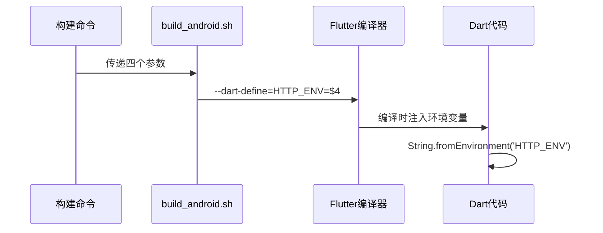
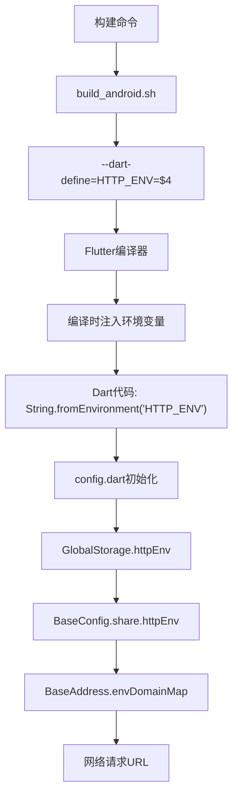
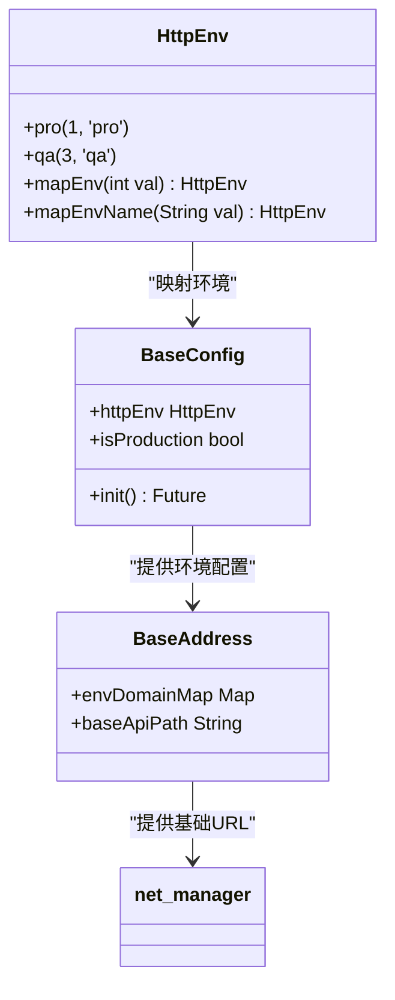

# 构建时环境注入

<cite>
**本文档引用的文件**   
- [build_android.sh](file://scripts/build_android.sh)
- [build_ios.sh](file://scripts/build_ios.sh)
- [env.dart](file://lib/config/env.dart)
- [config.dart](file://lib/config/config.dart)
- [address.dart](file://lib/config/address.dart)
- [main.dart](file://lib/main.dart)
- [net_manager.dart](file://lib/net/net_manager.dart)
</cite>

## 目录
1. [构建脚本参数解析](#构建脚本参数解析)
2. [Android环境注入机制](#android环境注入机制)
3. [iOS构建脚本现状分析](#ios构建脚本现状分析)
4. [环境变量数据流分析](#环境变量数据流分析)
5. [完整构建命令示例](#完整构建命令示例)
6. [改进建议](#改进建议)

## 构建脚本参数解析

构建脚本接收四个参数，分别代表不同的构建配置：

- **渠道**：指定应用的分发渠道，用于区分不同市场或合作伙伴的版本
- **分支**：指定从哪个代码分支进行构建，便于版本管理和特性追踪
- **build number**：构建编号，用于标识每次构建的唯一性，通常与CI/CD系统集成
- **http env**：HTTP环境标识，指定应用连接的后端服务环境（如qa或pro）

这些参数在构建过程中被注入到应用中，使同一代码库能够生成针对不同环境的构建产物。

**Section sources**
- [build_android.sh](file://scripts/build_android.sh#L2-L3)

## Android环境注入机制

Android构建脚本通过`--dart-define`参数将环境变量注入到Dart代码中。具体实现如下：

在`build_android.sh`脚本中，使用`--dart-define=HTTP_ENV=$4`将第四个参数（http env）作为编译时常量注入到应用中。这个值在编译时被嵌入到应用程序的二进制文件中，可以在运行时通过`String.fromEnvironment('HTTP_ENV')`访问。



**Diagram sources**
- [build_android.sh](file://scripts/build_android.sh#L26)
- [config.dart](file://lib/config/config.dart#L98-L100)

## iOS构建脚本现状分析

与Android构建脚本相比，iOS构建脚本存在环境注入缺失的问题：

在`build_ios.sh`脚本中，虽然使用了`--dart-define=BUILD_NUMBER=$1`注入构建编号，但缺少`--dart-define=HTTP_ENV`参数的注入。这导致iOS构建始终使用默认环境配置，无法根据构建参数灵活切换后端服务环境。

这种不一致性可能导致以下问题：
- QA测试时可能意外连接到生产环境
- 不同环境的测试覆盖不完整
- 发布流程中需要额外的手动配置步骤

**Section sources**
- [build_ios.sh](file://scripts/build_ios.sh#L43)
- [build_android.sh](file://scripts/build_android.sh#L26)

## 环境变量数据流分析

环境变量从构建脚本到应用运行时的完整数据流如下：



在应用启动时，`main.dart`中的`BaseConfig.share.init()`方法会读取编译时注入的环境变量，并通过`HttpEnv.mapEnvName`将其转换为相应的枚举值。这个值随后被存储在`GlobalStorage`中，并用于确定网络请求的目标地址。



**Diagram sources**
- [env.dart](file://lib/config/env.dart#L1-L23)
- [config.dart](file://lib/config/config.dart#L98-L104)
- [address.dart](file://lib/config/address.dart#L15-L18)
- [main.dart](file://lib/main.dart#L19)

## 完整构建命令示例

以下是为不同环境构建Android APK的完整命令示例：

```bash
# 构建QA环境的Android APK
./scripts/build_android.sh google main 123 qa

# 构建生产环境的Android APK
./scripts/build_android.sh google main 123 pro
```

执行上述命令后，生成的APK文件名将包含环境标识，如`oil_business_app_1.0.0_123_qa.apk`，便于区分不同环境的构建产物。

**Section sources**
- [build_android.sh](file://scripts/build_android.sh#L39)
- [build_android.sh](file://scripts/build_android.sh#L14-L54)

## 改进建议

针对当前构建系统的不足，提出以下改进建议：

1. **统一Android和iOS的环境注入机制**：
   修改`build_ios.sh`脚本，添加`--dart-define=HTTP_ENV=$2`参数（假设第二个参数为环境标识），确保iOS构建也能根据参数切换环境。

2. **增强环境验证**：
   在构建脚本中添加环境参数的验证逻辑，确保传入的环境值（qa/pro）是有效的，避免因拼写错误导致的构建问题。

3. **默认环境配置优化**：
   在`config.dart`中，将`String.fromEnvironment('HTTP_ENV', defaultValue: '1')`的默认值从'1'改为'qa'，更符合开发和测试的常规需求。

4. **文档化构建参数**：
   在项目README中详细记录构建脚本的使用方法和参数含义，降低新成员的上手成本。

5. **自动化测试环境切换**：
   在CI/CD流水线中配置不同的构建任务，自动为不同环境生成相应的构建产物，减少人为错误。

通过实施这些改进，可以建立更加健壮和一致的构建系统，确保Android和iOS平台在环境配置方面保持同步，提高开发效率和发布质量。

**Section sources**
- [build_ios.sh](file://scripts/build_ios.sh#L43)
- [config.dart](file://lib/config/config.dart#L99)
- [build_android.sh](file://scripts/build_android.sh#L26)