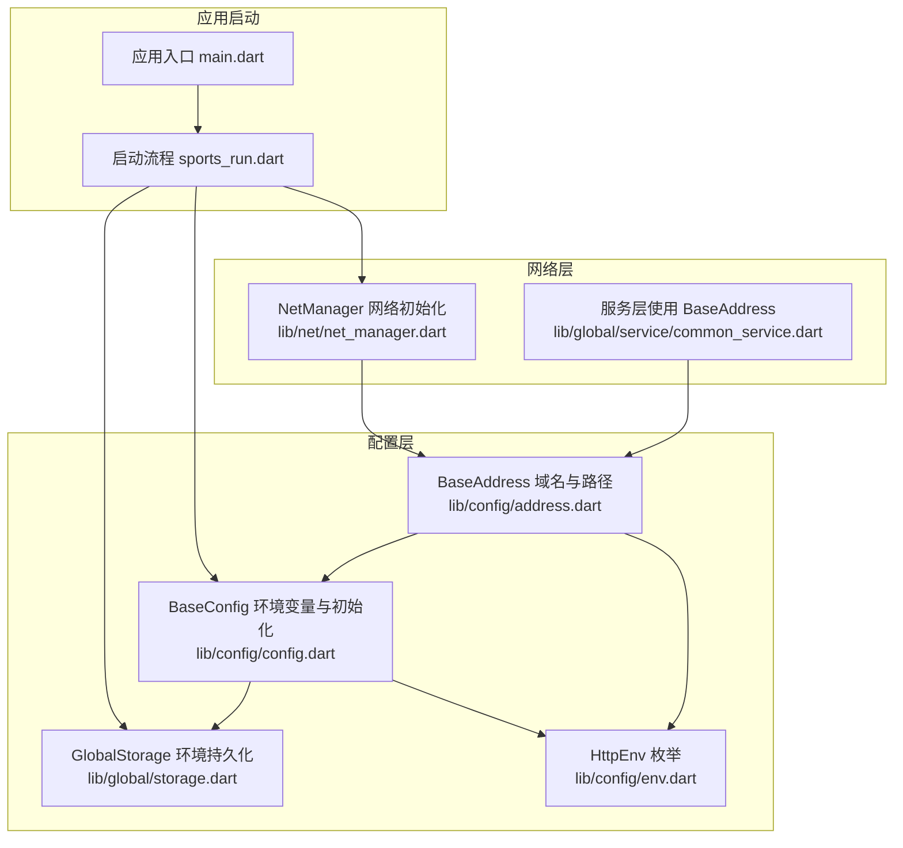
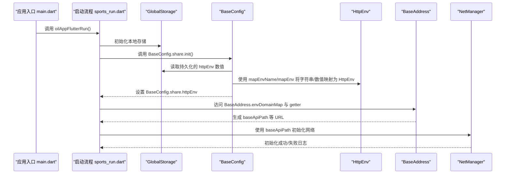
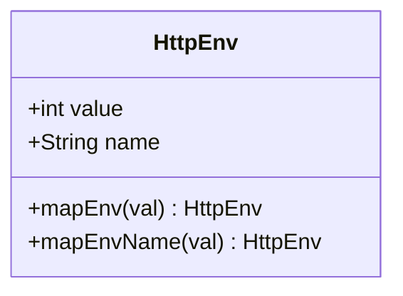
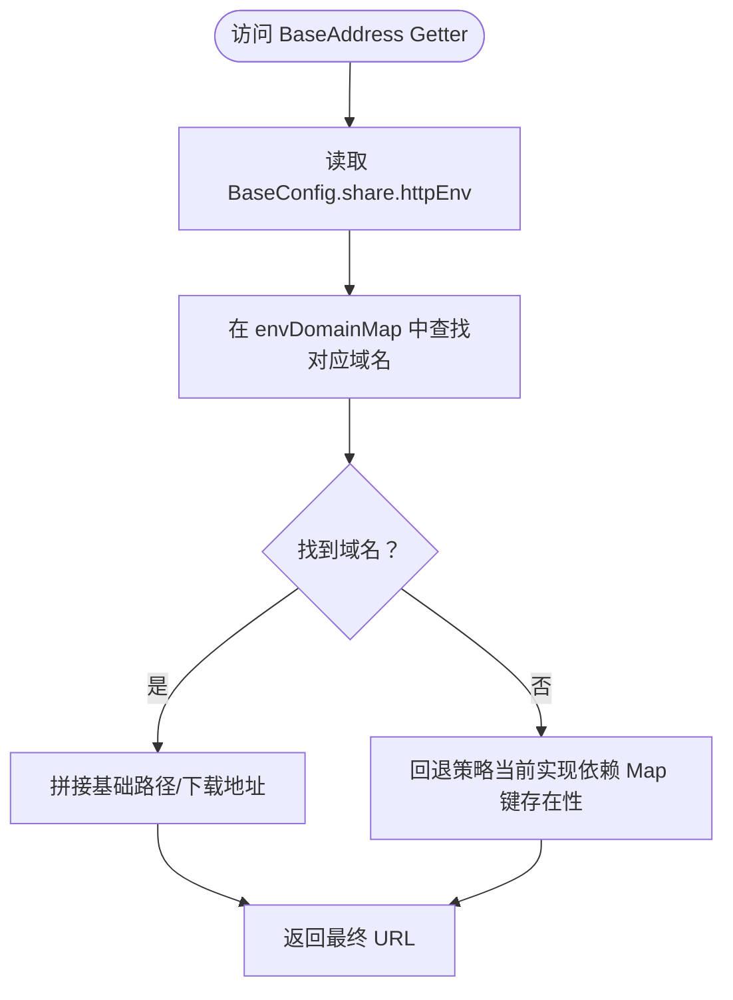
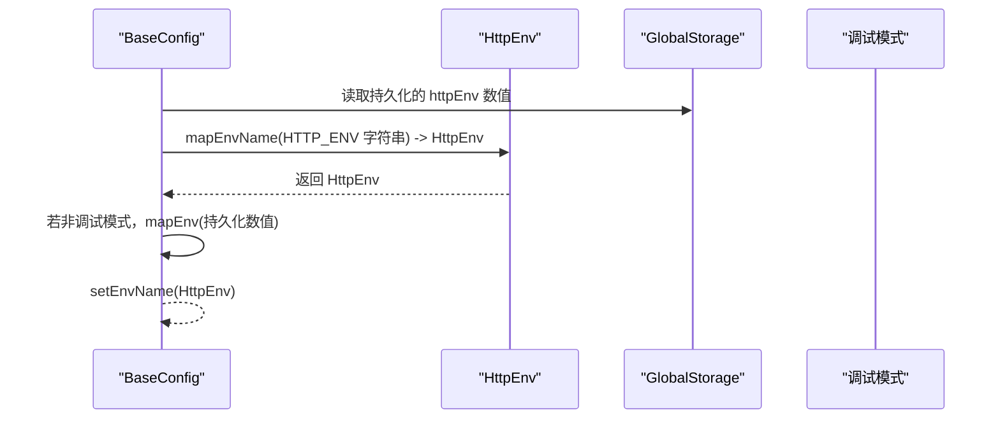
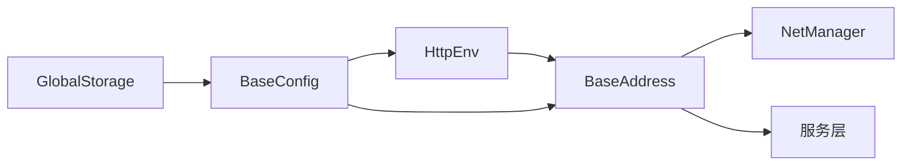

# 环境配置定义

<cite>
**本文引用的文件**
- [env.dart](file://lib/config/env.dart)
- [address.dart](file://lib/config/address.dart)
- [config.dart](file://lib/config/config.dart)
- [storage.dart](file://lib/global/storage.dart)
- [main.dart](file://lib/main.dart)
- [sports_run.dart](file://lib/sports_run.dart)
- [common_service.dart](file://lib/global/service/common_service.dart)
- [net_manager.dart](file://lib/net/net_manager.dart)
</cite>

## 目录
1. [简介](#简介)
2. [项目结构](#项目结构)
3. [核心组件](#核心组件)
4. [架构总览](#架构总览)
5. [组件详解](#组件详解)
6. [依赖关系分析](#依赖关系分析)
7. [性能与可维护性](#性能与可维护性)
8. [故障排查指南](#故障排查指南)
9. [结论](#结论)
10. [附录：新增环境步骤](#附录新增环境步骤)

## 简介
本文件系统化梳理项目中的“环境配置定义与运行时获取流程”。重点围绕以下目标展开：
- 解释 HttpEnv 枚举的定义与映射方法（mapEnv、mapEnvName）
- 说明 envDomainMap 如何将 HttpEnv 映射到具体域名，并通过 getter 动态生成 API 基础路径
- 结合 BaseConfig.share.httpEnv 的调用方式，完整描述运行时环境的获取与生效链路
- 提供新增环境（如 dev 或 staging）的步骤与类型安全实践建议

## 项目结构
与环境配置相关的核心文件位于 lib/config 与 lib/global 下，配合应用启动流程在 main.dart 与 sports_run.dart 中完成初始化。

图表来源
- [env.dart](file://lib/config/env.dart#L1-L24)
- [address.dart](file://lib/config/address.dart#L1-L41)
- [config.dart](file://lib/config/config.dart#L1-L108)
- [storage.dart](file://lib/global/storage.dart#L1-L34)
- [main.dart](file://lib/main.dart#L1-L22)
- [sports_run.dart](file://lib/sports_run.dart#L1-L117)
- [net_manager.dart](file://lib/net/net_manager.dart#L1-L88)
- [common_service.dart](file://lib/global/service/common_service.dart#L1-L25)

章节来源
- [main.dart](file://lib/main.dart#L1-L22)
- [sports_run.dart](file://lib/sports_run.dart#L1-L117)

## 核心组件
- HttpEnv 枚举：定义环境值与名称，并提供从数值/名称映射到枚举的静态方法
- BaseAddress：以 Map<HttpEnv, String> 维护域名映射，提供基于当前环境的 API 基础路径与下载地址等 getter
- BaseConfig：持有当前运行时环境变量 httpEnv，负责初始化逻辑与调试模式下的默认环境
- GlobalStorage：持久化存储 httpEnv 数值，作为后续初始化的输入源之一
- NetManager：在应用启动阶段使用 BaseAddress.baseApiPath 初始化网络客户端

章节来源
- [env.dart](file://lib/config/env.dart#L1-L24)
- [address.dart](file://lib/config/address.dart#L1-L41)
- [config.dart](file://lib/config/config.dart#L1-L108)
- [storage.dart](file://lib/global/storage.dart#L1-L34)
- [net_manager.dart](file://lib/net/net_manager.dart#L1-L88)

## 架构总览
下图展示从应用启动到网络初始化期间，环境配置的传递与使用路径。

图表来源
- [main.dart](file://lib/main.dart#L1-L22)
- [sports_run.dart](file://lib/sports_run.dart#L1-L117)
- [config.dart](file://lib/config/config.dart#L1-L108)
- [env.dart](file://lib/config/env.dart#L1-L24)
- [address.dart](file://lib/config/address.dart#L1-L41)
- [net_manager.dart](file://lib/net/net_manager.dart#L1-L88)

## 组件详解

### HttpEnv 枚举与映射方法
- 定义了 pro 与 qa 两个环境，分别包含 value 与 name 字段
- 提供 mapEnv(int)：按数值匹配 HttpEnv；若未找到，回退为 pro
- 提供 mapEnvName(String)：按名称匹配 HttpEnv；若未找到，回退为 pro

图表来源
- [env.dart](file://lib/config/env.dart#L1-L24)

章节来源
- [env.dart](file://lib/config/env.dart#L1-L24)

### BaseAddress：域名映射与动态路径生成
- envDomainMap：以 HttpEnv 为键，映射到对应域名字符串
- envBaseUrlPath、commonBaseHost、clientBaseUrl、appDownloadUrl 等 getter：均基于 BaseConfig.share.httpEnv 从 envDomainMap 中取值，并拼接出 API 基础路径或下载地址
- baseApiPath：当前直接返回 envBaseUrlPath，便于统一管理

图表来源
- [address.dart](file://lib/config/address.dart#L1-L41)
- [config.dart](file://lib/config/config.dart#L1-L108)

章节来源
- [address.dart](file://lib/config/address.dart#L1-L41)

### BaseConfig：运行时环境的确定与持久化
- 默认环境：在调试模式下默认为 HttpEnv.qa，否则为 HttpEnv.pro
- 初始化流程：
  - 从环境变量 HTTP_ENV 读取字符串值，经 mapEnvName 转换后写入 GlobalStorage.httpEnv
  - 若非调试模式，则从 GlobalStorage.httpEnv 读取数值，经 mapEnv 转换
  - 最终通过 setEnvName 将 HttpEnv 写入 BaseConfig.share.httpEnv
- 提供 isProduction 判断是否为正式环境

图表来源
- [config.dart](file://lib/config/config.dart#L1-L108)
- [env.dart](file://lib/config/env.dart#L1-L24)
- [storage.dart](file://lib/global/storage.dart#L1-L34)

章节来源
- [config.dart](file://lib/config/config.dart#L1-L108)
- [storage.dart](file://lib/global/storage.dart#L1-L34)

### 应用启动与网络初始化
- main.dart：应用启动时先初始化路由、存储与配置
- sports_run.dart：在准备阶段调用 BaseConfig.share.init()，随后使用 BaseAddress.baseApiPath 初始化 NetManager
- common_service.dart：在创建服务实例时传入 BaseAddress.commonBaseHost 作为 baseUrl

章节来源
- [main.dart](file://lib/main.dart#L1-L22)
- [sports_run.dart](file://lib/sports_run.dart#L1-L117)
- [net_manager.dart](file://lib/net/net_manager.dart#L1-L88)
- [common_service.dart](file://lib/global/service/common_service.dart#L1-L25)

## 依赖关系分析
- BaseAddress 依赖 BaseConfig.share.httpEnv 与 HttpEnv
- BaseConfig 依赖 HttpEnv、GlobalStorage 与环境变量 HTTP_ENV
- NetManager 依赖 BaseAddress.baseApiPath
- 服务层（如 CommonService）依赖 BaseAddress 的路径 getter

图表来源
- [env.dart](file://lib/config/env.dart#L1-L24)
- [address.dart](file://lib/config/address.dart#L1-L41)
- [config.dart](file://lib/config/config.dart#L1-L108)
- [storage.dart](file://lib/global/storage.dart#L1-L34)
- [net_manager.dart](file://lib/net/net_manager.dart#L1-L88)
- [common_service.dart](file://lib/global/service/common_service.dart#L1-L25)

章节来源
- [address.dart](file://lib/config/address.dart#L1-L41)
- [config.dart](file://lib/config/config.dart#L1-L108)
- [storage.dart](file://lib/global/storage.dart#L1-L34)
- [net_manager.dart](file://lib/net/net_manager.dart#L1-L88)
- [common_service.dart](file://lib/global/service/common_service.dart#L1-L25)

## 性能与可维护性
- 环境切换成本低：仅需修改 envDomainMap 与 HttpEnv 的映射，无需改动业务代码
- 类型安全：HttpEnv 为强类型枚举，mapEnv 与 mapEnvName 提供明确的回退策略
- 启动时一次性确定环境并缓存于 BaseConfig.share.httpEnv，避免重复解析
- 建议在新增环境时保持 HttpEnv.value 与 name 的唯一性，避免 mapEnv/mapEnvName 的歧义

[本节为通用建议，不直接分析具体文件]

## 故障排查指南
- HTTP_ENV 环境变量无效
  - 确认打包时注入了 HTTP_ENV 字符串值，且与 mapEnvName 的名称一致
  - 若未注入，默认值会触发 mapEnvName 的回退逻辑（回退至 pro）
- 域名映射缺失
  - 当前 BaseAddress.envBaseUrlPath 等 getter 依赖 envDomainMap[BaseConfig.share.httpEnv] 存在
  - 若新增环境但未在 envDomainMap 中配置，可能导致空字符串或异常
- 调试模式影响
  - 在调试模式下，BaseConfig 默认强制使用 HttpEnv.qa，不受持久化与环境变量影响
- 网络初始化失败
  - sports_run.dart 对 NetManager.init 做了异常捕获，失败时会记录日志并以离线模式继续启动

章节来源
- [config.dart](file://lib/config/config.dart#L1-L108)
- [address.dart](file://lib/config/address.dart#L1-L41)
- [sports_run.dart](file://lib/sports_run.dart#L1-L117)

## 结论
本项目的环境配置采用“强类型枚举 + 域名映射 + 启动时确定”的设计，具备良好的扩展性与可维护性。通过 HttpEnv 的 mapEnv 与 mapEnvName，以及 BaseAddress 的 envDomainMap 与 getter，实现了从环境变量到运行时 URL 的无缝衔接。新增环境只需在枚举与映射表中补充即可，业务层无需改动。

[本节为总结，不直接分析具体文件]

## 附录：新增环境步骤
以下步骤确保类型安全与最小改动：
1. 在 HttpEnv 中添加新值
   - 为新环境分配唯一的 value 与 name
   - 保证 mapEnv 与 mapEnvName 的回退策略符合预期（通常回退至 pro）
   - 参考路径：[env.dart](file://lib/config/env.dart#L1-L24)
2. 在 envDomainMap 中配置对应域名
   - 为新增的 HttpEnv 键添加域名映射
   - 确保所有 getter（如 envBaseUrlPath、commonBaseHost、clientBaseUrl、appDownloadUrl）均可通过该映射正确拼接
   - 参考路径：[address.dart](file://lib/config/address.dart#L1-L41)
3. 在 BaseConfig 初始化中支持新环境
   - 确保 HTTP_ENV 环境变量可接受新环境的名称字符串
   - 若需要，可在调试模式下调整默认行为（当前默认为 qa）
   - 参考路径：[config.dart](file://lib/config/config.dart#L1-L108)
4. 在应用启动流程中验证
   - 确认 main.dart 与 sports_run.dart 的初始化顺序正确，网络初始化使用 BaseAddress.baseApiPath
   - 参考路径：[main.dart](file://lib/main.dart#L1-L22)，[sports_run.dart](file://lib/sports_run.dart#L1-L117)
5. 业务层使用
   - 服务层通过 BaseAddress 的 getter 获取 baseUrl，无需感知环境细节
   - 参考路径：[common_service.dart](file://lib/global/service/common_service.dart#L1-L25)

章节来源
- [env.dart](file://lib/config/env.dart#L1-L24)
- [address.dart](file://lib/config/address.dart#L1-L41)
- [config.dart](file://lib/config/config.dart#L1-L108)
- [main.dart](file://lib/main.dart#L1-L22)
- [sports_run.dart](file://lib/sports_run.dart#L1-L117)
- [common_service.dart](file://lib/global/service/common_service.dart#L1-L25)