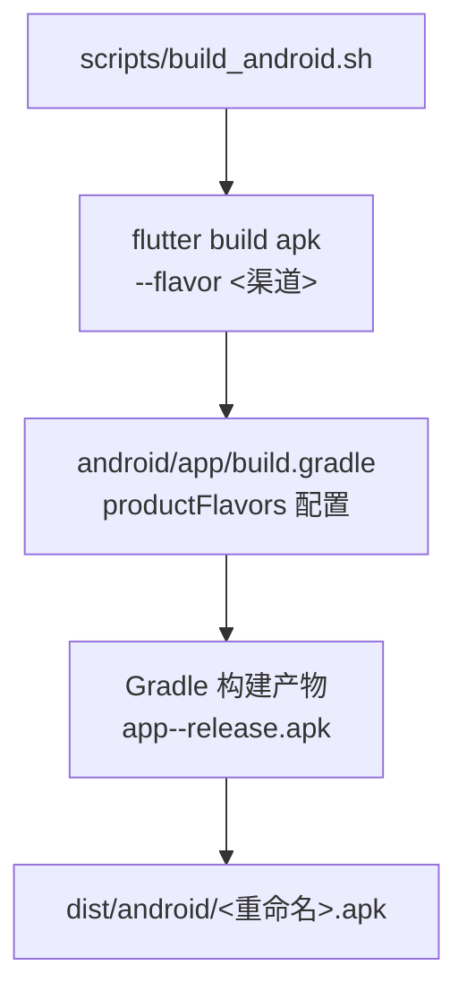
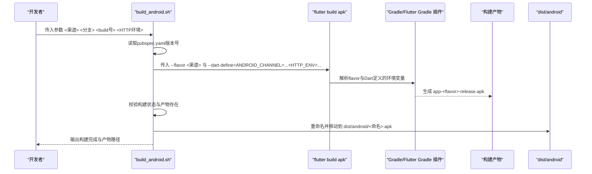
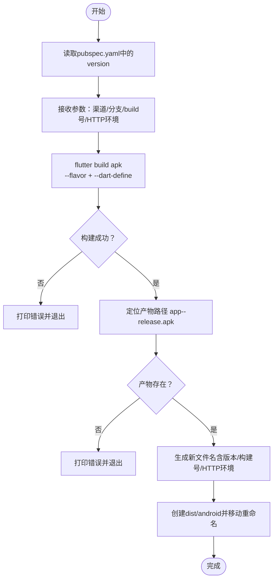
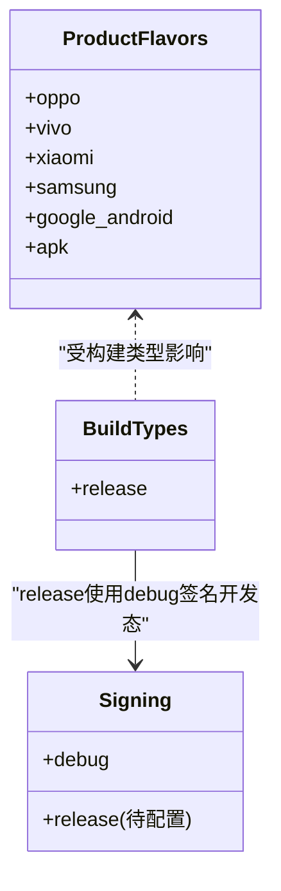
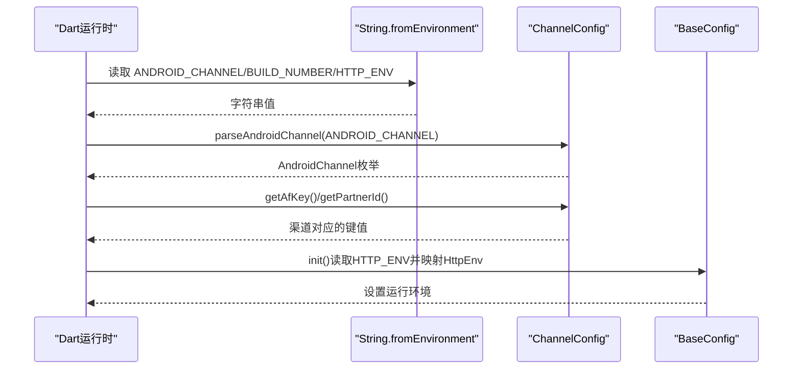
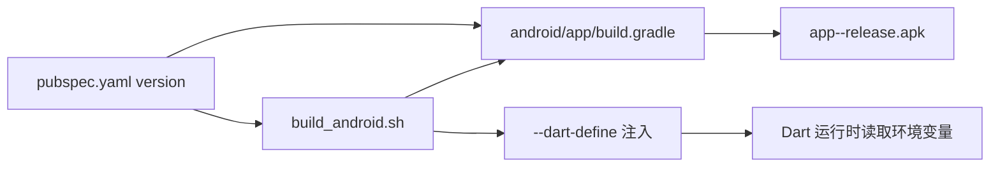

# Android构建流程

<cite>
**本文引用的文件列表**
- [build_android.sh](file://scripts/build_android.sh)
- [build.gradle（应用级）](file://android/app/build.gradle)
- [pubspec.yaml](file://pubspec.yaml)
- [env.dart](file://lib/config/env.dart)
- [channel.dart](file://lib/config/channel.dart)
- [config.dart](file://lib/config/config.dart)
- [local.properties](file://android/local.properties)
- [main.dart](file://lib/main.dart)
</cite>

## 目录
1. [简介](#简介)
2. [项目结构与入口](#项目结构与入口)
3. [核心组件](#核心组件)
4. [架构总览](#架构总览)
5. [详细组件分析](#详细组件分析)
6. [依赖关系分析](#依赖关系分析)
7. [性能与优化建议](#性能与优化建议)
8. [故障排查指南](#故障排查指南)
9. [结论](#结论)
10. [附录：命令与日志示例](#附录命令与日志示例)

## 简介
本文面向Android平台的构建流程，系统性解析以下内容：
- build_android.sh脚本如何通过flutter build apk命令进行APK构建，并说明flavor渠道管理、Dart定义的环境变量（ANDROID_CHANNEL、BUILD_NUMBER、HTTP_ENV）注入机制。
- android/app/build.gradle中productFlavors配置如何支持多渠道打包及不同flavor的实现机制。
- 构建产物的重命名与移动到dist/android目录的流程。
- 常见问题排查：签名配置错误、环境变量未生效、APK路径找不到等。
- 提供实际命令行调用示例与输出日志分析思路。

## 项目结构与入口
Android构建入口主要由两部分组成：
- 脚本入口：scripts/build_android.sh负责接收参数并执行flutter build apk。
- Gradle配置入口：android/app/build.gradle定义flavor维度与各渠道的applicationId后缀，决定多渠道打包策略。

图表来源
- [build_android.sh](file://scripts/build_android.sh#L1-L70)
- [build.gradle（应用级）](file://android/app/build.gradle#L34-L60)

章节来源
- [build_android.sh](file://scripts/build_android.sh#L1-L70)
- [build.gradle（应用级）](file://android/app/build.gradle#L34-L60)

## 核心组件
- 构建脚本：scripts/build_android.sh
  - 接收参数：渠道、分支、build号、HTTP环境。
  - 从pubspec.yaml读取版本号，用于产物命名。
  - 调用flutter build apk并传入--flavor与--dart-define。
  - 校验构建结果，定位产物路径，重命名为包含版本号、build号、HTTP环境的名称，并移动到dist/android目录。
- Gradle配置：android/app/build.gradle
  - 定义flavor维度“default”，并声明多个productFlavors（oppo、vivo、xiaomi、samsung、google_android、apk），每个flavor设置applicationIdSuffix。
  - release构建类型默认使用debug签名配置（开发调试友好，生产需替换为正式签名）。
- Dart侧环境变量注入与使用：
  - ANDROID_CHANNEL：通过const String.fromEnvironment读取，用于映射渠道键值（AFKey、PartnerId）。
  - BUILD_NUMBER：通过const String.fromEnvironment读取，用于版本信息展示。
  - HTTP_ENV：通过const String.fromEnvironment读取，用于运行时选择HTTP环境（qa/pro）。
- 版本来源：pubspec.yaml中的version字段被脚本读取作为APK命名的一部分。

章节来源
- [build_android.sh](file://scripts/build_android.sh#L1-L70)
- [build.gradle（应用级）](file://android/app/build.gradle#L34-L68)
- [pubspec.yaml](file://pubspec.yaml#L19-L20)
- [env.dart](file://lib/config/env.dart#L1-L24)
- [channel.dart](file://lib/config/channel.dart#L63-L85)
- [config.dart](file://lib/config/config.dart#L74-L107)

## 架构总览
下图展示了从命令行到最终产物的端到端流程，包括参数传递、Gradle渠道配置、Dart环境变量注入与产物重命名。

图表来源
- [build_android.sh](file://scripts/build_android.sh#L1-L70)
- [build.gradle（应用级）](file://android/app/build.gradle#L34-L60)
- [config.dart](file://lib/config/config.dart#L74-L107)

## 详细组件分析

### 组件A：构建脚本 build_android.sh 的工作流
- 参数与版本读取
  - 从pubspec.yaml提取version字段，作为APK命名的一部分。
- Flutter构建命令
  - 使用--flavor指定渠道，--dart-define注入ANDROID_CHANNEL、BUILD_NUMBER、HTTP_ENV。
  - 包含--no-tree-shake-icons等可选参数（按注释说明用途）。
- 产物校验与重命名
  - 校验上一条命令返回码，失败则退出。
  - 依据传入的分支、版本、build号、HTTP环境生成新文件名。
  - 将app-<flavor>-release.apk移动到dist/android目录并重命名为<新命名>.apk。
- 错误处理
  - 若构建失败或产物不存在，打印错误并退出。

图表来源
- [build_android.sh](file://scripts/build_android.sh#L1-L70)

章节来源
- [build_android.sh](file://scripts/build_android.sh#L1-L70)
- [pubspec.yaml](file://pubspec.yaml#L19-L20)

### 组件B：Gradle渠道配置与多渠道打包机制
- flavor维度与渠道
  - 定义flavorDimensions为"default"，productFlavors包含oppo、vivo、xiaomi、samsung、google_android、apk。
  - 每个flavor通过applicationIdSuffix区分，例如".oppo"、".vivo"等。
- 构建类型与签名
  - release构建类型当前使用debug签名配置，便于调试；生产应替换为正式签名配置。
- 影响范围
  - 不同flavor会生成不同的Application ID后缀，从而允许同一APK在同设备安装多个渠道版本（需不同签名或不同包名）。

图表来源
- [build.gradle（应用级）](file://android/app/build.gradle#L34-L68)

章节来源
- [build.gradle（应用级）](file://android/app/build.gradle#L34-L68)

### 组件C：Dart侧环境变量注入与使用
- ANDROID_CHANNEL
  - 通过const String.fromEnvironment读取，默认值为"apk"。
  - ChannelConfig.parseAndroidChannel根据该字符串映射到AndroidChannel枚举，进而获取对应渠道的AFKey与PartnerId。
- BUILD_NUMBER
  - 通过const String.fromEnvironment读取，用于显示build号。
- HTTP_ENV
  - 通过const String.fromEnvironment读取，默认值为"1"。
  - BaseConfig.init中将其映射为HttpEnv（qa/pro），并结合调试模式决定最终运行环境。

图表来源
- [channel.dart](file://lib/config/channel.dart#L63-L85)
- [config.dart](file://lib/config/config.dart#L74-L107)
- [env.dart](file://lib/config/env.dart#L1-L24)

章节来源
- [channel.dart](file://lib/config/channel.dart#L1-L86)
- [config.dart](file://lib/config/config.dart#L74-L107)
- [env.dart](file://lib/config/env.dart#L1-L24)

### 组件D：主入口与配置初始化
- main.dart中初始化全局配置，确保在应用启动时完成环境变量与版本信息的注入。
- BaseConfig.init会读取HTTP_ENV并设置运行环境，同时读取BUILD_NUMBER用于版本信息展示。

章节来源
- [main.dart](file://lib/main.dart#L1-L22)
- [config.dart](file://lib/config/config.dart#L74-L107)

## 依赖关系分析
- 脚本对Gradle配置的依赖
  - --flavor必须与android/app/build.gradle中的productFlavors一致，否则构建会失败。
- Gradle对Dart定义环境变量的依赖
  - 通过--dart-define传入的ANDROID_CHANNEL、BUILD_NUMBER、HTTP_ENV在Dart侧被读取，影响运行时行为。
- 版本来源
  - 脚本从pubspec.yaml读取version，用于APK命名；pubspec.yaml中的version也会影响Android的versionName/versionCode（由Flutter插件注入）。

图表来源
- [build_android.sh](file://scripts/build_android.sh#L1-L70)
- [build.gradle（应用级）](file://android/app/build.gradle#L34-L60)
- [pubspec.yaml](file://pubspec.yaml#L19-L20)

章节来源
- [build_android.sh](file://scripts/build_android.sh#L1-L70)
- [build.gradle（应用级）](file://android/app/build.gradle#L34-L60)
- [pubspec.yaml](file://pubspec.yaml#L19-L20)

## 性能与优化建议
- 构建参数建议
  - 在CI环境中启用--shrink与--obfuscate可减小包体并提升安全性（需配合ProGuard/R8规则）。
  - 使用--split-debug-info可分离调试符号，进一步降低APK体积。
- 渠道产物管理
  - 通过脚本统一命名与归档，便于后续分发与回溯。
- 签名与发布
  - 生产release构建务必替换为正式签名配置，避免调试签名限制导致无法发布。

[本节为通用建议，不直接分析具体文件]

## 故障排查指南
- 症状：签名配置错误或发布受限
  - 现象：构建成功但无法安装或发布失败。
  - 排查：确认release构建已配置正式签名，而非仅使用debug签名。
  - 参考位置：android/app/build.gradle中的release构建类型与signingConfig。
  章节来源
  - [build.gradle（应用级）](file://android/app/build.gradle#L62-L68)

- 症状：环境变量未生效（ANDROID_CHANNEL/BUILD_NUMBER/HTTP_ENV）
  - 现象：运行时渠道键值或HTTP环境不符合预期。
  - 排查：确认脚本调用时已传入--dart-define，并且Dart侧读取逻辑正常。
  - 参考位置：scripts/build_android.sh的--dart-define传参；Dart侧String.fromEnvironment读取。
  章节来源
  - [build_android.sh](file://scripts/build_android.sh#L24-L31)
  - [channel.dart](file://lib/config/channel.dart#L63-L85)
  - [config.dart](file://lib/config/config.dart#L74-L107)

- 症状：APK路径找不到
  - 现象：脚本报错提示产物不存在。
  - 排查：确认--flavor与android/app/build.gradle中的productFlavors一致；检查构建是否成功；确认产物路径拼写正确。
  - 参考位置：scripts/build_android.sh中定位app-<flavor>-release.apk的逻辑。
  章节来源
  - [build_android.sh](file://scripts/build_android.sh#L44-L53)
  - [build.gradle（应用级）](file://android/app/build.gradle#L34-L60)

- 症状：版本号未更新
  - 现象：APK命名未包含最新version。
  - 排查：确认pubspec.yaml的version字段已更新；脚本能正确读取该字段。
  章节来源
  - [pubspec.yaml](file://pubspec.yaml#L19-L20)
  - [build_android.sh](file://scripts/build_android.sh#L5-L7)

## 结论
- build_android.sh通过--flavor与--dart-define实现了灵活的渠道与环境变量注入，配合android/app/build.gradle的productFlavors，可快速完成多渠道打包。
- Dart侧通过String.fromEnvironment读取ANDROID_CHANNEL、BUILD_NUMBER、HTTP_ENV，使运行时行为与构建参数保持一致。
- 产物命名与归档流程清晰，便于后续分发与追溯。
- 建议在生产环境完善签名配置与构建参数，确保安全与合规。

[本节为总结，不直接分析具体文件]

## 附录：命令与日志示例
- 命令行调用示例
  - 示例：./scripts/build_android.sh oppo master 101 qa
  - 说明：构建oppo渠道，分支master，build号101，HTTP环境为qa。
- 预期输出日志要点
  - 显示从pubspec.yaml读取的version。
  - 显示渠道、分支、build号、HTTP环境参数。
  - 成功时输出“Built Android done.”与dist/android下的产物路径。
  - 失败时输出错误信息并退出。

章节来源
- [build_android.sh](file://scripts/build_android.sh#L1-L70)
- [pubspec.yaml](file://pubspec.yaml#L19-L20)