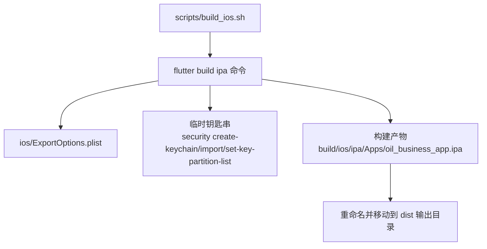
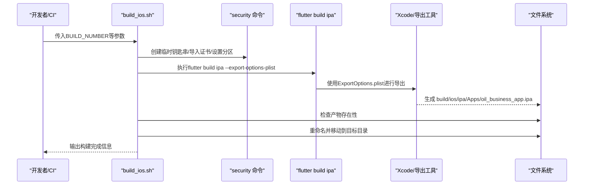
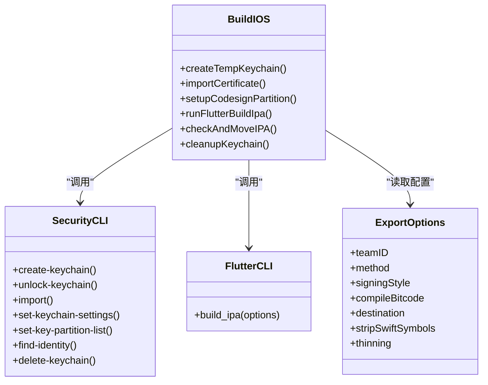
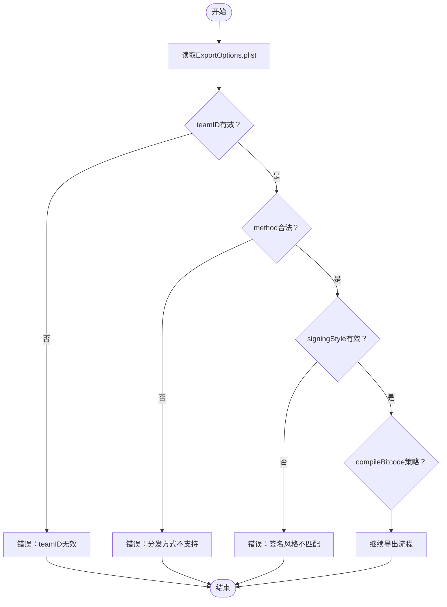
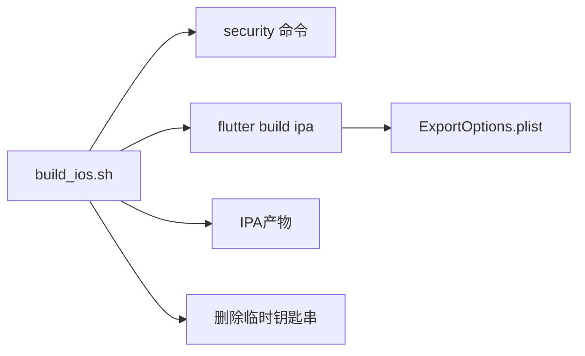

# iOS构建流程

<cite>
**本文引用的文件列表**
- [scripts/build_ios.sh](file://scripts/build_ios.sh)
- [ios/ExportOptions.plist](file://ios/ExportOptions.plist)
- [ios/Runner/Info.plist](file://ios/Runner/Info.plist)
- [ios/Flutter/AppFrameworkInfo.plist](file://ios/Flutter/AppFrameworkInfo.plist)
- [pubspec.yaml](file://pubspec.yaml)
- [ios/ci_scripts/ci_post_clone.sh](file://ios/ci_scripts/ci_post_clone.sh)
- [scripts/build_android.sh](file://scripts/build_android.sh)
</cite>

## 目录
1. [引言](#引言)
2. [项目结构](#项目结构)
3. [核心组件](#核心组件)
4. [架构总览](#架构总览)
5. [详细组件分析](#详细组件分析)
6. [依赖关系分析](#依赖关系分析)
7. [性能与可维护性考量](#性能与可维护性考量)
8. [故障排查指南](#故障排查指南)
9. [结论](#结论)

## 引言
本文面向iOS平台的自动化构建流程，围绕scripts/build_ios.sh脚本展开，系统说明其如何创建临时钥匙串、导入证书并执行flutter build ipa命令；重点阐述安全密钥链管理机制（通过security命令创建临时keychain、导入p12证书、配置codesign权限）；解释ExportOptions.plist在IPA导出过程中的作用（团队ID、分发方式、签名风格等）；分析构建产物的重命名与移动逻辑，并提供常见问题的解决方案。

## 项目结构
iOS构建相关的关键位置：
- 脚本入口：scripts/build_ios.sh
- 导出配置：ios/ExportOptions.plist
- 应用元数据：ios/Runner/Info.plist、ios/Flutter/AppFrameworkInfo.plist
- 版本来源：pubspec.yaml
- CI准备：ios/ci_scripts/ci_post_clone.sh
- 对比参考：scripts/build_android.sh（用于对比构建流程）

图表来源
- [scripts/build_ios.sh](file://scripts/build_ios.sh#L28-L71)
- [ios/ExportOptions.plist](file://ios/ExportOptions.plist#L1-L29)

章节来源
- [scripts/build_ios.sh](file://scripts/build_ios.sh#L28-L71)
- [pubspec.yaml](file://pubspec.yaml#L1-L40)

## 核心组件
- 构建脚本：负责创建临时钥匙串、导入证书、设置codesign权限、调用flutter build ipa、检查结果、重命名并移动IPA产物。
- 导出选项：ExportOptions.plist定义导出策略（分发方式、签名风格、团队ID、bitcode等）。
- 应用元数据：Info.plist与AppFrameworkInfo.plist提供应用标识、版本、最低系统版本等，影响签名与打包行为。
- 版本来源：pubspec.yaml提供版本号，脚本读取后用于日志输出与后续命名策略（脚本当前未直接使用该版本进行IPA命名，但可用于扩展）。

章节来源
- [scripts/build_ios.sh](file://scripts/build_ios.sh#L28-L71)
- [ios/ExportOptions.plist](file://ios/ExportOptions.plist#L1-L29)
- [ios/Runner/Info.plist](file://ios/Runner/Info.plist#L1-L78)
- [ios/Flutter/AppFrameworkInfo.plist](file://ios/Flutter/AppFrameworkInfo.plist#L1-L27)
- [pubspec.yaml](file://pubspec.yaml#L1-L40)

## 架构总览
下图展示iOS构建流程的端到端交互：脚本驱动security与flutter命令，结合ExportOptions.plist完成签名与导出，最终产出IPA并按规则重命名与移动。

图表来源
- [scripts/build_ios.sh](file://scripts/build_ios.sh#L28-L71)
- [ios/ExportOptions.plist](file://ios/ExportOptions.plist#L1-L29)

## 详细组件分析

### 组件A：构建脚本（build_ios.sh）
- 功能职责
  - 创建临时钥匙串并解锁
  - 导入p12证书并授予codesign权限
  - 调用flutter build ipa并传入ExportOptions.plist
  - 校验构建结果，重命名并移动IPA产物
  - 清理临时钥匙串

- 关键步骤与实现要点
  - 临时钥匙串生命周期：创建、加入用户域、设置无自动锁定、解锁、导入证书、设置分区列表、删除
  - 证书导入与识别：导入p12并指定codesign工具为受信任程序；通过find-identity自动解析签名身份
  - 导出配置：通过--export-options-plist传递ExportOptions.plist
  - 产物处理：检查产物是否存在，按参数决定下载名称，移动到固定输出目录

- 复杂度与性能
  - 时间复杂度主要由flutter build ipa主导，钥匙串操作为O(1)级
  - 临时钥匙串避免污染系统钥匙串，提升安全性与可重复性

- 错误处理
  - 构建失败时立即退出并提示
  - 产物不存在时提示并退出

- 可扩展点
  - 从pubspec.yaml读取版本号用于命名或日志
  - 支持多渠道/多变体的导出策略（结合ExportOptions.plist）

章节来源
- [scripts/build_ios.sh](file://scripts/build_ios.sh#L28-L71)

#### 类图：脚本内部流程与依赖

图表来源
- [scripts/build_ios.sh](file://scripts/build_ios.sh#L28-L71)
- [ios/ExportOptions.plist](file://ios/ExportOptions.plist#L1-L29)

### 组件B：ExportOptions.plist（导出配置）
- 作用概述
  - 控制flutter build ipa的导出行为，包括分发方式、签名风格、团队ID、bitcode编译策略、thinning策略、stripSwiftSymbols等
  - 影响最终IPA的签名方式与可安装性

- 关键字段说明
  - teamID：团队ID，用于匹配证书与描述文件
  - method：分发方式，如release-testing等
  - signingStyle：签名风格，automatic或manual
  - compileBitcode：是否编译bitcode
  - destination：导出目标类型
  - stripSwiftSymbols：剥离Swift符号
  - thinning：变体裁剪策略
  - manifest：iTunes Connect元数据（appURL/displayImageURL/fullSizeImageURL）

- 与脚本的关系
  - 脚本通过--export-options-plist参数将此配置注入flutter build ipa流程

章节来源
- [ios/ExportOptions.plist](file://ios/ExportOptions.plist#L1-L29)
- [scripts/build_ios.sh](file://scripts/build_ios.sh#L43-L43)

#### 流程图：导出配置对构建的影响

图表来源
- [ios/ExportOptions.plist](file://ios/ExportOptions.plist#L1-L29)

### 组件C：应用元数据（Info.plist与AppFrameworkInfo.plist）
- 作用概述
  - 提供应用标识、显示名称、版本号、最低系统版本等，影响签名与打包
  - Runner/Info.plist包含应用运行期配置（如URL Scheme、权限声明等）
  - Flutter/AppFrameworkInfo.plist定义Flutter框架的Bundle信息

- 与构建的关系
  - 版本字段（CFBundleShortVersionString/CFBundleVersion）与pubspec.yaml中的version配合使用
  - 最低系统版本（MinimumOSVersion）影响兼容性与导出策略

章节来源
- [ios/Runner/Info.plist](file://ios/Runner/Info.plist#L1-L78)
- [ios/Flutter/AppFrameworkInfo.plist](file://ios/Flutter/AppFrameworkInfo.plist#L1-L27)
- [pubspec.yaml](file://pubspec.yaml#L1-L40)

### 组件D：CI准备脚本（ci_post_clone.sh）
- 作用概述
  - 在CI环境中安装Flutter、预缓存iOS工件、安装CocoaPods并执行pod install，确保iOS构建前置条件就绪

- 与iOS构建的关系
  - 为build_ios.sh提供稳定的环境基础，减少本地差异导致的构建失败

章节来源
- [ios/ci_scripts/ci_post_clone.sh](file://ios/ci_scripts/ci_post_clone.sh#L1-L31)

## 依赖关系分析
- 脚本对系统工具的依赖
  - security：创建/导入/解锁/设置分区/删除临时钥匙串
  - flutter：执行build ipa并读取ExportOptions.plist
  - xcrun/xcodebuild：由flutter内部调用，依据ExportOptions.plist执行导出

- 脚本对配置文件的依赖
  - ExportOptions.plist：导出策略与签名控制
  - pubspec.yaml：版本号来源（当前脚本未直接使用，可用于扩展命名）

- 脚本对文件系统的依赖
  - 读取证书p12
  - 写入临时钥匙串
  - 读取构建产物并移动到输出目录

图表来源
- [scripts/build_ios.sh](file://scripts/build_ios.sh#L28-L71)
- [ios/ExportOptions.plist](file://ios/ExportOptions.plist#L1-L29)

章节来源
- [scripts/build_ios.sh](file://scripts/build_ios.sh#L28-L71)
- [ios/ExportOptions.plist](file://ios/ExportOptions.plist#L1-L29)

## 性能与可维护性考量
- 性能
  - 临时钥匙串避免了系统钥匙串的频繁交互，降低锁竞争风险
  - 导出前仅做必要配置，减少不必要的IO与网络请求
- 可维护性
  - 将导出策略集中于ExportOptions.plist，便于统一管理
  - 脚本职责单一，易于定位问题与扩展功能
- 建议
  - 将证书与密码从脚本硬编码迁移到安全的环境变量或密钥管理服务
  - 将版本号与命名策略从pubspec.yaml读取并用于IPA命名，增强一致性
  - 在CI中复用ci_post_clone.sh，确保环境一致

[本节为通用建议，无需特定文件引用]

## 故障排查指南
- 证书导入失败
  - 现象：security import报错或codesign无法找到证书
  - 排查要点
    - p12文件路径与密码是否正确
    - 临时钥匙串是否已创建并解锁
    - 是否指定了-T "/usr/bin/codesign"允许codesign使用该证书
  - 处理建议
    - 确认证书与私钥匹配，重新导入
    - 检查临时钥匙串设置与分区列表，确保非交互式shell可用codesign

- 密钥链权限错误
  - 现象：set-key-partition-list失败或codesign提示权限不足
  - 排查要点
    - 是否使用-D指定正确的证书身份
    - 密码是否与临时钥匙串一致
  - 处理建议
    - 重新执行set-key-partition-list，确保-D与find-identity返回的身份一致

- ExportOptions.plist配置不当
  - 现象：导出失败或签名不匹配
  - 排查要点
    - teamID是否与证书匹配
    - method与signingStyle是否符合当前证书类型
    - compileBitcode与thinning策略是否与期望一致
  - 处理建议
    - 校正teamID与method，确保与证书/描述文件一致

- 构建产物缺失
  - 现象：IPA文件不存在
  - 排查要点
    - flutter build ipa是否成功执行
    - 产物路径是否正确
  - 处理建议
    - 查看构建日志，确认导出阶段无异常
    - 校正产物路径或导出配置

- CI环境差异
  - 现象：本地可运行，CI失败
  - 排查要点
    - 是否执行了ci_post_clone.sh完成Flutter与CocoaPods准备
    - 是否设置了必要的环境变量（如证书、密码、teamID）
  - 处理建议
    - 在CI中先执行ci_post_clone.sh
    - 使用安全存储管理敏感信息

章节来源
- [scripts/build_ios.sh](file://scripts/build_ios.sh#L28-L71)
- [ios/ExportOptions.plist](file://ios/ExportOptions.plist#L1-L29)
- [ios/ci_scripts/ci_post_clone.sh](file://ios/ci_scripts/ci_post_clone.sh#L1-L31)

## 结论
本脚本通过临时钥匙串与证书导入、导出配置注入、产物重命名与移动，完整实现了iOS的自动化构建与分发准备。ExportOptions.plist作为导出策略的核心，直接影响签名与分发方式；而脚本对security命令的使用确保了非交互式环境下的codesign可用性。建议在生产环境中进一步强化安全与可维护性（证书与密码的安全存储、版本号与命名策略的统一、CI环境的标准化），以获得更稳定可靠的构建体验。