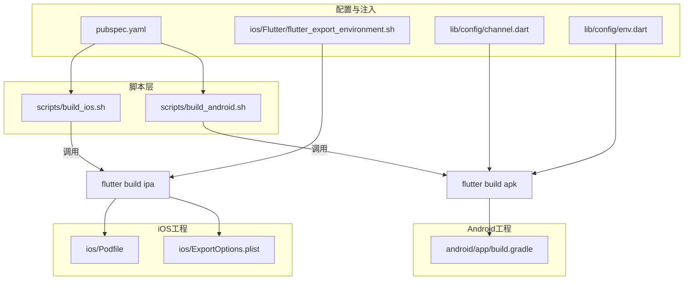
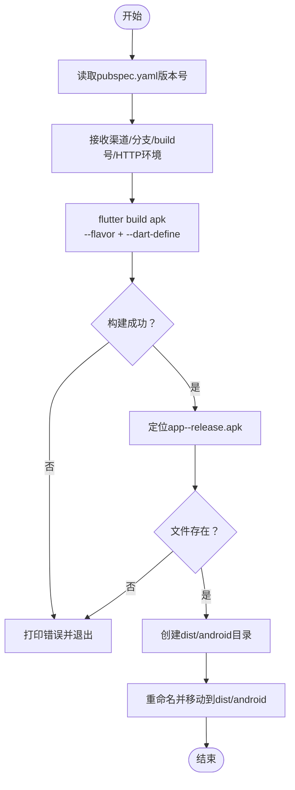
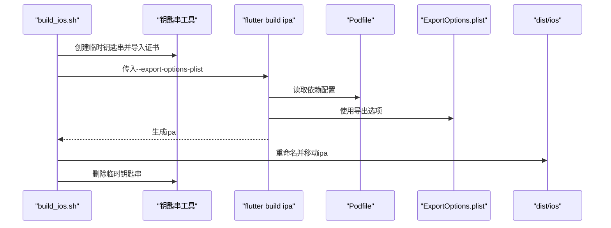
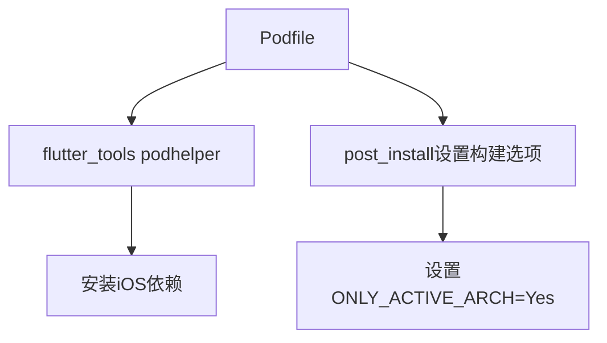
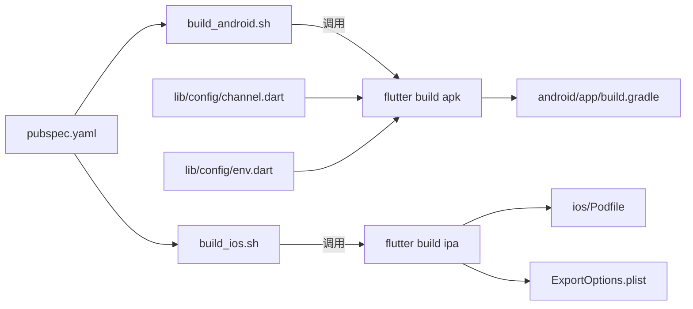

# 构建流程

<cite>
**本文引用的文件**
- [scripts/build_android.sh](file://scripts/build_android.sh)
- [scripts/build_ios.sh](file://scripts/build_ios.sh)
- [android/app/build.gradle](file://android/app/build.gradle)
- [ios/Podfile](file://ios/Podfile)
- [ios/ExportOptions.plist](file://ios/ExportOptions.plist)
- [pubspec.yaml](file://pubspec.yaml)
- [lib/config/channel.dart](file://lib/config/channel.dart)
- [lib/config/env.dart](file://lib/config/env.dart)
- [ios/Flutter/flutter_export_environment.sh](file://ios/Flutter/flutter_export_environment.sh)
</cite>

## 目录
1. [简介](#简介)
2. [项目结构](#项目结构)
3. [核心组件](#核心组件)
4. [架构总览](#架构总览)
5. [详细组件分析](#详细组件分析)
6. [依赖关系分析](#依赖关系分析)
7. [性能考虑](#性能考虑)
8. [故障排查指南](#故障排查指南)
9. [结论](#结论)

## 简介
本文件面向Android与iOS平台，系统化说明应用的自动化构建流程。重点覆盖：
- Android端：build_android.sh如何调用flutter build apk进行打包，包含flavor渠道选择、Dart环境变量注入（ANDROID_CHANNEL、BUILD_NUMBER、HTTP_ENV）、产物重命名与归档至dist/android目录。
- iOS端：build_ios.sh如何创建临时钥匙串、导入证书并执行flutter build ipa，同时结合ExportOptions.plist完成导出配置；说明android/app/build.gradle中的productFlavors多渠道配置与ios/Podfile的依赖管理结构。
- 常见问题与排障建议：签名配置错误、证书导入失败、依赖解析问题等。

## 项目结构
围绕构建相关的关键位置如下：
- 脚本层：scripts/build_android.sh、scripts/build_ios.sh
- Android工程：android/app/build.gradle（渠道flavor配置）
- iOS工程：ios/Podfile（依赖管理）、ios/ExportOptions.plist（导出配置）
- 配置与运行时注入：pubspec.yaml（脚本入口）、lib/config/channel.dart与lib/config/env.dart（运行时读取Dart环境变量）



图表来源
- [scripts/build_android.sh](file://scripts/build_android.sh#L1-L70)
- [scripts/build_ios.sh](file://scripts/build_ios.sh#L1-L72)
- [android/app/build.gradle](file://android/app/build.gradle#L1-L74)
- [ios/Podfile](file://ios/Podfile#L1-L49)
- [ios/ExportOptions.plist](file://ios/ExportOptions.plist#L1-L30)
- [pubspec.yaml](file://pubspec.yaml#L24-L33)
- [lib/config/channel.dart](file://lib/config/channel.dart#L1-L86)
- [lib/config/env.dart](file://lib/config/env.dart#L1-L24)
- [ios/Flutter/flutter_export_environment.sh](file://ios/Flutter/flutter_export_environment.sh#L1-L13)

章节来源
- [scripts/build_android.sh](file://scripts/build_android.sh#L1-L70)
- [scripts/build_ios.sh](file://scripts/build_ios.sh#L1-L72)
- [android/app/build.gradle](file://android/app/build.gradle#L1-L74)
- [ios/Podfile](file://ios/Podfile#L1-L49)
- [ios/ExportOptions.plist](file://ios/ExportOptions.plist#L1-L30)
- [pubspec.yaml](file://pubspec.yaml#L24-L33)
- [lib/config/channel.dart](file://lib/config/channel.dart#L1-L86)
- [lib/config/env.dart](file://lib/config/env.dart#L1-L24)
- [ios/Flutter/flutter_export_environment.sh](file://ios/Flutter/flutter_export_environment.sh#L1-L13)

## 核心组件
- Android构建脚本：负责读取版本、执行flutter build apk、注入Dart环境变量、重命名并移动APK产物。
- iOS构建脚本：负责创建临时钥匙串、导入证书、执行flutter build ipa并按条件重命名IPA产物。
- Android渠道配置：在build.gradle中通过productFlavors定义多渠道，配合applicationIdSuffix实现差异化包名。
- iOS依赖管理：Podfile使用flutter_tools提供的podhelper，自动安装iOS依赖，并在post_install中设置构建选项。
- 导出配置：ExportOptions.plist控制导出方式、签名风格、bitcode编译等。
- 运行时注入：pubspec.yaml提供脚本入口；lib/config/channel.dart与lib/config/env.dart在运行时读取Dart环境变量（如ANDROID_CHANNEL、HTTP_ENV）。

章节来源
- [scripts/build_android.sh](file://scripts/build_android.sh#L1-L70)
- [scripts/build_ios.sh](file://scripts/build_ios.sh#L1-L72)
- [android/app/build.gradle](file://android/app/build.gradle#L34-L60)
- [ios/Podfile](file://ios/Podfile#L1-L49)
- [ios/ExportOptions.plist](file://ios/ExportOptions.plist#L1-L30)
- [pubspec.yaml](file://pubspec.yaml#L24-L33)
- [lib/config/channel.dart](file://lib/config/channel.dart#L63-L85)
- [lib/config/env.dart](file://lib/config/env.dart#L1-L24)

## 架构总览
下图展示从脚本到最终产物的整体流程与关键交互点。

```mermaid
sequenceDiagram
participant Dev as "开发者"
participant S_A as "build_android.sh"
participant S_I as "build_ios.sh"
participant FLUT_A as "flutter build apk"
participant FLUT_I as "flutter build ipa"
participant GRADLE as "android/app/build.gradle"
participant POD as "ios/Podfile"
participant OPT as "ExportOptions.plist"
participant DIST as "dist/android / dist/ios"
Dev->>S_A : 传入渠道/分支/build号/HTTP环境
S_A->>S_A : 读取pubspec.yaml版本
S_A->>FLUT_A : 传入--flavor与--dart-define
FLUT_A->>GRADLE : 应用productFlavors与构建类型
FLUT_A-->>S_A : 生成app-<flavor>-release.apk
S_A->>DIST : 重命名并移动到dist/android
Dev->>S_I : 传入build号可选测试标识
S_I->>S_I : 创建临时钥匙串并导入证书
S_I->>FLUT_I : 传入--export-options-plist
FLUT_I->>POD : 读取依赖配置
FLUT_I->>OPT : 使用导出选项
FLUT_I-->>S_I : 生成ipa
S_I->>DIST : 重命名并移动到dist/ios
```

图表来源
- [scripts/build_android.sh](file://scripts/build_android.sh#L1-L70)
- [scripts/build_ios.sh](file://scripts/build_ios.sh#L1-L72)
- [android/app/build.gradle](file://android/app/build.gradle#L34-L60)
- [ios/Podfile](file://ios/Podfile#L1-L49)
- [ios/ExportOptions.plist](file://ios/ExportOptions.plist#L1-L30)

## 详细组件分析

### Android构建流程（build_android.sh）
- 输入参数与版本读取
  - 通过pubspec.yaml提取版本号，用于后续产物命名。
- 渠道与Dart变量注入
  - 使用--flavor指定渠道（对应android/app/build.gradle中的productFlavors）。
  - 通过--dart-define注入ANDROID_CHANNEL、BUILD_NUMBER、HTTP_ENV。
- 构建与产物处理
  - 成功后定位app-<flavor>-release.apk，创建dist/android目录并移动重命名为包含版本、build号、HTTP环境的名称。
- 错误处理
  - 若flutter build失败或APK未找到，脚本会打印错误并退出。



图表来源
- [scripts/build_android.sh](file://scripts/build_android.sh#L1-L70)

章节来源
- [scripts/build_android.sh](file://scripts/build_android.sh#L1-L70)
- [pubspec.yaml](file://pubspec.yaml#L19-L20)
- [android/app/build.gradle](file://android/app/build.gradle#L34-L60)
- [lib/config/channel.dart](file://lib/config/channel.dart#L63-L85)
- [lib/config/env.dart](file://lib/config/env.dart#L1-L24)

### iOS构建流程（build_ios.sh）
- 钥匙串与证书准备
  - 创建临时钥匙串，解锁并导入p12证书，设置分区列表以允许非交互式codesign。
- 导出配置
  - 通过--export-options-plist指向ExportOptions.plist，控制导出方式、签名风格、bitcode编译等。
- 构建与产物处理
  - 成功后定位ipa，根据是否提供第二参数决定下载文件名，移动到目标目录。
- 清理
  - 删除临时钥匙串。



图表来源
- [scripts/build_ios.sh](file://scripts/build_ios.sh#L1-L72)
- [ios/Podfile](file://ios/Podfile#L1-L49)
- [ios/ExportOptions.plist](file://ios/ExportOptions.plist#L1-L30)

章节来源
- [scripts/build_ios.sh](file://scripts/build_ios.sh#L1-L72)
- [ios/ExportOptions.plist](file://ios/ExportOptions.plist#L1-L30)
- [ios/Podfile](file://ios/Podfile#L1-L49)

### Android渠道配置（android/app/build.gradle）
- 多维度渠道
  - 通过flavorDimensions与productFlavors定义多个渠道（如oppo、vivo、xiaomi、samsung、google_android、apk），每个渠道设置applicationIdSuffix以区分包名。
- 构建类型
  - release构建默认使用debug签名配置，便于本地调试；生产发布应替换为正式签名配置。

```mermaid
classDiagram
class AndroidAppGradle {
+flavorDimensions "default"
+productFlavors {
+oppo
+vivo
+xiaomi
+samsung
+google_android
+apk
}
+buildTypes {
+release
}
}
AndroidAppGradle --> "使用" AndroidAppGradle : "applicationIdSuffix"
```

图表来源
- [android/app/build.gradle](file://android/app/build.gradle#L34-L60)

章节来源
- [android/app/build.gradle](file://android/app/build.gradle#L34-L60)

### iOS依赖管理（ios/Podfile）
- 依赖安装
  - 使用flutter_tools提供的podhelper，自动安装iOS依赖。
- 构建设置
  - 在post_install中为各target设置ONLY_ACTIVE_ARCH为YES，减少构建时间与潜在冲突。
- 配置一致性
  - 通过include Generated.xcconfig确保Xcode构建参数一致。



图表来源
- [ios/Podfile](file://ios/Podfile#L1-L49)

章节来源
- [ios/Podfile](file://ios/Podfile#L1-L49)

### 导出配置（ios/ExportOptions.plist）
- 关键项
  - compileBitcode、method、signingStyle、teamID、stripSwiftSymbols、thinning等，影响导出方式与打包行为。
- 注意事项
  - method需与实际导出策略匹配；teamID需与导入证书的团队一致；signingStyle为automatic时需确保钥匙串中存在有效证书。

章节来源
- [ios/ExportOptions.plist](file://ios/ExportOptions.plist#L1-L30)

### 运行时注入与渠道映射
- Android渠道注入
  - 通过--dart-define注入ANDROID_CHANNEL，运行时在lib/config/channel.dart中读取该值并映射到具体渠道枚举，从而切换不同渠道的参数（如AFKey、PartnerId）。
- HTTP环境注入
  - 通过--dart-define注入HTTP_ENV，运行时在lib/config/env.dart中解析为HttpEnv枚举，用于切换接口地址等。

章节来源
- [scripts/build_android.sh](file://scripts/build_android.sh#L24-L33)
- [lib/config/channel.dart](file://lib/config/channel.dart#L63-L85)
- [lib/config/env.dart](file://lib/config/env.dart#L1-L24)

## 依赖关系分析
- 脚本与构建命令
  - build_android.sh与build_ios.sh分别调用flutter build apk与flutter build ipa。
- Android侧
  - flutter build apk读取android/app/build.gradle的productFlavors与构建类型，最终生成app-<flavor>-release.apk。
- iOS侧
  - flutter build ipa读取ios/Podfile与ExportOptions.plist，生成ipa。
- 运行时注入
  - pubspec.yaml提供脚本入口；lib/config/channel.dart与lib/config/env.dart在运行时读取Dart环境变量。



图表来源
- [scripts/build_android.sh](file://scripts/build_android.sh#L1-L70)
- [scripts/build_ios.sh](file://scripts/build_ios.sh#L1-L72)
- [android/app/build.gradle](file://android/app/build.gradle#L34-L60)
- [ios/Podfile](file://ios/Podfile#L1-L49)
- [ios/ExportOptions.plist](file://ios/ExportOptions.plist#L1-L30)
- [pubspec.yaml](file://pubspec.yaml#L24-L33)
- [lib/config/channel.dart](file://lib/config/channel.dart#L63-L85)
- [lib/config/env.dart](file://lib/config/env.dart#L1-L24)

章节来源
- [scripts/build_android.sh](file://scripts/build_android.sh#L1-L70)
- [scripts/build_ios.sh](file://scripts/build_ios.sh#L1-L72)
- [android/app/build.gradle](file://android/app/build.gradle#L34-L60)
- [ios/Podfile](file://ios/Podfile#L1-L49)
- [ios/ExportOptions.plist](file://ios/ExportOptions.plist#L1-L30)
- [pubspec.yaml](file://pubspec.yaml#L24-L33)
- [lib/config/channel.dart](file://lib/config/channel.dart#L63-L85)
- [lib/config/env.dart](file://lib/config/env.dart#L1-L24)

## 性能考虑
- Android
  - 使用--no-tree-shake-icons避免图标裁剪导致的额外处理开销；可按需开启--shrink/--obfuscate以减小体积，但需平衡构建时间与调试信息分离（--split-debug-info）。
- iOS
  - post_install中设置ONLY_ACTIVE_ARCH=Yes有助于缩短构建时间；导出时stripSwiftSymbols可优化包体大小。
- 通用
  - 保持依赖精简，避免不必要的第三方库；合理使用Dart环境变量减少运行时分支判断成本。

## 故障排查指南
- Android
  - 渠道不匹配：确认--flavor与android/app/build.gradle中的productFlavors一致。
  - 产物缺失：检查app-<flavor>-release.apk是否存在；若不存在，查看flutter build apk输出日志定位失败原因。
  - 版本号不一致：pubspec.yaml与构建参数不一致会导致命名混乱，建议统一从pubspec.yaml读取版本号。
- iOS
  - 钥匙串与证书
    - 临时钥匙串创建失败：检查密码与路径权限；确认security命令可用。
    - 证书导入失败：核对p12文件路径、密码与证书有效性；确保导入时包含codesigning权限。
    - 证书不可用：检查teamID与证书团队是否一致；必要时重新登录Apple Developer账户并更新证书。
  - 导出配置
    - ExportOptions.plist的method与signingStyle需与实际导出策略匹配；compileBitcode与stripSwiftSymbols会影响包体与兼容性。
  - 依赖解析
    - CocoaPods未安装或版本不匹配：先执行flutter pub get，再执行pod install；若报错，清理DerivedData并重试。
- 通用
  - 环境变量
    - Android：ANDROID_CHANNEL、BUILD_NUMBER、HTTP_ENV需正确传入；运行时可通过const String.fromEnvironment读取。
    - iOS：导出环境变量由flutter_export_environment.sh提供，确保Xcode构建时生效。

章节来源
- [scripts/build_android.sh](file://scripts/build_android.sh#L24-L53)
- [scripts/build_ios.sh](file://scripts/build_ios.sh#L35-L66)
- [android/app/build.gradle](file://android/app/build.gradle#L34-L60)
- [ios/Podfile](file://ios/Podfile#L1-L49)
- [ios/ExportOptions.plist](file://ios/ExportOptions.plist#L1-L30)
- [ios/Flutter/flutter_export_environment.sh](file://ios/Flutter/flutter_export_environment.sh#L1-L13)
- [lib/config/channel.dart](file://lib/config/channel.dart#L63-L85)
- [lib/config/env.dart](file://lib/config/env.dart#L1-L24)

## 结论
本项目通过脚本化的方式实现了Android与iOS的自动化构建，借助Flutter的渠道flavor与Dart环境变量注入，能够灵活地支持多渠道打包与环境切换。Android端通过productFlavors实现差异化包名，iOS端通过临时钥匙串与ExportOptions.plist完成签名与导出配置。建议在生产环境中完善签名配置与依赖管理，确保构建稳定性与安全性。