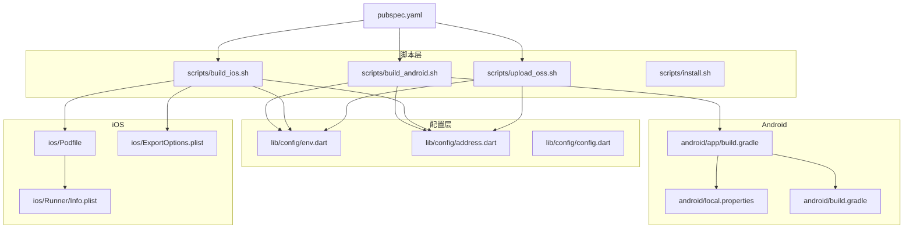
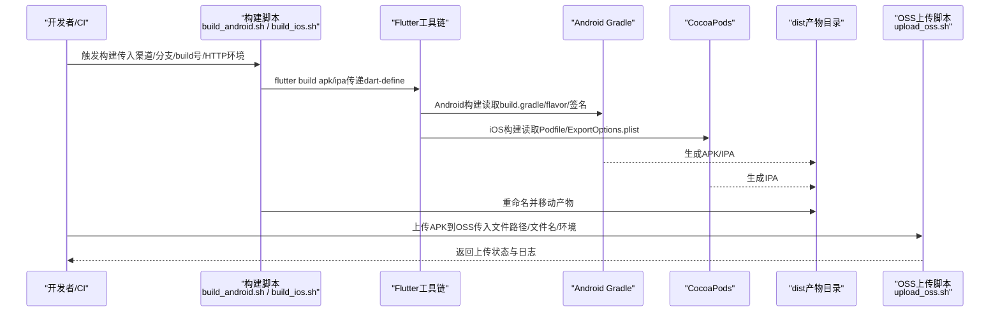
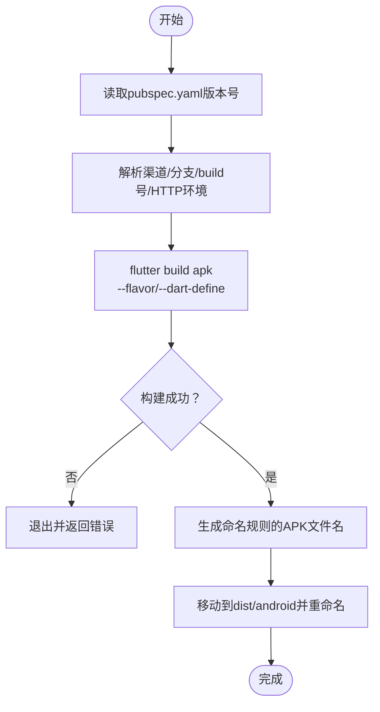
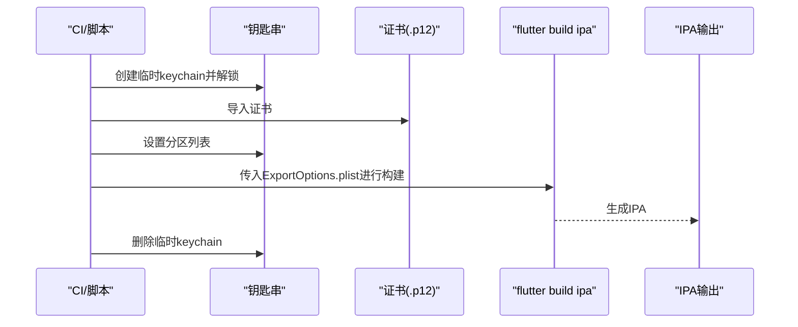
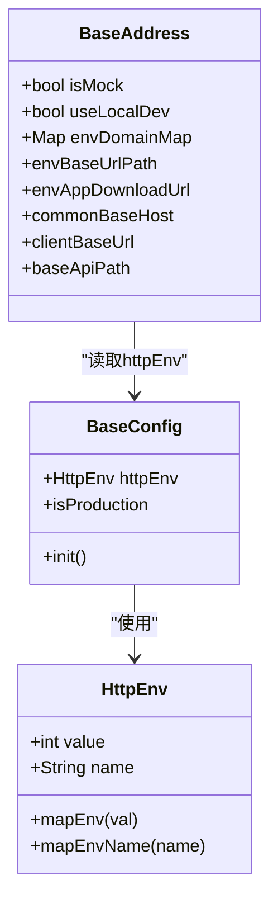
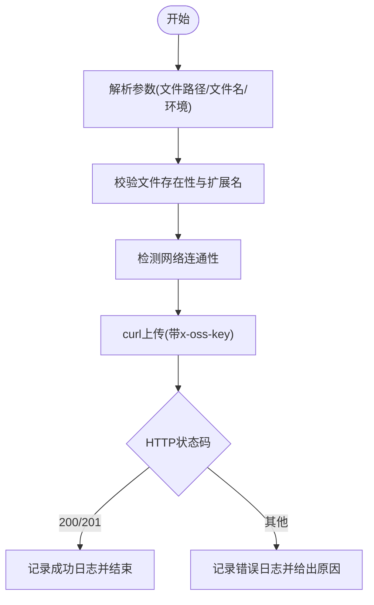
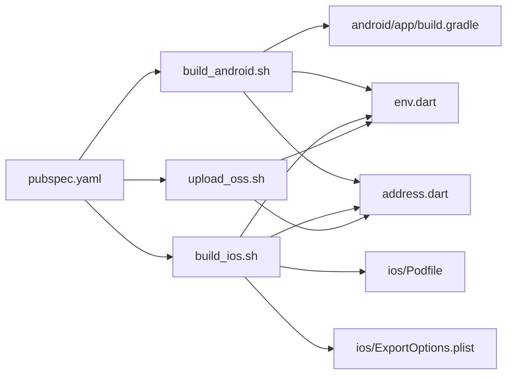

# 部署指南

<cite>
**本文引用的文件**
- [scripts/build_android.sh](file://scripts/build_android.sh)
- [scripts/build_ios.sh](file://scripts/build_ios.sh)
- [scripts/upload_oss.sh](file://scripts/upload_oss.sh)
- [lib/config/env.dart](file://lib/config/env.dart)
- [lib/config/address.dart](file://lib/config/address.dart)
- [lib/config/config.dart](file://lib/config/config.dart)
- [android/app/build.gradle](file://android/app/build.gradle)
- [android/local.properties](file://android/local.properties)
- [android/build.gradle](file://android/build.gradle)
- [ios/Podfile](file://ios/Podfile)
- [ios/ExportOptions.plist](file://ios/ExportOptions.plist)
- [ios/Runner/Info.plist](file://ios/Runner/Info.plist)
- [pubspec.yaml](file://pubspec.yaml)
- [scripts/install.sh](file://scripts/install.sh)
</cite>

## 目录
1. [简介](#简介)
2. [项目结构](#项目结构)
3. [核心组件](#核心组件)
4. [架构总览](#架构总览)
5. [详细组件分析](#详细组件分析)
6. [依赖关系分析](#依赖关系分析)
7. [性能与优化建议](#性能与优化建议)
8. [故障排查指南](#故障排查指南)
9. [结论](#结论)
10. [附录](#附录)

## 简介
本部署指南面向发布团队与CI/CD工程师，提供从构建到分发的完整操作手册。内容覆盖：
- 使用scripts目录下的脚本构建Android APK与iOS IPA，并说明版本号管理、代码混淆（R8/ProGuard）、签名配置等关键步骤
- 多环境管理策略：通过env.dart与address.dart配置开发、测试、生产环境的API地址
- 将构建产物上传至分发平台（OSS）的流程，参考upload_oss.sh脚本
- 平台特定配置：Android的build.gradle签名配置与iOS的Podfile依赖管理
- 应用商店（Google Play、App Store）发布的检查清单

## 项目结构
围绕部署相关的关键目录与文件如下：
- scripts：包含构建与上传脚本，负责打包与分发
- lib/config：包含环境枚举、地址映射与全局配置
- android：Android工程配置，含签名、渠道、Gradle仓库等
- ios：iOS工程配置，含Pod依赖、导出选项、Info.plist
- pubspec.yaml：项目元数据与脚本命令入口

图表来源
- [scripts/build_android.sh](file://scripts/build_android.sh#L1-L70)
- [scripts/build_ios.sh](file://scripts/build_ios.sh#L1-L72)
- [scripts/upload_oss.sh](file://scripts/upload_oss.sh#L1-L211)
- [lib/config/env.dart](file://lib/config/env.dart#L1-L24)
- [lib/config/address.dart](file://lib/config/address.dart#L1-L41)
- [lib/config/config.dart](file://lib/config/config.dart#L1-L108)
- [android/app/build.gradle](file://android/app/build.gradle#L1-L74)
- [android/local.properties](file://android/local.properties#L1-L4)
- [android/build.gradle](file://android/build.gradle#L1-L44)
- [ios/Podfile](file://ios/Podfile#L1-L49)
- [ios/ExportOptions.plist](file://ios/ExportOptions.plist#L1-L30)
- [ios/Runner/Info.plist](file://ios/Runner/Info.plist#L1-L78)
- [pubspec.yaml](file://pubspec.yaml#L1-L211)

章节来源
- [pubspec.yaml](file://pubspec.yaml#L1-L211)

## 核心组件
- 构建脚本
  - Android：scripts/build_android.sh，负责读取版本号、执行flutter打包、重命名与移动产物
  - iOS：scripts/build_ios.sh，负责临时钥匙串导入、证书签名、导出IPA并重命名
- 分发脚本：scripts/upload_oss.sh，负责上传APK到OSS并记录日志
- 环境配置：lib/config/env.dart、lib/config/address.dart、lib/config/config.dart，统一管理HTTP环境与API地址
- 平台配置
  - Android：android/app/build.gradle（渠道、签名、ABI过滤）、android/local.properties（本地SDK路径与默认版本名）
  - iOS：ios/Podfile（依赖安装与构建设置）、ios/ExportOptions.plist（导出配置）、ios/Runner/Info.plist（Bundle信息）

章节来源
- [scripts/build_android.sh](file://scripts/build_android.sh#L1-L70)
- [scripts/build_ios.sh](file://scripts/build_ios.sh#L1-L72)
- [scripts/upload_oss.sh](file://scripts/upload_oss.sh#L1-L211)
- [lib/config/env.dart](file://lib/config/env.dart#L1-L24)
- [lib/config/address.dart](file://lib/config/address.dart#L1-L41)
- [lib/config/config.dart](file://lib/config/config.dart#L1-L108)
- [android/app/build.gradle](file://android/app/build.gradle#L1-L74)
- [android/local.properties](file://android/local.properties#L1-L4)
- [ios/Podfile](file://ios/Podfile#L1-L49)
- [ios/ExportOptions.plist](file://ios/ExportOptions.plist#L1-L30)
- [ios/Runner/Info.plist](file://ios/Runner/Info.plist#L1-L78)

## 架构总览
下图展示从脚本到平台配置与运行时配置的整体流程，以及产物上传到OSS的链路。

图表来源
- [scripts/build_android.sh](file://scripts/build_android.sh#L1-L70)
- [scripts/build_ios.sh](file://scripts/build_ios.sh#L1-L72)
- [scripts/upload_oss.sh](file://scripts/upload_oss.sh#L1-L211)
- [android/app/build.gradle](file://android/app/build.gradle#L1-L74)
- [ios/Podfile](file://ios/Podfile#L1-L49)
- [ios/ExportOptions.plist](file://ios/ExportOptions.plist#L1-L30)

## 详细组件分析

### Android构建流程与签名配置
- 版本号管理
  - 脚本从pubspec.yaml读取version，用于命名APK文件
  - 通过--flavor指定渠道，--dart-define传入渠道、build号、HTTP环境
- 代码混淆与压缩
  - 脚本注释中包含--shrink与--obfuscate参数，用于启用R8/ProGuard压缩与混淆
  - 可结合--split-debug-info进一步减小包体
- 渠道与ABI过滤
  - build.gradle定义了productFlavors（oppo/vivo/xiaomi/samsung/google_android/apk），可按渠道打包
  - ndk.abiFilters配置了多架构ABI，便于全平台兼容
- 签名配置
  - 当前release类型使用debug签名配置；如需正式签名，应在signingConfigs中添加release签名并指向相应密钥库
- 产物命名与输出
  - 脚本根据版本号、build号、HTTP环境生成带时间戳的APK名称，并输出到dist/android目录

图表来源
- [scripts/build_android.sh](file://scripts/build_android.sh#L1-L70)
- [android/app/build.gradle](file://android/app/build.gradle#L1-L74)
- [pubspec.yaml](file://pubspec.yaml#L1-L211)

章节来源
- [scripts/build_android.sh](file://scripts/build_android.sh#L1-L70)
- [android/app/build.gradle](file://android/app/build.gradle#L1-L74)
- [android/local.properties](file://android/local.properties#L1-L4)

### iOS构建流程与签名配置
- 临时钥匙串与证书导入
  - 脚本创建临时keychain、解锁、导入.p12证书、设置分区列表以支持非交互签名
  - 自动推导证书身份与UUID，确保codesign可用
- 导出IPA
  - 使用flutter build ipa并指定--export-options-plist
  - 导出路径固定为build/ios/ipa/Apps/oil_business_app.ipa
- 产物命名与清理
  - 根据是否传入测试参数决定下载文件名
  - 最后删除临时keychain，避免残留

图表来源
- [scripts/build_ios.sh](file://scripts/build_ios.sh#L1-L72)
- [ios/ExportOptions.plist](file://ios/ExportOptions.plist#L1-L30)

章节来源
- [scripts/build_ios.sh](file://scripts/build_ios.sh#L1-L72)
- [ios/ExportOptions.plist](file://ios/ExportOptions.plist#L1-L30)

### 多环境管理策略（HTTP环境与API地址）
- 环境枚举
  - env.dart定义HttpEnv枚举（pro/qa），并提供映射方法
- 运行时配置
  - config.dart在初始化时读取HTTP_ENV（默认字符串），并结合debug模式确定当前环境
  - 通过GlobalStorage持久化环境值，供后续模块使用
- API地址映射
  - address.dart根据当前环境映射到远程域名，并提供基础API路径与下载地址
  - 支持本地开发模式开关，便于联调

图表来源
- [lib/config/env.dart](file://lib/config/env.dart#L1-L24)
- [lib/config/config.dart](file://lib/config/config.dart#L1-L108)
- [lib/config/address.dart](file://lib/config/address.dart#L1-L41)

章节来源
- [lib/config/env.dart](file://lib/config/env.dart#L1-L24)
- [lib/config/config.dart](file://lib/config/config.dart#L1-L108)
- [lib/config/address.dart](file://lib/config/address.dart#L1-L41)

### 产物上传到OSS（upload_oss.sh）
- 参数与环境
  - 接收文件路径、文件名与环境（dev/pro，默认dev）
  - 根据环境选择上传与签名URL
- 上传流程
  - 校验文件存在性与扩展名
  - 通过curl以multipart/form-data上传，携带x-oss-key头部
  - 记录HTTP状态码、耗时与实际上传大小
- 结果处理
  - 200/201视为成功，记录日志
  - 其他状态码给出常见原因提示（参数错误、认证失败、服务器错误等）

图表来源
- [scripts/upload_oss.sh](file://scripts/upload_oss.sh#L1-L211)
- [lib/config/address.dart](file://lib/config/address.dart#L1-L41)
- [lib/config/env.dart](file://lib/config/env.dart#L1-L24)

章节来源
- [scripts/upload_oss.sh](file://scripts/upload_oss.sh#L1-L211)
- [lib/config/address.dart](file://lib/config/address.dart#L1-L41)
- [lib/config/env.dart](file://lib/config/env.dart#L1-L24)

### 平台特定配置要点
- Android
  - 渠道：通过productFlavors定义多渠道，配合--flavor进行打包
  - ABI：ndk.abiFilters开启多架构，利于全平台兼容
  - 签名：release类型当前使用debug签名，建议在signingConfigs中配置正式签名
  - 仓库：根build.gradle配置阿里云与腾讯云镜像源，提升依赖拉取稳定性
- iOS
  - 依赖：Podfile启用frameworks与modular headers，并通过flutter_install_all_ios_pods安装依赖
  - 导出：ExportOptions.plist配置导出方式、stripSwiftSymbols、teamID等
  - Bundle：Runner/Info.plist包含Bundle标识、版本、权限描述、URL Scheme等

章节来源
- [android/app/build.gradle](file://android/app/build.gradle#L1-L74)
- [android/build.gradle](file://android/build.gradle#L1-L44)
- [ios/Podfile](file://ios/Podfile#L1-L49)
- [ios/ExportOptions.plist](file://ios/ExportOptions.plist#L1-L30)
- [ios/Runner/Info.plist](file://ios/Runner/Info.plist#L1-L78)

## 依赖关系分析
- 脚本与配置
  - build_android.sh与build_ios.sh均依赖pubspec.yaml中的version与--dart-define传参
  - upload_oss.sh依赖address.dart与env.dart提供的环境映射
- 平台配置
  - Android构建依赖android/app/build.gradle的flavor与签名配置
  - iOS构建依赖ios/Podfile与ExportOptions.plist
- 项目元数据
  - pubspec.yaml提供脚本命令入口与版本信息

图表来源
- [pubspec.yaml](file://pubspec.yaml#L1-L211)
- [scripts/build_android.sh](file://scripts/build_android.sh#L1-L70)
- [scripts/build_ios.sh](file://scripts/build_ios.sh#L1-L72)
- [scripts/upload_oss.sh](file://scripts/upload_oss.sh#L1-L211)
- [android/app/build.gradle](file://android/app/build.gradle#L1-L74)
- [ios/Podfile](file://ios/Podfile#L1-L49)
- [ios/ExportOptions.plist](file://ios/ExportOptions.plist#L1-L30)
- [lib/config/env.dart](file://lib/config/env.dart#L1-L24)
- [lib/config/address.dart](file://lib/config/address.dart#L1-L41)

章节来源
- [pubspec.yaml](file://pubspec.yaml#L1-L211)

## 性能与优化建议
- 构建阶段
  - 启用--shrink与--obfuscate（脚本注释中已提供参数），结合--split-debug-info减少包体
  - Android端保持ndk.abiFilters合理，避免不必要的ABI导致包体增大
- 依赖拉取
  - 使用国内镜像源（已在android/build.gradle配置），缩短依赖下载时间
- 上传阶段
  - upload_oss.sh已内置网络连通性检测与超时控制，建议在CI中复用该逻辑
- 环境切换
  - 通过--dart-define与HTTP_ENV实现无二进制差异的环境切换，降低维护成本

[本节为通用建议，不直接分析具体文件]

## 故障排查指南
- Android构建失败
  - 检查渠道参数与--flavor是否匹配build.gradle中的productFlavors
  - 确认--dart-define传入的BUILD_NUMBER与HTTP_ENV是否正确
  - 若签名问题导致安装失败，需在signingConfigs中配置release签名
- iOS构建失败
  - 确认临时keychain创建、证书导入与分区列表设置是否成功
  - 检查ExportOptions.plist的teamID与signingStyle是否正确
  - 如导出路径不存在，确认flutter build ipa命令执行成功
- 上传OSS失败
  - 检查x-oss-key是否正确
  - 查看HTTP状态码并对照upload_oss.sh中的错误分支
  - 确认目标环境（dev/pro）与对应URL一致
- 环境配置异常
  - 确认HTTP_ENV传入值与env.dart映射一致
  - 检查address.dart中的envDomainMap与当前环境是否匹配

章节来源
- [scripts/build_android.sh](file://scripts/build_android.sh#L1-L70)
- [scripts/build_ios.sh](file://scripts/build_ios.sh#L1-L72)
- [scripts/upload_oss.sh](file://scripts/upload_oss.sh#L1-L211)
- [lib/config/env.dart](file://lib/config/env.dart#L1-L24)
- [lib/config/address.dart](file://lib/config/address.dart#L1-L41)

## 结论
本指南基于仓库现有脚本与配置，给出了从构建到分发的完整流程。建议在正式发布前：
- 明确各环境的API地址与证书/签名配置
- 在Android中配置正式签名并在CI中安全存储密钥
- 在iOS中完善ExportOptions.plist与证书管理
- 使用upload_oss.sh进行标准化上传并记录日志
- 准备应用商店发布清单，确保合规与可回溯

[本节为总结，不直接分析具体文件]

## 附录

### 发布操作清单（Google Play / App Store）
- Android
  - 配置release签名（在signingConfigs中添加release）
  - 确认应用内版本号与版本名与pubspec.yaml一致
  - 生成APK并校验渠道、build号、HTTP环境参数
  - 上传至应用商店或分发平台
- iOS
  - 准备Apple Developer账号与证书
  - 配置ExportOptions.plist（teamID、signingStyle、stripSwiftSymbols等）
  - 生成IPA并校验Bundle信息（CFBundleShortVersionString/CFBundleVersion）
  - 上传至TestFlight或App Store Connect

[本节为通用清单，不直接分析具体文件]