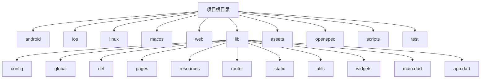
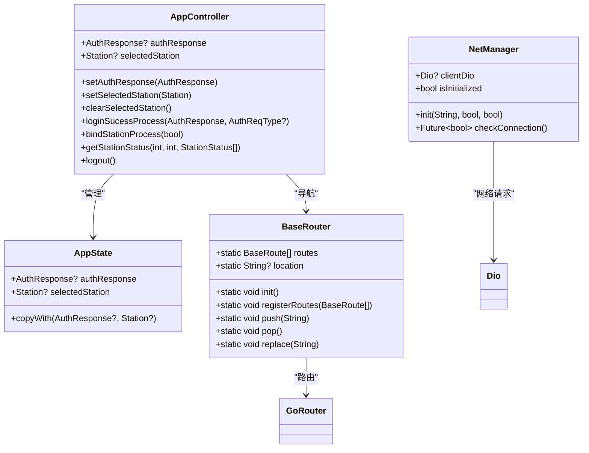
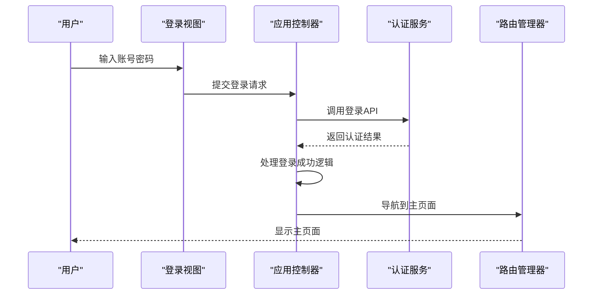
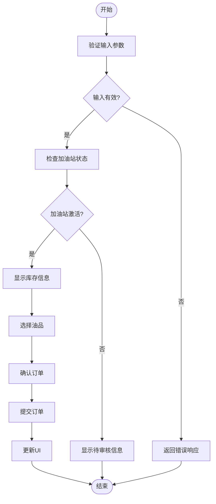
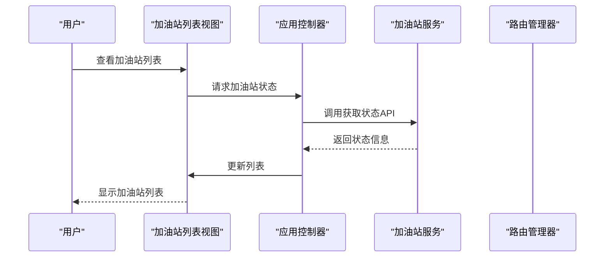
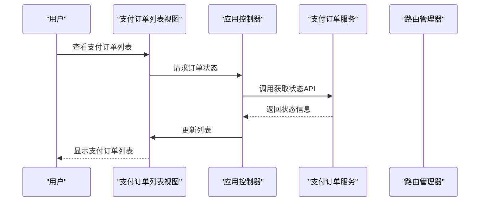

# 项目概述

<cite>
**本文档引用的文件**  
- [main.dart](file://lib/main.dart)
- [app.dart](file://lib/app.dart)
- [router.dart](file://lib/router/router.dart)
- [routes.dart](file://lib/router/routes.dart)
- [config.dart](file://lib/config/config.dart)
- [storage.dart](file://lib/global/storage.dart)
- [app_controller.dart](file://lib/global/app_controller.dart)
- [app_state.dart](file://lib/global/app_state.dart)
- [net_manager.dart](file://lib/net/net_manager.dart)
- [auth_rep_type.dart](file://lib/global/model/auth_rep_type.dart)
- [pubspec.yaml](file://pubspec.yaml)
</cite>

## 目录
1. [简介](#简介)
2. [项目结构](#项目结构)
3. [核心组件](#核心组件)
4. [架构概述](#架构概述)
5. [详细组件分析](#详细组件分析)
6. [依赖分析](#依赖分析)
7. [性能考虑](#性能考虑)
8. [故障排除指南](#故障排除指南)
9. [结论](#结论)

## 简介
油品业务App是一款专为加油站管理人员设计的综合性移动应用，旨在简化油品采购、提货和订单管理流程。该应用基于Flutter框架构建，具备跨平台特性，支持Android、iOS、Web、Linux和macOS等多个操作系统，确保用户在不同设备上都能获得一致的使用体验。通过集成用户认证、油品业务操作、加油站管理和订单跟踪等核心功能，该应用为加油站管理人员提供了一站式的解决方案，显著提升了工作效率和业务管理水平。

## 项目结构
该项目采用模块化设计，文件组织清晰，便于维护和扩展。主要目录包括`android`、`ios`、`linux`、`macos`和`web`，分别对应不同平台的原生配置。`lib`目录是应用的核心，包含配置、全局状态、网络管理、页面、资源、路由、静态资源和工具等子目录。`assets`目录存放HTML文件和翻译资源，`openspec`目录包含项目规格说明，`scripts`目录提供构建和开发脚本，`test`目录包含单元测试和集成测试。

**Diagram sources**
- [lib/main.dart](file://lib/main.dart#L1-L22)
- [lib/app.dart](file://lib/app.dart#L1-L92)

**Section sources**
- [lib/main.dart](file://lib/main.dart#L1-L22)
- [lib/app.dart](file://lib/app.dart#L1-L92)

## 核心组件
油品业务App的核心组件包括用户认证、油品业务操作、加油站管理和订单跟踪。用户认证模块负责用户的登录、注册和密码管理，确保数据安全。油品业务操作模块支持油品采购和提货，提供详细的订单信息和操作记录。加油站管理模块允许用户查看和管理多个加油站的信息，包括状态和库存。订单跟踪模块提供实时的订单状态更新，帮助用户及时了解订单进展。

**Section sources**
- [lib/global/app_controller.dart](file://lib/global/app_controller.dart#L1-L146)
- [lib/global/app_state.dart](file://lib/global/app_state.dart#L1-L23)

## 架构概述
该应用采用MVVM（Model-View-ViewModel）架构模式，结合BLoC（Business Logic Component）状态管理，确保代码的可维护性和可测试性。MVVM模式将视图（View）与业务逻辑（ViewModel）分离，通过数据绑定实现视图的自动更新。BLoC模式通过事件驱动的方式管理应用状态，使用Cubit和HydratedCubit来处理复杂的业务逻辑和状态持久化。GoRouter路由系统用于管理应用的导航和页面跳转，支持深度链接和路由守卫。

**Diagram sources**
- [lib/global/app_controller.dart](file://lib/global/app_controller.dart#L1-L146)
- [lib/global/app_state.dart](file://lib/global/app_state.dart#L1-L23)
- [lib/router/router.dart](file://lib/router/router.dart#L1-L228)
- [lib/net/net_manager.dart](file://lib/net/net_manager.dart#L1-L88)

## 详细组件分析
### 用户认证组件分析
用户认证组件是应用的入口，负责用户的登录、注册和密码管理。通过`LoginView`和`RegisterView`等视图组件，用户可以轻松完成身份验证。`AppController`中的`loginSucessProcess`方法处理登录成功后的逻辑，包括跳转到主页面和绑定加油站。`AuthService`提供底层的API调用，确保认证过程的安全性和可靠性。

#### 对于API/服务组件：

**Diagram sources**
- [lib/pages/login/view.dart](file://lib/pages/login/view.dart#L1-L47)
- [lib/global/app_controller.dart](file://lib/global/app_controller.dart#L1-L146)
- [lib/global/service/auth_service.dart](file://lib/global/service/auth_service.dart#L1-L50)

**Section sources**
- [lib/pages/login/view.dart](file://lib/pages/login/view.dart#L1-L47)
- [lib/global/app_controller.dart](file://lib/global/app_controller.dart#L1-L146)

### 油品业务操作组件分析
油品业务操作组件支持油品采购和提货，提供详细的订单信息和操作记录。`OilPickupView`和`OilPurchaseDetailView`等视图组件允许用户查看和管理订单。`OilPickupService`和`OilOrderService`提供底层的API调用，确保业务操作的准确性和及时性。`AppController`中的`getStationStatus`方法获取加油站的状态信息，帮助用户做出决策。

#### 对于复杂逻辑组件：

**Diagram sources**
- [lib/pages/oil_pickup/view.dart](file://lib/pages/oil_pickup/view.dart#L1-L19)
- [lib/pages/main_oil_pay/oil_purchase_detail/view.dart](file://lib/pages/main_oil_pay/oil_purchase_detail/view.dart#L1-L20)
- [lib/global/service/station_service.dart](file://lib/global/service/station_service.dart#L1-L50)

**Section sources**
- [lib/pages/oil_pickup/view.dart](file://lib/pages/oil_pickup/view.dart#L1-L19)
- [lib/pages/main_oil_pay/oil_purchase_detail/view.dart](file://lib/pages/main_oil_pay/oil_purchase_detail/view.dart#L1-L20)

### 加油站管理组件分析
加油站管理组件允许用户查看和管理多个加油站的信息，包括状态和库存。`StationListView`和`StationManagementListPage`等视图组件提供直观的界面，方便用户操作。`StationService`提供底层的API调用，确保数据的实时性和准确性。`AppController`中的`bindStationProcess`方法处理绑定加油站的逻辑，确保用户能够顺利使用应用。

#### 对于API/服务组件：

**Diagram sources**
- [lib/pages/station_list/view.dart](file://lib/pages/station_list/view.dart#L1-L20)
- [lib/global/app_controller.dart](file://lib/global/app_controller.dart#L1-L146)
- [lib/global/service/station_service.dart](file://lib/global/service/station_service.dart#L1-L50)

**Section sources**
- [lib/pages/station_list/view.dart](file://lib/pages/station_list/view.dart#L1-L20)
- [lib/global/app_controller.dart](file://lib/global/app_controller.dart#L1-L146)

### 订单跟踪组件分析
订单跟踪组件提供实时的订单状态更新，帮助用户及时了解订单进展。`PayOrderListView`和`PayOrderDetailPage`等视图组件显示订单的详细信息，包括支付状态和物流信息。`PayOrderService`提供底层的API调用，确保数据的准确性和及时性。`AppController`中的`getStationStatus`方法获取订单的状态信息，帮助用户做出决策。

#### 对于API/服务组件：

**Diagram sources**
- [lib/pages/pay_order_list/view.dart](file://lib/pages/pay_order_list/view.dart#L1-L17)
- [lib/global/app_controller.dart](file://lib/global/app_controller.dart#L1-L146)
- [lib/global/service/pay_order_service.dart](file://lib/global/service/pay_order_service.dart#L1-L50)

**Section sources**
- [lib/pages/pay_order_list/view.dart](file://lib/pages/pay_order_list/view.dart#L1-L17)
- [lib/global/app_controller.dart](file://lib/global/app_controller.dart#L1-L146)

## 依赖分析
该项目依赖于多个第三方库，以实现各种功能。`bloc`和`flutter_bloc`用于状态管理，`dio`用于网络请求，`go_router`用于路由管理，`hydrated_bloc`用于状态持久化，`hive`用于本地存储，`device_info_plus`用于获取设备信息，`logger`用于日志记录，`flutter_hooks`用于Hooks，`cached_network_image`用于网络图片加载，`pull_to_refresh_flutter3`用于上拉下拉刷新，`image_picker`用于获取相册和相机图片，`flutter_svg`用于SVG加载，`flutter_smart_dialog`用于弹出层，`flutter_keyboard_visibility`用于监听键盘可见性，`tdesign_flutter`用于UI组件，`qr_flutter`用于二维码生成，`internet_connection_checker`用于检查网络连接，`retrofit`用于REST API，`json_annotation`和`freezed_annotation`用于代码生成，`flutter_screenutil`用于屏幕适配，`shared_preferences`用于共享偏好设置，`get_it`用于依赖注入，`rename_app`用于重命名应用。

```mermaid
graph TD
A[油品业务App] --> B[bloc]
A --> C[flutter_bloc]
A --> D[dio]
A --> E[go_router]
A --> F[hydrated_bloc]
A --> G[hive]
A --> H[device_info_plus]
A --> I[logger]
A --> J[flutter_hooks]
A --> K[cached_network_image]
A --> L[pull_to_refresh_flutter3]
A --> M[image_picker]
A --> N[flutter_svg]
A --> O[flutter_smart_dialog]
A --> P[flutter_keyboard_visibility]
A --> Q[tdesign_flutter]
A --> R[qr_flutter]
A --> S[internet_connection_checker]
A --> T[retrofit]
A --> U[json_annotation]
A --> V[freezed_annotation]
A --> W[flutter_screenutil]
A --> X[shared_preferences]
A --> Y[get_it]
A --> Z[rename_app]
```

**Diagram sources**
- [pubspec.yaml](file://pubspec.yaml#L54-L137)

**Section sources**
- [pubspec.yaml](file://pubspec.yaml#L54-L137)

## 性能考虑
为了确保应用的高性能，项目采用了多种优化措施。首先，使用`flutter_screenutil`进行屏幕适配，确保在不同设备上都能获得良好的用户体验。其次，通过`cached_network_image`缓存网络图片，减少网络请求次数，提高加载速度。此外，使用`pull_to_refresh_flutter3`实现上拉下拉刷新，提升用户交互体验。最后，通过`logger`记录日志，帮助开发者及时发现和解决问题。

## 故障排除指南
在使用油品业务App时，可能会遇到一些常见问题。以下是一些故障排除建议：
- **登录失败**：检查网络连接，确保账号密码正确。
- **订单状态不更新**：尝试刷新页面，或检查网络连接。
- **图片加载慢**：检查网络连接，或清除缓存后重试。
- **应用崩溃**：重启应用，或联系技术支持。

**Section sources**
- [lib/net/net_manager.dart](file://lib/net/net_manager.dart#L1-L88)
- [lib/utils/log.dart](file://lib/utils/log.dart#L1-L50)

## 结论
油品业务App通过采用MVVM架构模式和BLoC状态管理，结合GoRouter路由系统，为加油站管理人员提供了一个高效、可靠的油品采购、提货和订单管理工具。其跨平台特性确保了在不同设备上的兼容性和一致性，而丰富的功能模块则满足了用户的多样化需求。通过持续的优化和改进，该应用有望成为加油站管理领域的标杆产品。